**By Jessica Batke and Laura Edelson**

**This is part of “The Locknet,” originally published on [ChinaFile](https://locknet.chinafile.com/additional-materials/the-mechanics-of-online-censorship/censorship-how-china-disrupts-the-network/).**

<h2 id=network-level-censorship>Network-Level Censorship</h2>
                                
Chinese authorities have many political, legal, and bureaucratic methods to avoid unwanted information circulating on the country’s domestic internet. They can deny website registration licenses, or mandate that companies such as Apple <a href="https://www.reuters.com/article/technology/apple-says-it-is-removing-vpn-services-from-china-app-store-idUSKBN1AE0BX/" target="_blank" rel="noopener">remove</a> censorship circumvention tools from local app stores. They can also outsource censorship to the online platforms themselves, holding the platforms responsible for any content that appears on their services—a technique known as <strong>service-level censorship</strong>. (Reports of Weibo or WeChat <a href="https://www.theguardian.com/world/article/2024/may/17/chinese-social-media-companies-remove-posts-showing-off-wealth-and-worshiping-money" target="_blank" rel="noopener">removing content</a> from their platforms are examples of service-level censorship.)

                                
However, authorities have fewer options when it comes to information hosted abroad. They cannot force international companies to conduct service-level censorship on information hosted outside China. This leaves authorities largely dependent on less-obvious technical means to try and filter out any “dangerous” information before it seeps too far across the border. So, they use <strong>network-level censorship</strong> to target users inside China trying to access information hosted on websites outside China, though it can affect any traffic deemed “dangerous.” Network-level censorship takes place not at a company’s office, but instead inside countless machines embedded throughout the country’s internet backboneA high-speed cable, or set of cables, designed to carry internet traffic across longer distances. A home internet user does not connect directly into an internet backbone; rather, backbones generally run between large hubs of internet traffic, such as between two major ISPs’ networks., or within ISPsOrganizations that provide users access to the internet, in addition to other related services, such as maintaining <b>DNS resolvers</b>. An ISP may be privately or publicly owned. In many countries, including China and the U.S., ISPs are required to share certain information with law enforcement agencies.’ networks.

                                
The bluntest—and most disruptive—network-level method at authorities’ disposal is simply to shut off the internet altogether. China has relatively few international gatewaysThe physical points at which data enters or leaves a country. Depending on the volume of a country’s internet traffic and the number of international gateways it has, such gateways can be bottlenecks or chokepoints, since all cross-border data must flow through them. and relatively few companies controlling the domestic internet backboneA high-speed cable, or set of cables, designed to carry internet traffic across longer distances. A home internet user does not connect directly into an internet backbone; rather, backbones generally run between large hubs of internet traffic, such as between two major ISPs’ networks., all of which are state-owned, so authorities have the capacity to fully stop traffic flows in and out of China, as well as in and out of specific areas within China.

                                
Undoubtedly, this is an extreme measure and is not deployed often or lightly. There is, however, a clear precedent for it: In 2009, following an outbreak of violence in the Xinjiang Uyghur Autonomous Region (XUAR) in western China, the government essentially severed the region’s internet from the rest of the country’s (and the globe’s) for about <a href="https://archive.is/0z004" target="_blank" rel="noopener">10 months</a>, functionally creating a severely limited regional intranet. During the shutdown, most people only had <a href="https://archive.is/b2g2z" target="_blank" rel="noopener">access</a> to officially-sanctioned websites affiliated with regional and local governments. They could not access email accounts, mostly run by companies based outside the region, or visit any websites—even Chinese government ones—hosted outside the XUAR.

                                
In the vast majority of cases, however, it behooves the Chinese government to make its censorship protocols less obvious to its citizens. In its day-to-day monitoring and censorship of the internet, the regime also has an array of other technical tools at its disposal. Authorities deploy these tools simultaneously, at <a href="/research&writing/Locknet_Internet_101/#intro-to-the-stack-how-does-all-of-this-come-together">different layers of the stack</a>, creating a system of overlapping mechanisms wherein redundancy is a feature, not a bug. The pieces of monitoring and disruption equipment that deploy most of these tools are called <strong>middleboxes</strong>, since they sit somewhere between the two endpoints of an internet connection—between, say, a user at home in Beijing and a website hosted in South Korea.

                                
Obviously, Beijing doesn’t publish official accounts of what and how it censors at the network level, so to understand this process we must extrapolate from the information we have available to us. Though we know that the Party-state imposes the online censorship system on the companies managing internet infrastructure and services, we have minimal information about the details of implementation. Computer science experiments can provide excellent detail about the technical specifications of a given censorship method, but they do not tell us who pays for or maintains the relevant physical equipment or software. We do not have direct insight into the processes by which network-level blocklists are created, or who disseminates them and to whom. Add to this the fact that the online censorship system is constantly evolving, and it becomes even more difficult to track how a particular tool is managed. In these explainers, therefore, we often remain frustratingly, though necessarily, vague about how keywords or blocklists make their way into the system, and how consistent those blocklists might be across the country. The explainers also only represent our best understanding of how the system works at present, without offering a full account of how it has changed over time.

                                
However, the best way to understand most, if not all, of the technical measures outlined below is as part of a “<a href="https://www.researchgate.net/publication/256063559_Regional_Variation_in_Chinese_Internet_Filtering" target="_blank" rel="noopener">system</a> of <em>centrally coordinated local implementation</em>,” as one scholar phrased it. “[T]he application of filtering policies is decentralized, to varying degrees, among actors such as internet service providers. While certain filtering decisions are replicated strictly across the entire nation, other policies are more or less open to interpretation by local operators.” Or, put <a href="https://archive.org/details/GFW_Wikipedia_V3.0" target="_blank" rel="noopener">more directly</a>: “[the censorship system’s] operation is haphazard and ill-maintained. The . . . filtering rules are like a cesspool. At the same time, [the] Chinese censorship bureaucracy <em>intends</em> to be thorough and extensive.”

                                
Censorship dictates <a href="/research&writing/Locknet_Notes_on_China/#what-is-document-9">flow from the Party-state</a>; the question is, for any given instance of network-level censorshipCensorship conducted by equipment placed within an internet network, aimed at all traffic that transits that network. This may include machines positioned throughout an ISP’s network, or machines positioned at international gateways that are designed to handle all internet traffic passing through those gateways., how deeply involved is a central or local cadre in updating the blocklist? How aggressively is the government pushing its “local operators” (read: ISPsOrganizations that provide users access to the internet, in addition to other related services, such as maintaining <b>DNS resolvers</b>. An ISP may be privately or publicly owned. In many countries, including China and the U.S., ISPs are required to share certain information with law enforcement agencies.) to adhere to a provided blocklist, or to supplement it with their own terms? And how might this change over time? Often, from our vantage point outside the system, we don’t have a way to know for sure.

                                <h2 id=in-path-vs-path-adjacent-technologies>In-Path vs. Path-Adjacent Technologies</h2>
                                
There are two main ways an online censorship system, whether in China or elsewhere, can disrupt a connection. The difference between the two lies in the placement of censorship hardware—the middleboxesMachines that are positioned between two endpoints of online communications, often in order to read the contents of those communications as they pass back and forth.—in relationship to the physical cable transferring internet traffic from one endpoint to another:

                                <ul>
                                    <li>
                                        
An <strong>in-path</strong> system utilizes a middlebox placed <em>directly on</em> the cable transferring internet traffic between two endpoints. The middlebox reads traffic as it transits the cable and blocks, or <strong>drops</strong>, traffic it finds objectionable.

                                    </li>
                                    <li>
                                        
A <strong>path-adjacent</strong> system utilizes a middlebox placed <em>adjacent</em> to the cable transferring internet traffic between two endpoints. (In computer science literature, this is called an <strong>on-path system</strong>, but because that terminology is unnecessarily confusing, we won’t be using it here.) A second cable sends copies of the internet traffic to the middlebox. This middlebox can read everything copied to it, but cannot directly disrupt already-flowing traffic.

                                    </li>
                                </ul>
                                <figure>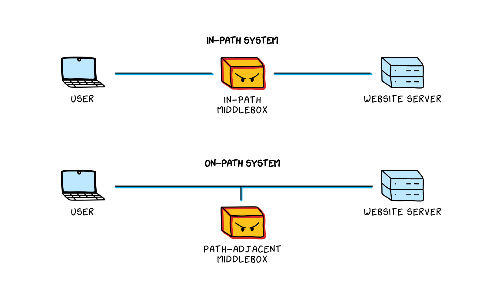
                                </figure>
                                
In-path technologies, while logically simpler, are more expensive than path-adjacent technologies. In-path systems require more computer processing power, and therefore resources, to analyze and block traffic in real time while avoiding a slowdown of all traffic along that cable.

                                
Most of the technologies the Party-state employs are path-adjacent. Unlike in-path technologies, path-adjacent technologies do not technically <em>block</em> information from moving through the network. Instead, they inject their own information into the network, relying on their physical proximity to each endpoint to <em>win a race</em> against the legitimate traffic they’re trying to censor.

                                
For example, if a user in Xi’an tries to visit a blocklisted website that’s hosted in the United States, the user’s computer will issue a packetWhat the transport layer creates when preparing data to be sent from one computer to another. When the transport layer receives data from the application layer, it divides that data into segments called packets, which can then be individually processed and routed throughout the internet. that tries to reach the website. A path-adjacent middleboxA <b>middlebox</b> that monitors, but does not sit directly on, a cable transferring information between two endpoints. (More commonly referred to as an on-path middlebox by computer scientists.) It monitors internet traffic by reading copies of that traffic. A path-adjacent middlebox cannot directly block internet traffic; instead, it must issue orders to one or both endpoints of the connection in an attempt to have them break the connection. cannot directly stop the packet from flowing from the user to the website—it simply doesn’t have access to that traffic, because it doesn’t sit directly on the cable carrying it. Instead, after seeing a copy of the packet, the middlebox has to inject (or <strong>forge</strong>) its own new packet, pretending to be one of the endpoints and encouraging the connection to close or otherwise not complete properly. Because the middlebox, located somewhere within China, is physically much closer to the user in Xi’an than the website in the United States is, the middlebox’s forged traffic will reach the user’s computer first. The forged traffic thus wins the race against any legitimate traffic the U.S. website might send. Even if the legitimate traffic reaches the user, it’ll be too late—the user’s computer will have already accepted the forged information and acted on it, ignoring any legitimate information that arrives later.

                                
When we do see China deploying an in-pathA middlebox that sits directly on a cable transferring information between two endpoints. All internet traffic therefore also transits the middlebox before reaching its intended destination. An in-path middlebox can opt to block certain pieces of unwanted internet traffic so that they never reach their intended destination (also known as <b>dropping</b> traffic). technology, we might ask: Why are censors devoting extra resources in this case? Is it because the targeted information is more sensitive? Is it because path-adjacent technologies don’t work here? Is it because the censors don’t anticipate much traffic flow, meaning the in-path middlebox doesn’t need to be as fast?

                                <h2 id=preemptive-censorship-preventing-users-from-reaching-their-intended-destination>Preemptive Censorship: Preventing Users from Reaching their Intended Destination</h2>
                                
If authorities determine that a domain has hosted, or is likely to host, too much undesirable content, they may choose to prevent Chinese citizens—or anyone located inside China—from ever establishing a connection with it. You can think of a <strong>domain</strong> as a website like nytimes.com, which includes not only the landing page but also many individual web pages with URLs such as nytimes.com/example-article.

                                
Preemptive censorship mechanisms work by tampering with the internet’s fundamental identification and routing systems, such that a user is never able to obtain the correct information that would allow them to connect to a banned website. These censorship mechanisms are the system’s front-line defense against information entering China from abroad. Authorities install the equipment that implements these defenses physically near international gatewaysThe physical points at which data enters or leaves a country. Depending on the volume of a country’s internet traffic and the number of international gateways it has, such gateways can be bottlenecks or chokepoints, since all cross-border data must flow through them., where internet traffic enters and leaves the country. While these mechanisms do inspect the <a href="/research&writing/Locknet_Internet_101/#how-do-you-send-data-across-the-internet">packets flowing through the network</a>, they only look at the packet headers, not at the payload (or <strong>content</strong>) of the packet. Reading only packet headers requires minimal computing resources, making these mechanisms fast and cheap to deploy.

                                
These technologies are relatively blunt instruments, as they block entire websites, regardless of the content of any individual page. Someone in China wanting to view a cake recipe on <em>The</em> <em>New York Times</em> website is out of luck, since any and all webpages on <em>The</em> <em>New York Times</em> website are blocked in China, no matter their specific content. This is in contrast to more targeted censorship mechanisms, which may only try to stop citizens from loading specific web pages based on the content of those particular pages.

                                
<a href="https://queue.acm.org/detail.cfm?id=2405036" target="_blank" rel="noopener">Lists</a> of <a href="https://www.usenix.org/system/files/sec21-hoang.pdf" target="_blank" rel="noopener">banned domains</a> are currently <a href="https://ensa.fi/papers/Ensafi2015a.pdf" target="_blank" rel="noopener">centralized</a>—that is, the same lists are loaded onto many individual pieces of equipment all along China’s border, whether they’re sitting on infrastructure managed by state-owned China Unicom, China Mobile, or any other provider. The centralized nature of network-level domain blocklists indicates that the Chinese government maintains relatively direct control over this portion of the broader censorship regime.

                                
This might seem obvious—if the Chinese government wants to block certain websites in China, why <em>wouldn’t</em> it just maintain one list that gets loaded onto all the equipment? However, this level of centralization hasn’t always been the case. Moreover, centralized domain-blocking lists stand in stark contrast to the way that the government has delegated censorship on domestic social media platforms, with each <a href="https://jeffreyknockel.com/publications/foci2015svps.pdf" target="_blank" rel="noopener">company</a> <a href="https://jeffreyknockel.com/publications/foci2017games.pdf" target="_blank" rel="noopener">making</a> its <a href="https://aclanthology.org/W18-4201.pdf" target="_blank" rel="noopener">own</a> <a href="https://citizenlab.ca/2021/03/tiktok-vs-douyin-security-privacy-analysis/" target="_blank" rel="noopener">list</a> of <a href="https://citizenlab.ca/2023/04/a-comparison-of-search-censorship-in-china/" target="_blank" rel="noopener">banned</a> keywords based on its interpretation of government priorities.

                                
There are two main ways the PRC’s censorship system preemptively blocks access to entire domains: through the DNSThe system that converts a human-friendly domain name (e.g., “catvideos.com”) into a computer-friendly IP address (e.g., “157.240.22.35”). By converting domain names into IP addresses, DNS allows routers throughout the internet to efficiently send information to the correct destination. DNS relies on <b>DNS resolvers</b> and <b>nameservers</b> to assist with this conversion. system, and through the IPThe set of rules, developed over time and with the input of many different international organizations and individuals, that guides how packets of data travel across networks and that allows the many different networks that make up the internet to be interoperable. Internet Protocol Version 4 (IPv4) and Internet Protocol Version 6 (IPv6) are both currently in use on the internet. system.

                                <h2 id=dns-based-censorship>DNS-Based Censorship</h2>
                                
Tampering with the <a href="/research&writing/Locknet_Internet_101/#ip-addresses-and-the-domain-name-system-how-do-routers-know-where-to-send-data">domain name system (DNS)</a> is one of the simplest ways that the Chinese government can prevent internet users in China from accessing information from abroad. Simply put, DNS takes a human-friendly domain name (e.g., citizenlab.ca) and translates it into a computer-friendly IP addressA series of characters that identifies a computer or server using the IP system to communicate over the internet. Internet Protocol Version 4 (IPv4) addresses are composed of a set of four numbers, each with one to three digits, separated by periods (for example, <b>104.18.204.43</b>). Internet Protocol Version 6 (IPv6) addresses are longer and can also include letters (such as <b>1050:0:0:0:5:600:300c:326b</b>). (e.g., 157.240.22.35). That IP address is then used to route information to the correct destination—all without the human user having to remember Citizen Lab’s IP address, or even ever see what it is. This act of translation between domain names and IP addresses offers an early opportunity for censorship, before any information is directly transmitted between a domestic user and a foreign website.

                                
To understand how the PRC corrupts the DNS process, we must first get a handle on how DNSThe system that converts a human-friendly domain name (e.g., “catvideos.com”) into a computer-friendly IP address (e.g., “157.240.22.35”). By converting domain names into IP addresses, DNS allows routers throughout the internet to efficiently send information to the correct destination. DNS relies on <b>DNS resolvers</b> and <b>nameservers</b> to assist with this conversion. <em>should</em> function.

                                
The normal process for a DNS request goes something like this: A user types “citizenlab.ca” into a browser. The browser recognizes this as an implicit request for an IP address for the <a href="https://citizenlab.ca/" target="_blank" rel="noopener">Citizen Lab website</a>. The browser, functioning at the application layerThe part of the network stack that conducts high-level data management and translation, such as character encoding, data compression, encryption/decryption, and remote file access. <b>HTTP</b> and <b>HTTPS protocols</b> function at this layer., pushes the DNS query “citizenlab.ca” down to the transport layerThe part of the network stack that segments data into packets. Depending on the protocol in use, the transport layer may also establish a connection with another machine prior to sending packets, or reassemble received packets into the correct order..

                                
The transport layer segments this query into packetsWhat the transport layer creates when preparing data to be sent from one computer to another. When the transport layer receives data from the application layer, it divides that data into segments called packets, which can then be individually processed and routed throughout the internet.. <a href="https://www.geeksforgeeks.org/why-does-dns-use-udp-and-not-tcp/" target="_blank" rel="noopener">Most</a> computer operating systems use UDP (User Datagram Protocol) packets for DNS requests. After the transport layer creates the UDP packets, the packets head to the internet layerThe part of the network stack that manages flows of information across the internet. The internet layer organizes traffic and routing among multiple different nodes within and between networks, ensuring that packets reach the correct destination.. In most cases, the user’s computer will already have saved the IP address for a nearby DNS resolverA server that is the first stop in the DNS lookup process. It receives a domain name from a user and then queries a nameserver to find the corresponding IP address, which it then sends back to the user. DNS resolvers are often run by <b>internet service providers (ISPs)</b>., which is a serverA computer that “serves up” requested content. Most online information is stored (or hosted) on a server. When a user visits a website, it is a server that actually sends back the website content to the user. Servers exist for many different purposes. Major social media companies have many of them in order to provide content to users quickly. that acts as a massive directory: its only purpose is to search for and return IP addresses to users looking for them. So the internet layer appends the DNS resolver’s IP address to each packet.

                                
The packets then move down through the link layerThe part of the network stack that transmits data between two nodes connected by a physical layer. For example, the link layer transmits data between two routers, or between a home computer and a home modem. to the physical layerThe part of the network stack that converts digital data into electrical, radio, or optical signals, which it then transmits and receives over a physical medium such as a cable.. They flow across the broader network, and eventually back up through the stackAn abstraction that characterizes the relationship between various elements of the online communication process, with one element stacked on top of another in <b>layers</b>. Though there are several different ways of envisioning the stack, all versions describe each layer as having a specific set of dedicated tasks it performs, while having no insight into what happens at the other layers of the stack. to the DNS resolverA server that is the first stop in the DNS lookup process. It receives a domain name from a user and then queries a nameserver to find the corresponding IP address, which it then sends back to the user. DNS resolvers are often run by <b>internet service providers (ISPs)</b>..

                                

                                    <video class="animation" src="/media/locknet/animation-1.mp4" controls playsinline preload="metadata"></video>
                                

                                
If the user has requested a popular website, the DNS resolverA server that is the first stop in the DNS lookup process. It receives a domain name from a user and then queries a nameserver to find the corresponding IP address, which it then sends back to the user. DNS resolvers are often run by <b>internet service providers (ISPs)</b>. may already have the IP addressA series of characters that identifies a computer or server using the IP system to communicate over the internet. Internet Protocol Version 4 (IPv4) addresses are composed of a set of four numbers, each with one to three digits, separated by periods (for example, <b>104.18.204.43</b>). Internet Protocol Version 6 (IPv6) addresses are longer and can also include letters (such as <b>1050:0:0:0:5:600:300c:326b</b>). handy—a DNS resolver will save, or <strong>cache</strong>, the IP addresses of recently-requested websites. If the user has requested a less popular website, however, the DNS resolver will have to do some additional work, sending out queries to nameserversServers that store and organize DNS records, including domain names and IP addresses. As part of the <b>DNS lookup</b> process, a <b>DNS resolver</b> will query a nameserver, asking if it contains the record for a particular domain name. If the nameserver does contain that record, it will return the associated IP address to the DNS resolver. A nameserver that contains the record is referred to as the <b>authoritative nameserver.</b> around the world. It may take multiple nameservers to help identify an <strong>authoritative nameserver</strong> that contains the information in question. Once the DNS resolver has an IP address, it sends that information back to the user. The user’s computer can now use the IP address to connect to the Citizen Lab website.

                                
Methods for disrupting the DNSThe system that converts a human-friendly domain name (e.g., “catvideos.com”) into a computer-friendly IP address (e.g., “157.240.22.35”). By converting domain names into IP addresses, DNS allows routers throughout the internet to efficiently send information to the correct destination. DNS relies on <b>DNS resolvers</b> and <b>nameservers</b> to assist with this conversion. process all involve the same basic principle: If a user requests a DNS “translation” for a banned website, the censorship system offers up an intentional “mistranslation” instead, sending back the wrong IP address, which directs the user to a defunct website or an error message. The censorship system carries out that misdirection through <strong>DNS injection</strong>.

                                <h3 id=dns-injection>DNS Injection</h3>
                                
To prevent users in China from accessing particular websites abroad (or certain services, such as the <a href="https://ooni.org/post/2021-how-signal-private-messenger-blocked-around-the-world/#china" target="_blank" rel="noopener">encrypted messaging platform Signal</a>), Chinese authorities intercept DNS requests and return false IP addressesCharacters identifying computers or servers using the IP system to communicate over the internet. Internet Protocol Version 4 (IPv4) addresses are composed of a set of four numbers, each with one to three digits, separated by periods (for example, <b>104.18.204.43</b>). Internet Protocol Version 6 (IPv6) addresses are longer and can also include letters (such as <b>1050:0:0:0:5:600:300c:326b</b>). to users. They do this by installing monitoring equipment (middleboxesMachines that are positioned between two endpoints of online communications, often in order to read the contents of those communications as they pass back and forth.) in various locations throughout China’s domestic network, <a href="https://www.usenix.org/system/files/conference/foci14/foci14-anonymous.pdf" target="_blank" rel="noopener">near national borders</a>.

                                
A path-adjacent middleboxA <b>middlebox</b> that monitors, but does not sit directly on, a cable transferring information between two endpoints. (More commonly referred to as an on-path middlebox by computer scientists.) It monitors internet traffic by reading copies of that traffic. A path-adjacent middlebox cannot directly block internet traffic; instead, it must issue orders to one or both endpoints of the connection in an attempt to have them break the connection. designed to conduct DNS injection takes three basic actions:

                                <ol>
                                    <li><strong>It looks for and reads DNS requests.</strong> The middlebox reviews passing internet traffic. If it spots a UDPA standard for delivering data online, specifying how to break data up into packets in preparation to be transmitted over the internet. Because UDP does not establish a firm connection before sending data, and does not require reassembly of data once it reaches its destination, UDP is most often used by applications that prioritize speed, such as video streaming and <b>DNS lookups</b>. packetWhat the transport layer creates when preparing data to be sent from one computer to another. When the transport layer receives data from the application layer, it divides that data into segments called packets, which can then be individually processed and routed throughout the internet., it will check if that packet is a DNS request. If it identifies a DNS request, it reads the domain name written on the packet.</li>
                                    <li><strong>It checks the DNS request against a list of banned domain names</strong>. DNS injection middleboxes all have up-to-date lists of banned domain names already loaded onto them, created by censors working for or at the behest of the Party-state. Once the middlebox has read a packet’s domain name, it checks that name against its blacklist.</li>
                                    <li><strong>It “injects” a forged response, or does nothing at all.</strong> If the middlebox determines that the user has requested a banned domain name (like “citizenlab.ca”), it sends them back a response that is designed to look like a response from a DNS resolverA server that is the first stop in the DNS lookup process. It receives a domain name from a user and then queries a nameserver to find the corresponding IP address, which it then sends back to the user. DNS resolvers are often run by <b>internet service providers (ISPs)</b>.—except it contains the wrong IP address, which sends the user to a different, unrelated website. If the middlebox determines that the website is not on the list, it injects nothing.</li>
                                </ol>
                                
Because this is a path-adjacent system, it does not technically <em>block</em> any of the original packets from moving through the network, it merely <em>wins a</em> <em>race</em> against those packets. By the time Citizen Lab’s real IP addressA series of characters that identifies a computer or server using the IP system to communicate over the internet. Internet Protocol Version 4 (IPv4) addresses are composed of a set of four numbers, each with one to three digits, separated by periods (for example, <b>104.18.204.43</b>). Internet Protocol Version 6 (IPv6) addresses are longer and can also include letters (such as <b>1050:0:0:0:5:600:300c:326b</b>). arrives, the DNS resolverA server that is the first stop in the DNS lookup process. It receives a domain name from a user and then queries a nameserver to find the corresponding IP address, which it then sends back to the user. DNS resolvers are often run by <b>internet service providers (ISPs)</b>. has already sent the middlebox’s false IP address to the user and ignores any additional IPThe set of rules, developed over time and with the input of many different international organizations and individuals, that guides how packets of data travel across networks and that allows the many different networks that make up the internet to be interoperable. Internet Protocol Version 4 (IPv4) and Internet Protocol Version 6 (IPv6) are both currently in use on the internet. information that might come in. The user’s computer will probably cache the false IP address, meaning that if the user tries to visit the website again, their computer won’t even bother with the DNS lookupThe process by which a user’s computer converts human-friendly domain names into computer-friendly IP addresses. It consists of the computer sending the domain name to a DNS resolver, which searches for and returns the corresponding IP address to the user. but will instead go directly to the false IP address. The false IP address won’t always win the race against the real IP address—but it wins the vast majority of the time, making this a highly effective censorship mechanism even if it is not watertight. As it almost always does, China’s censorship system here opts for expediency over perfection; less-than-perfect outcomes still work well enough that the authorities have no need to pay extra for flawless execution.

                                

                                    <video class="animation" src="/media/locknet/animation-2.mp4" controls playsinline preload="metadata"></video>
                                

                                
In 2024, <a href="https://www3.cs.stonybrook.edu/~mikepo/papers/gfweb.sec24.pdf" target="_blank" rel="noopener">researchers found</a> that this DNS injection system blocks nearly 1.1 million domain names. Though some domain names are only blocked for a brief period of time, the researchers noted that more than 50 percent of the censored domain names stayed blocked for at least three months. And authorities are constantly <a href="https://www.usenix.org/system/files/foci20-paper-anonymous_0.pdf" target="_blank" rel="noopener">tweaking</a> the system’s blocklists. A <a href="https://www.usenix.org/system/files/sec21-hoang.pdf" target="_blank" rel="noopener">2020 academic study</a> showed that the DNS injection system was incidentally blocking tens of thousands of innocuous websites whose domain names were too similar to censored ones (for example, the banned domain name torproject.com also caused the blocking of the unrelated website mentorproject.com.) By the time of the 2024 study, this sort of overblocking had been corrected, mitigating some of the collateral damage the system had previously been inflicting.

                                
Other countries that employ DNS injection often <a href="https://people.cs.umass.edu/~phillipa/papers/TWeb.pdf" target="_blank" rel="noopener">redirect users to <strong>blockpages</strong>,</a> or webpages that explicitly tell users the site they were trying to reach has been made unavailable to them. In China, however, DNS injections usually redirect users to websites that are totally unrelated to the user’s original request. A <a href="https://www.usenix.org/system/files/sec21-hoang.pdf" target="_blank" rel="noopener">2020 study</a> found that the false IP addressesCharacters identifying computers or servers using the IP system to communicate over the internet. Internet Protocol Version 4 (IPv4) addresses are composed of a set of four numbers, each with one to three digits, separated by periods (for example, <b>104.18.204.43</b>). Internet Protocol Version 6 (IPv6) addresses are longer and can also include letters (such as <b>1050:0:0:0:5:600:300c:326b</b>). the system provided to users were often for blank web pages belonging to non-Chinese entities, including Facebook, Twitter, and Dropbox, potentially costing those companies substantial money in hosting fees as DNS injection drove traffic to them. More recently, <a href="https://gitlab.torproject.org/tpo/anti-censorship/censorship-analysis/-/issues/40026" target="_blank" rel="noopener">some DNS redirects</a> sent users to an “<a href="https://web.archive.org/web/20220111095544/http://39.102.194.95/" target="_blank" rel="noopener">Anti-Fraud” website</a> run by the Chinese government, warning them that the website they were trying to visit was potentially a scam, though a <a href="https://www3.cs.stonybrook.edu/~mikepo/papers/gfweb.sec24.pdf" target="_blank" rel="noopener">later study</a> was not able to confirm this was happening through DNSThe system that converts a human-friendly domain name (e.g., “catvideos.com”) into a computer-friendly IP address (e.g., “157.240.22.35”). By converting domain names into IP addresses, DNS allows routers throughout the internet to efficiently send information to the correct destination. DNS relies on <b>DNS resolvers</b> and <b>nameservers</b> to assist with this conversion..

                                <h3 id=dns-cache-poisoning>DNS Cache Poisoning</h3>
                                
The PRC’s DNS injection system also ends up tampering with the information stored on DNS resolversA server that is the first stop in the DNS lookup process. It receives a domain name from a user and then queries a nameserver to find the corresponding IP address, which it then sends back to the user. DNS resolvers are often run by <b>internet service providers (ISPs)</b>.. Let’s return to the example above. A user in Hainan sends out a DNS lookupThe process by which a user’s computer converts human-friendly domain names into computer-friendly IP addresses. It consists of the computer sending the domain name to a DNS resolver, which searches for and returns the corresponding IP address to the user. for citizenlab.ca. The DNS lookup goes first to a DNS resolver in China, which queries the authoritative nameserverA server that stores and organizes DNS records, including domain names and IP addresses. As part of the <b>DNS lookup</b> process, a <b>DNS resolver</b> will query a nameserver, asking if it contains the record for a particular domain name. If the nameserver does contain that record, it will return the associated IP address to the DNS resolver. A nameserver that contains the record is referred to as the <b>authoritative nameserver.</b> (and triggers the DNS injection middleboxA machine that is positioned between two endpoints of online communications, often in order to read the contents of those communications as they pass back and forth.). The DNS injector’s false response must pass back through that DNS resolver before it reaches the user—and the DNS resolver caches that response to use the next time someone tries to reach citizenlab.ca. One <a href="https://www.usenix.org/system/files/conference/foci14/foci14-anonymous.pdf" target="_blank" rel="noopener">2014 study</a> tested about 150,000 DNS resolvers in China over a two-week period and discovered that more than 99.85 percent of them gave these kinds of “polluted” answers.

                                
DNS cache poisoning, also known as <strong>DNS spoofing</strong>, affects the global internet as well. China’s DNS middleboxes sometimes send false IP addressesCharacters identifying computers or servers using the IP system to communicate over the internet. Internet Protocol Version 4 (IPv4) addresses are composed of a set of four numbers, each with one to three digits, separated by periods (for example, <b>104.18.204.43</b>). Internet Protocol Version 6 (IPv6) addresses are longer and can also include letters (such as <b>1050:0:0:0:5:600:300c:326b</b>). not into China but outwards, where they flow through and are cached by DNS resolvers. It happens like this:

                                
A user outside China—let’s say in Vietnam—types a web address into a browser. The website in question, brookings.edu, is available in Vietnam but blocked in China. The user’s DNS query may first go to a DNS resolverA server that is the first stop in the DNS lookup process. It receives a domain name from a user and then queries a nameserver to find the corresponding IP address, which it then sends back to the user. DNS resolvers are often run by <b>internet service providers (ISPs)</b>. in Vietnam. So far, so good.

                                
However, the DNS resolver must still <a href="/research&writing/Locknet_How_China_Disrupts_the_Network/#dns-based-censorship">query several other nameservers</a> to get the appropriate information. As we know, the path any given packetWhat the transport layer creates when preparing data to be sent from one computer to another. When the transport layer receives data from the application layer, it divides that data into segments called packets, which can then be individually processed and routed throughout the internet. takes through the internet can be <a href="/research&writing/Locknet_Internet_101/#what-even-is-the-internet">difficult to predict</a>. The DNS resolver in Vietnam, trying to reach a nameserver in the United States, may end up sending its query through a few routersA router is a computer and networking device that guides and directs data, in small chunks called <b>data packets</b>, between computer networks. In addition to other functions, routers ensure packets are sent to their correct destination, or IP address, via the best available route. in the PRC.

                                
Once that query crosses the Chinese border, however briefly, it also flows through a DNS censorship middlebox. The middlebox, which does not care where the request comes from, sees that the DNS lookupThe process by which a user’s computer converts human-friendly domain names into computer-friendly IP addresses. It consists of the computer sending the domain name to a DNS resolver, which searches for and returns the corresponding IP address to the user. is for a banned site and sends a false IP addressA series of characters that identifies a computer or server using the IP system to communicate over the internet. Internet Protocol Version 4 (IPv4) addresses are composed of a set of four numbers, each with one to three digits, separated by periods (for example, <b>104.18.204.43</b>). Internet Protocol Version 6 (IPv6) addresses are longer and can also include letters (such as <b>1050:0:0:0:5:600:300c:326b</b>). back to the DNS resolverA server that is the first stop in the DNS lookup process. It receives a domain name from a user and then queries a nameserver to find the corresponding IP address, which it then sends back to the user. DNS resolvers are often run by <b>internet service providers (ISPs)</b>. in Vietnam. The DNS resolver in Vietnam caches the IP address, and, at least until the cache resets, will return that false address to anyone else in Vietnam looking for brookings.edu.

                                
This DNS cache poisoning occurs because the PRC’s DNS injectors function <strong>bidirectionally</strong>: they don’t differentiate between traffic flowing from the inside out and traffic from the outside in. Any DNS query that transits the cable they’re monitoring will be subject to the same inspection, and to the same injected response. A <a href="https://conferences.sigcomm.org/sigcomm/2012/paper/ccr-paper266.pdf" target="_blank" rel="noopener">2012 study</a> found that “26% of 43,000 measured open resolvers outside China, distributed in 109 countries, may suffer some collateral damage” of the type described above. <a href="https://www.usenix.org/system/files/sec21-hoang.pdf" target="_blank" rel="noopener">A 2020 study</a> showed that a sizeable minority of websites (nearly 62,000) on the banned domain list have at least one authoritative nameserver in China. This means “there is always a non-zero chance” people outside of China trying to access one of these sites will end up with a poisoned DNS response.

                                
International DNS cache poisoning may not be an intended result of the system, but it impacts international users nonetheless.

                                <h3 id=dns-based-geoblocking>DNS-Based Geoblocking</h3>
                                
Geoblocking, however, <em>is</em> an intended effect of the DNSThe system that converts a human-friendly domain name (e.g., “catvideos.com”) into a computer-friendly IP address (e.g., “157.240.22.35”). By converting domain names into IP addresses, DNS allows routers throughout the internet to efficiently send information to the correct destination. DNS relies on <b>DNS resolvers</b> and <b>nameservers</b> to assist with this conversion. censorship system. Leveraging the bidirectional nature of the DNS injection system (it filters traffic both going into and coming out of China), Chinese authorities have recently begun deploying it to prevent users <em>outside</em> China from accessing certain websites hosted <em>within</em> China. Remember that DNS blocking occurs near the national border, and only affects traffic crossing that border. Therefore, the same banned domain list that keeps Chinese web users from accessing websites overseas can also stop foreigners from reaching websites hosted in China.

                                
For example, <a href="https://www.usenix.org/system/files/sec21-hoang.pdf" target="_blank" rel="noopener">authorities have put</a> beian.gov.cn on the banned domain list. This domain is the official website of the Chinese government office that issues licenses for websites in China—definitely not a site that the authorities want to block for domestic users. Both its <a href="/research&writing/Locknet_How_China_Disrupts_the_Network/#dns-based-censorship">authoritative nameservers</a> are located inside China. Users inside China will have no problem connecting to beian.gov.cn, because their DNS queries (including connecting with the DNS resolverA server that is the first stop in the DNS lookup process. It receives a domain name from a user and then queries a nameserver to find the corresponding IP address, which it then sends back to the user. DNS resolvers are often run by <b>internet service providers (ISPs)</b>. and nameserversServers that store and organize DNS records, including domain names and IP addresses. As part of the <b>DNS lookup</b> process, a <b>DNS resolver</b> will query a nameserver, asking if it contains the record for a particular domain name. If the nameserver does contain that record, it will return the associated IP address to the DNS resolver. A nameserver that contains the record is referred to as the <b>authoritative nameserver.</b>) will stay within China, never crossing a national border and therefore never triggering a DNS injector. By contrast, the same DNS query from a user outside China must cross the border into China at some point to reach the authoritative nameservers for the domain. Once the DNS query crosses the border, the DNS injectors kick into action and the user is either directed to the wrong website or simply told that the website refused to connect:

                                <figure>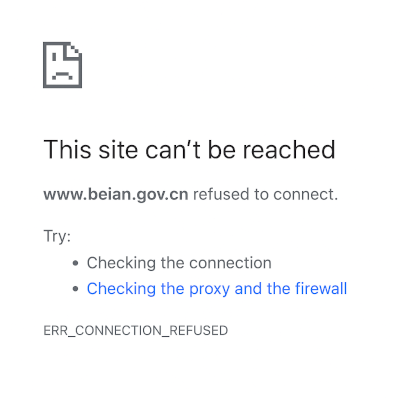
                                    <figcaption>
                                        
A screenshot taken by the authors on June 21, 2024.

                                    </figcaption>
                                </figure>
                                
There are other reasons why a user outside China might not be able to connect to a website inside the country. For example, an individual company could use any number of <a href="https://archive.ph/cqGYw" target="_blank" rel="noopener">commercial technologies</a> to prevent visitors located outside China from accessing its website. But the existing DNS injection system offers the government a centralized way to deny international users access to sites of its choosing.

                                <h2 id=ip-blocking>IP Blocking</h2>
                                
IP blocking, like DNSThe system that converts a human-friendly domain name (e.g., “catvideos.com”) into a computer-friendly IP address (e.g., “157.240.22.35”). By converting domain names into IP addresses, DNS allows routers throughout the internet to efficiently send information to the correct destination. DNS relies on <b>DNS resolvers</b> and <b>nameservers</b> to assist with this conversion.-based censorship, is one of the most basic, and therefore resource-effective, censorship mechanisms the Chinese government has. Beijing uses these two mechanisms to reinforce and backstop each other. IP blocking simply involves creating a list of IP addressesCharacters identifying computers or servers using the IP system to communicate over the internet. Internet Protocol Version 4 (IPv4) addresses are composed of a set of four numbers, each with one to three digits, separated by periods (for example, <b>104.18.204.43</b>). Internet Protocol Version 6 (IPv6) addresses are longer and can also include letters (such as <b>1050:0:0:0:5:600:300c:326b</b>). associated with banned websites and then preventing internet users from accessing them. From a user’s perspective, this type of blocking occurs <em>after</em> they have successfully made a DNS query (translating a typed domain name, like washingtonpost.com, into an IP address, like 104.100.53.87), but <em>before</em> they have actually connected to and received any information from the website they’re trying to reach.

                                
More specifically, IP blocking works like this:

                                
Say that a college student in Shanghai tries to go to the website of <em>The Washington Post</em> by typing washingtonpost.com into her browser. (For the sake of this example, we’ll assume that washingtonpost.com is <em>not</em> blocked via DNSThe system that converts a human-friendly domain name (e.g., “catvideos.com”) into a computer-friendly IP address (e.g., “157.240.22.35”). By converting domain names into IP addresses, DNS allows routers throughout the internet to efficiently send information to the correct destination. DNS relies on <b>DNS resolvers</b> and <b>nameservers</b> to assist with this conversion., but that its IP address <em>is</em> blocked. And, yes, this is a possible real-world scenario: there are <a href="https://www.usenix.org/system/files/foci19-paper_chai_update.pdf" target="_blank" rel="noopener">separate blocklists</a> for DNS and IP addresses, though there is some overlap between them.)

                                
After successfully using DNSThe system that converts a human-friendly domain name (e.g., “catvideos.com”) into a computer-friendly IP address (e.g., “157.240.22.35”). By converting domain names into IP addresses, DNS allows routers throughout the internet to efficiently send information to the correct destination. DNS relies on <b>DNS resolvers</b> and <b>nameservers</b> to assist with this conversion. to determine <em>The Washington Post</em>’s IP address, the student’s computer creates packetsWhat the transport layer creates when preparing data to be sent from one computer to another. When the transport layer receives data from the application layer, it divides that data into segments called packets, which can then be individually processed and routed throughout the internet. and appends <em>The Washington Post</em>’s IP address (104.100.53.87) to them. These packets then travel from the student’s dorm room, across campus, and through the network managed by the student’s ISPAn organization that provides users access to the internet, in addition to other related services, such as maintaining <b>DNS resolvers</b>. An ISP may be privately or publicly owned. In many countries, including China and the U.S., ISPs are required to share certain information with law enforcement agencies..

                                
At some point, the packets reach a routerA router is a computer and networking device that guides and directs data, in small chunks called <b>data packets</b>, between computer networks. In addition to other functions, routers ensure packets are sent to their correct destination, or IP address, via the best available route. at the edge of the ISP’s network. Here, the router connects directly with an international gatewaysThe physical point at which data enters or leaves a country. Depending on the volume of a country’s internet traffic and the number of international gateways it has, such gateways can be bottlenecks or chokepoints, since all cross-border data must flow through them., the place where data actually enters and leaves the country. The router pings the international gateway, asking for more information about where to send the packets next. Because the international gateway sits at the edge of a network, it implements the <strong>Border Gateway Protocol</strong>, a set of rules that help disseminate information about other networks. In this case, the Border Gateway Protocol essentially tells domestic routers what international routers are available and what routes they might use to transmit packets.

                                
However, for the international gateways under its control, the PRC has <a href="https://queue.acm.org/detail.cfm?id=2405036" target="_blank" rel="noopener">altered</a> the Border Gateway Protocol to include lists of blocked IP addressesCharacters identifying computers or servers using the IP system to communicate over the internet. Internet Protocol Version 4 (IPv4) addresses are composed of a set of four numbers, each with one to three digits, separated by periods (for example, <b>104.18.204.43</b>). Internet Protocol Version 6 (IPv6) addresses are longer and can also include letters (such as <b>1050:0:0:0:5:600:300c:326b</b>).. When a domestic router pings the international gateway, the gateway consults the blocklist. If the IP address is not on the blocklist, the gateway behaves normally, sending back the appropriate routing information. But if the IP address <em>is</em> on the blocklist, the gateway sends back information that ensures the packets never reach their intended destination. (There are <a href="https://www.cloudflare.com/learning/ddos/glossary/ddos-blackhole-routing/" target="_blank" rel="noopener">different ways</a> the international gateway can do this: by telling the domestic router the destination is unreachable or prohibited, or by sending back a non-functioning IP address such as 0.0.0.0. In any case, <a href="https://www.cloudflare.com/learning/ddos/glossary/ddos-blackhole-routing/" target="_blank" rel="noopener">the result is the same</a>.)

                                
In our example, we’ll say that the international gatewayThe physical point at which data enters or leaves a country. Depending on the volume of a country’s internet traffic and the number of international gateways it has, such gateways can be bottlenecks or chokepoints, since all cross-border data must flow through them. tells the router that the destination IP address is unreachable. The router thus discards the packets intended for <em>The Washington Post</em>—it simply drops them then and there, without forwarding them anywhere. <em>The Washington Post</em> never receives the packets, let alone tries to send anything back to the student.

                                

                                    <video class="animation" src="/media/locknet/animation-3.mp4" controls playsinline preload="metadata"></video>
                                

                                
Like DNS-based censorship, this mechanism is quite simple, requiring minimal computing power and not appreciably slowing other internet traffic. It can even work in tandem with DNS censorship: according to <a href="https://people.cs.umass.edu/~phillipa/papers/TWeb.pdf" target="_blank" rel="noopener">one 2014 study</a>, in some cases, the DNS blocking system redirects the user to an IP addressA series of characters that identifies a computer or server using the IP system to communicate over the internet. Internet Protocol Version 4 (IPv4) addresses are composed of a set of four numbers, each with one to three digits, separated by periods (for example, <b>104.18.204.43</b>). Internet Protocol Version 6 (IPv6) addresses are longer and can also include letters (such as <b>1050:0:0:0:5:600:300c:326b</b>). that was subject to IP blockingWhen a network-level censorship system disrupts a connection based on either the destination or origin IP address written to data packet headers..

                                
Because of the simplicity of this method, the PRC has implemented IP blocking <a href="https://web.archive.org/web/20230604231024/https://library.fes.de/libalt/journals/swetsfulltext/14218789.PDF" target="_blank" rel="noopener">nearly as long</a> as the internet has been available in China. Yet, the way that the modern internet has developed means that IP blocking <a href="https://conferences.sigcomm.org/imc/2007/papers/imc124.pdf" target="_blank" rel="noopener">may affect</a> many more domains than just the intended targets. Many websites do not have their own dedicated IP address. Instead, they share an IP address with multiple other websites, and their web hosting service is responsible for correctly routing traffic among them. (Think of any personal website you could create with a company such as Squarespace. Even though you’d have your own URL, say, <a href="https://www.cutedogs.biz" target="_blank" rel="noopener">www.cutedogs.biz</a>, you’d be sharing an IP address with many other personal websites. It would be Squarespace’s job to make sure that people hoping to visit <a href="https://www.cutedogs.biz" target="_blank" rel="noopener">www.cutedogs.biz</a> actually received content from that website, rather than from any other websites, like <a href="https://www.catsare.cool" target="_blank" rel="noopener">www.catsare.cool</a>, that happen to share the same IP address.) This means that when the PRC blocks an IP address, it can block not just the intended website, but any co-hosted website that has the same IP address.

                                <h2 id=reactive-censorship-breaking-up-active-connections>Reactive Censorship: Breaking up Active Connections</h2>
                                
Though preemptive censorship is simple, efficient, and effective, it’s not flawless. DNSThe system that converts a human-friendly domain name (e.g., “catvideos.com”) into a computer-friendly IP address (e.g., “157.240.22.35”). By converting domain names into IP addresses, DNS allows routers throughout the internet to efficiently send information to the correct destination. DNS relies on <b>DNS resolvers</b> and <b>nameservers</b> to assist with this conversion. and IPThe set of rules, developed over time and with the input of many different international organizations and individuals, that guides how packets of data travel across networks and that allows the many different networks that make up the internet to be interoperable. Internet Protocol Version 4 (IPv4) and Internet Protocol Version 6 (IPv6) are both currently in use on the internet. blocklists rarely contain every possible “dangerous” domain name, and tech-savvy citizens may be able to circumvent DNS- and IP-blocking technologies.

                                
Therefore, the Party-state has deployed <em>additional</em> domain-blocking technologies to serve as a <a href="https://www.usenix.org/system/files/sec24fall-prepub-310-hoang.pdf" target="_blank" rel="noopener">backstop</a>. However, unlike the preemptive DNSThe system that converts a human-friendly domain name (e.g., “catvideos.com”) into a computer-friendly IP address (e.g., “157.240.22.35”). By converting domain names into IP addresses, DNS allows routers throughout the internet to efficiently send information to the correct destination. DNS relies on <b>DNS resolvers</b> and <b>nameservers</b> to assist with this conversion. and IPThe set of rules, developed over time and with the input of many different international organizations and individuals, that guides how packets of data travel across networks and that allows the many different networks that make up the internet to be interoperable. Internet Protocol Version 4 (IPv4) and Internet Protocol Version 6 (IPv6) are both currently in use on the internet. blocks, which prevent users from ever connecting to a banned site, these additional technologies only kick in once a user has initiated a connection. They are inherently reactive: They monitor and respond to the information being passed between the two endpoints of the connection.

                                
Such reactive tools demand more resources—and therefore money and maintenance—than the simpler preemptive technologies. They are also slower. Despite these disadvantages, however, reactive technologies <a href="https://drive.google.com/file/d/0B8ztBERe_FUwdF9pVEE1MWF2Y0E/edit?resourcekey=0-oWV-_Pdh6W0j6hWsUHVQIg" target="_blank" rel="noopener">do have benefits</a>. For one, they can be harder to circumvent. Someone with only minimal technical knowledge can easily learn how to use alternate DNS servers in order to avoid DNS-based censorship, but evading reactive technologies is more challenging. For another, reactive technologies can sometimes allow for more granular blocking—blocking only specific webpages rather than entire domains.

                                
Like IP- or DNS-blocking equipment, which, at this point, the Party-state only deploys near the country’s physical borders, the equipment that conducts reactive blocking may be deployed at the border as well as <a href="https://drive.google.com/file/d/0B8ztBERe_FUwdF9pVEE1MWF2Y0E/edit?resourcekey=0-oWV-_Pdh6W0j6hWsUHVQIg" target="_blank" rel="noopener">deeper</a> <a href="https://web.eecs.umich.edu/~zmao/Papers/china-censorship-pam11.pdf" target="_blank" rel="noopener">within</a> an ISP’s network. As documented in <a href="https://gfw.report/publications/sp25/en/" target="_blank" rel="noopener">recent academic work</a>, a particular province or city may command its own reactive middleboxesMachines that are positioned between two endpoints of online communications, often in order to read the contents of those communications as they pass back and forth. to enforce stricter censorship within its jurisdiction.

                                
The geographic distribution of reactive middleboxes, the potential for different blocklists depending on who is running them, and the difficulty and expense of running computer science experiments from many different vantage points within China means that it can be challenging to discern how centralized or decentralized the blocklists are. Recent research <a href="https://www3.cs.stonybrook.edu/~mikepo/papers/gfweb.sec24.pdf" target="_blank" rel="noopener">suggests</a> that the middleboxes running at the behest of the central government are using similar, if not identical, blocklists. These blocklists vary based on protocol—that is, there is one blocklist for <em>HTTP request</em> filtering, one blocklist for <em>HTTP response</em> filtering, and a separate blocklist for <em>HTTPS</em> filtering (all methods described below)—but each of those blocklists appears to be uniformly distributed to the appropriate middleboxes throughout the country. It appears that any given middlebox only works against one type of traffic, and so only has one blocklist.

                                
This same set of factors—wide geographic distribution, different types of middleboxes, and limited opportunities for international observers to run experiments—also means many questions about reactive censorship in China remain unanswered. Different groups of researchers sometimes find differing results when trying to measure reactive censorship. For instance, studies in the 2010s suggested that reactive middleboxes censored at least some traffic that stayed wholly within China, but a <a href="https://dl.acm.org/doi/fullHtml/10.1145/3442381.3450076" target="_blank" rel="noopener">2021 study</a> found that censorship was only triggered when packetsWhat the transport layer creates when preparing data to be sent from one computer to another. When the transport layer receives data from the application layer, it divides that data into segments called packets, which can then be individually processed and routed throughout the internet. crossed the border. The same study found that traffic entering China was more intensively censored than traffic leaving China, undermining previous conclusions that the PRC’s censorship mechanisms behaved the same no matter the direction of traffic. Whether or not these findings are still true today, or were only true under the particular conditions of that study, we won’t know without additional research.

                                
<a href="https://dl.acm.org/doi/fullHtml/10.1145/3442381.3450076" target="_blank" rel="noopener">One</a> <a href="https://www.cs.ucr.edu/~krish/imc17.pdf" target="_blank" rel="noopener">consistent</a> <a href="https://www.cs.unm.edu/~crandall/concept_doppler_ccs07.pdf" target="_blank" rel="noopener">finding</a>, however, is that reactive filtering is not a watertight mechanism. Over and over again, researchers find that some amount of traffic that should have been censored still slips through the cracks. Different routes—like sending information from Shanghai to Pittsburgh, instead of from Beijing to San Jose—can also <a href="https://dl.acm.org/doi/fullHtml/10.1145/3442381.3450076" target="_blank" rel="noopener">result</a> in varied degrees of censorship. Again, it is difficult to know exactly why this is in any given case. An overloaded system “failing open,” thus allowing otherwise unwanted traffic through (the most likely option)? Human error? Shutdowns for routine maintenance or testing? Differing blocklists? Whatever the case, the system does not need to be watertight in order to be effective. Blocking <em>enough</em> traffic <em>enough</em> of the time is perfectly adequate to keep <em>enough</em> citizens well away from any “dangerous” information.

                                <h2 id=tcp-interference>TCP Interference</h2>
                                
When a middleboxA machine that is positioned between two endpoints of online communications, often in order to read the contents of those communications as they pass back and forth. detects a “dangerous” keyword (just how this is done will be discussed in detail below), the middlebox’s go-to response is to disrupt the offending connection with a method known as a <strong>TCP reset</strong>.

                                
<strong>TCP</strong>, or <strong>Transmission Control Protocol</strong>, is one of the protocols that defines the way packetsWhat the transport layer creates when preparing data to be sent from one computer to another. When the transport layer receives data from the application layer, it divides that data into segments called packets, which can then be individually processed and routed throughout the internet. are created and sent at the transport layerThe part of the network stack that segments data into packets. Depending on the protocol in use, the transport layer may also establish a connection with another machine prior to sending packets, or reassemble received packets into the correct order.. Many web applications, including websites, will specify that the transport layer use TCP when creating packets, as TCP packet transmission is more reliable than UDPA standard for delivering data online, specifying how to break data up into packets in preparation to be transmitted over the internet. Because UDP does not establish a firm connection before sending data, and does not require reassembly of data once it reaches its destination, UDP is most often used by applications that prioritize speed, such as video streaming and <b>DNS lookups</b>. packet transmission. The distinction between these two protocols is relevant because the connections they create behave differently, and the PRC’s censorship system therefore handles them differently. TCP’s unique way of creating connections is what allows the PRC to employ the TCP reset.

                                <h3 id=tcp-three-way-handshake>TCP Three-Way Handshake</h3>
                                
PacketsWhat the transport layer creates when preparing data to be sent from one computer to another. When the transport layer receives data from the application layer, it divides that data into segments called packets, which can then be individually processed and routed throughout the internet. sent using TCP start every session with a <strong>three-way handshake</strong>, a brief series of communications designed to let both sides know that they acknowledge each other and are ready to open a connection.

                                
The three-way handshake goes something like this: a user in Qinghai (after successfully completing a <a href="/research&writing/Locknet_How_China_Disrupts_the_Network/#dns-based-censorship">DNS query</a>, tries to connect to CNBC’s homepage, hosted in the U.S. His computer sends an initial packet to CNBC’s serverA computer that “serves up” requested content. Most online information is stored (or hosted) on a server. When a user visits a website, it is a server that actually sends back the website content to the user. Servers exist for many different purposes. Major social media companies have many of them in order to provide content to users quickly. that essentially says, “Hey, I’d like to talk. My sequence number is 346.” This is a <strong>synchronization</strong>, or SYN, packet. The sequence number it contains is chosen at random.

                                
CNBC responds, “Hey, got your message. Yeah, we can talk. The next number in your sequence is 347. My sequence number is 882.” This is a <strong>synchronize-acknowledge</strong>, or SYN-ACK, packet. It both acknowledges receipt of the original message, by incrementing the sender’s sequence number by one, and sends out its own random synchronization sequence number.

                                
Finally, the Qinghai computer completes the handshake: “Got your message too! The next number in your sequence is 883.” This is an <strong>acknowledgement</strong>, or ACK, packet.

                                
Once the handshake is complete, the real data (such as text from the website) can be sent. If the handshake is not completed, no content will be transmitted.

                                
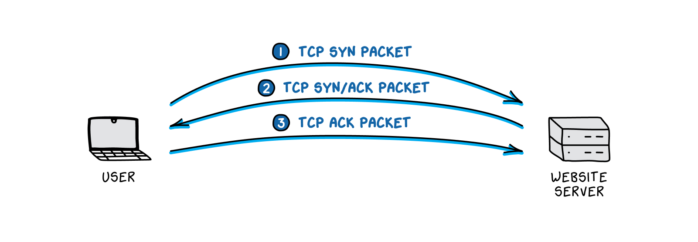

                                
The sequence number and the packet type (SYN, SYN/ACK, or ACK) are included in the TCPA standard for delivering data online, specifying how to break data up into packets in preparation to be transmitted over the internet. Because TCP ensures that each side of a connection is ready before transmitting data, and because it allows for data reassembly at the destination, TCP is most often used by applications prioritizing reliability and completeness, such as web browsing, email, and file transfers. packet’s header, along with other information the protocol needs to ensure it is properly transmitting and receiving data.

                                <figure>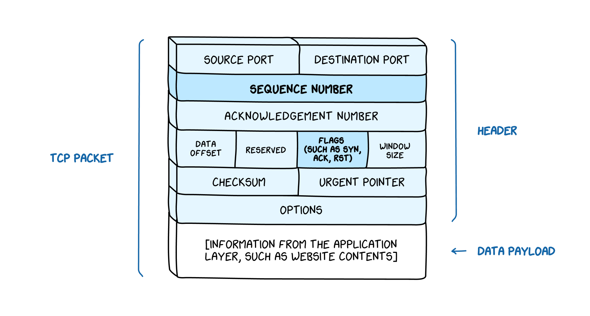
                                    <figcaption>
                                        
(The headers relevant to our discussion of the TCP handshake are in bold.)

                                    </figcaption>
                                </figure>
                                <h3 id=tcp-reset>TCP Reset</h3>
                                
The TCP handshakeThe mechanism <b>TCP</b> uses to establish a connection between two endpoints. The handshake ensures that each side of the connection is available and ready to transmit and receive data. The handshake works by both sides exchanging three different types of packets: first, a synchronization, or SYN, packet; second, a synchronize-acknowledge, or SYN-ACK, packet; and third, an acknowledgement, or ACK, packet., while setting the stage for the connection, also serves as an alert to China’s middleboxesMachines that are positioned between two endpoints of online communications, often in order to read the contents of those communications as they pass back and forth. to start paying attention. Once a middlebox sees a SYN packetWhat the transport layer creates when preparing data to be sent from one computer to another. When the transport layer receives data from the application layer, it divides that data into segments called packets, which can then be individually processed and routed throughout the internet., indicating the beginning of a TCP handshake, it will then start monitoring for any substantive content sent between those two endpoints. (This is true <a href="https://www3.cs.stonybrook.edu/~mikepo/papers/gfweb.sec24.pdf" target="_blank" rel="noopener">even if</a> the middlebox <a href="https://www.cs.ucr.edu/~krish/imc17.pdf" target="_blank" rel="noopener">doesn’t see</a> the full handshake. Because internet routing is <a href="/research&writing/Locknet_Internet_101/#what-even-is-the-internet">so hard to predict</a>, each of the three-way handshake packets might travel on a different route—and get intercepted by different middleboxes. The middleboxes make up for this by monitoring for <em>any</em> related communications once they see an indication of a three-way handshake taking place.)

                                
If the middlebox determines that either side has sent any undesirable information (the means by which it can do this will be discussed later), it will forcibly terminate that connection with a <strong>TCP reset</strong>, often abbreviated as TCP RST. Through this technique, the middlebox issues its own packet, a TCP reset packet, to both ends of the connection. The TCP reset packet simply tells the computers on both ends of the connection to disconnect (reset). In fact, these middleboxes issue <a href="https://www.freehaven.net/anonbib/cache/clayton:pet2006.pdf" target="_blank" rel="noopener">multiple reset packets</a> to each end of the connection—if for some reason the first TCP reset didn’t do the trick, the second or third one almost certainly will.

                                
The TCP reset is an incredibly simple tool, and one that doesn’t slow down internet traffic. Because it is path-adjacent, it does not stop or otherwise interfere with the packets being sent back and forth between Qinghai and the United States. Like DNS middleboxes, the middleboxes that monitor TCPA standard for delivering data online, specifying how to break data up into packets in preparation to be transmitted over the internet. Because TCP ensures that each side of a connection is ready before transmitting data, and because it allows for data reassembly at the destination, TCP is most often used by applications prioritizing reliability and completeness, such as web browsing, email, and file transfers. connections <a href="/research&writing/Locknet_How_China_Disrupts_the_Network/#in-path-vs-path-adjacent-technologies">do not sit directly on the cable that carries the traffic between the two endpoints</a>. Instead, the system copies packets from the main cable onto an offshoot cable which leads to the middlebox. The middlebox, therefore, only sees copies of what’s being sent back and forth between Qinghai and the United States and can’t disrupt the flow of that traffic. Instead, by issuing TCP reset packets, the middlebox essentially directs the machines in Qinghai and the United States to disrupt the traffic themselves, by closing their connection to each other.

                                
The TCP reset works so well because the middlebox actually impersonates both ends of the connection when it sends the reset packets. To the user’s computer in Qinghai, the reset packet looks like it’s coming from the CNBC serverA computer that “serves up” requested content. Most online information is stored (or hosted) on a server. When a user visits a website, it is a server that actually sends back the website content to the user. Servers exist for many different purposes. Major social media companies have many of them in order to provide content to users quickly.. To the CNBC server, the reset packet looks like it’s coming from the computer in Qinghai. Because internet connections generally don’t have any sort of identity verification built in, it’s easy for the middlebox to pretend to be someone’s computer or a news website server—and most machines receiving packets generally believe that the sender is who it says it is.

                                
Once a TCP middlebox begins monitoring a connection, it will keep monitoring that connection until it believes the connection is no longer active. That means the user in Qinghai may have no problem reading multiple articles on the CNBC website, only running into trouble after clicking on a link that contains “dangerous” keywords, which the middlebox promptly disrupts.

                                

                                    <video class="animation" src="/media/locknet/animation-4.mp4" controls playsinline preload="metadata"></video>
                                

                                
China’s TCP reset mechanism doesn’t just terminate the connection. It also enforces something called <strong>residual censorship</strong>. Once a middlebox issues a TCP reset, it prevents any further connection between those two endpoints for a certain amount of time by automatically issuing additional disruptive TCP packets if either side tries to re-establish the connection.

                                
Let’s say the user in Qinghai manages to connect to the CNBC website and clicks on a URL that contains the keyword “Falun Gong.” A middlebox sees the blacklisted keyword in the URL and sends out TCP reset packets to both the person in Qinghai and the CNBC server. The user sees a message that their connection has been reset. If the user tries to go to <em>any</em> page on the CNBC site again, the middlebox won’t even wait for the TCP handshakeThe mechanism <b>TCP</b> uses to establish a connection between two endpoints. The handshake ensures that each side of the connection is available and ready to transmit and receive data. The handshake works by both sides exchanging three different types of packets: first, a synchronization, or SYN, packet; second, a synchronize-acknowledge, or SYN-ACK, packet; and third, an acknowledgement, or ACK, packet. to finish. It will simply issue disruptive TCP packets so that the connection cannot be made. The user will remain unable to even complete a TCP handshake with the CNBC website for <a href="https://dl.acm.org/doi/fullHtml/10.1145/3442381.3450076#sec-17" target="_blank" rel="noopener">around</a> <a href="https://www.cs.ucr.edu/~krish/imc17.pdf" target="_blank" rel="noopener">90 seconds</a>. This residual censorship period is just long enough that <a href="https://drive.google.com/file/d/0B8ztBERe_FUwdF9pVEE1MWF2Y0E/edit?resourcekey=0-oWV-_Pdh6W0j6hWsUHVQIg" target="_blank" rel="noopener">many users</a> will “learn” that the website they’re trying to visit is “unstable,” and perhaps stop trying to visit it altogether.

                                
A censorship process with this kind of temporary memory is described as <strong>stateful</strong> because it tracks the states (e.g., initiating handshake, transmitting information, reset) of various connections. As you might expect, stateful machines need much more computing power than <strong>stateless</strong> ones, which only look at each packet in isolation. Because of this, in the early days of China’s online censorship regime TCP middleboxes were stateless. But since the late 2000s, with the pressure of more internet traffic and more circumvention methods, TCP middleboxes have <a href="https://web.eecs.umich.edu/~zmao/Papers/china-censorship-pam11.pdf" target="_blank" rel="noopener">been tracking</a> connections’ states.

                                
Stateful middleboxes make it much <a href="https://web.eecs.umich.edu/~zmao/Papers/china-censorship-pam11.pdf" target="_blank" rel="noopener">more difficult</a> for international researchers to study China’s censorship regime. Many computer science experiments send “probe” packets through the country’s network in order to analyze the response. A stateless middlebox will respond to each of these probes. A stateful middlebox, however, can recognize repeated probes as a sort of unwanted traffic and reset the connection.

                                
Based on the <a href="https://dl.acm.org/doi/fullHtml/10.1145/3442381.3450076" target="_blank" rel="noopener">most recent</a> study available, these reactive middleboxes mainly target internet traffic crossing the national border. There are many more TCP connections occurring within China at any given moment that are likely not subject to these middleboxes’ scrutiny.

                                <h2 id=deep-packet-inspection>Deep Packet Inspection</h2>
                                
But what exactly triggers a TCP resetA type of packet, and also the name of a mechanism frequently deployed by the Chinese censorship system to forcibly disrupt specific internet connections. After detecting undesirable content, a path-adjacent <b>middlebox</b> issues one or more TCP reset packets to each end of the connection. These packets instruct each endpoint of the connection to reset itself, effectively terminating the connection. This mechanism does not technically <em>block</em> content that has already been sent; instead, it tricks the endpoints into breaking the connection so no more content is sent or received. Also known as TCP RST.
                                    ? How does the middleboxA machine that is positioned between two endpoints of online communications, often in order to read the contents of those communications as they pass back and forth. know that “dangerous” information is flowing through the system?

                                
This is where reactive filtering gets expensive, both in terms of computing resources and actual money. Reactive blocking mechanisms rely on <strong>deep packet inspection</strong> (DPI). Deep packet inspection means looking at the data being sent by the application layerThe part of the network stack that conducts high-level data management and translation, such as character encoding, data compression, encryption/decryption, and remote file access. <b>HTTP</b> and <b>HTTPS protocols</b> function at this layer., which is the data nested most deeply in the Russian nesting doll of data packetsWhat the transport layer creates when preparing data to be sent from one computer to another. When the transport layer receives data from the application layer, it divides that data into segments called packets, which can then be individually processed and routed throughout the internet.. It may not seem that much more challenging or time-consuming to peer one layer deeper into a packet, and it may not be appreciably more difficult as a one-off. However, the expense comes at scale. Running deep packet inspectionThe process of unpacking an internet packet and reading the content contained at the deepest (application) layer. on the likely billions of daily connections between China and the outside world, and keeping that inspection system from slowing internet traffic to a crawl, requires a massive investment in many, <em>many</em> middleboxes. (You may be wondering how many middleboxes. We just don’t know.)

                                
Deep packet inspection doesn’t always equate to censorship. Companies, universities, and many other networks use deep packet inspectionThe process of unpacking an internet packet and reading the content contained at the deepest (application) layer. to detect and stop cyberattacks; China has turned this technology to its own purposes.

                                
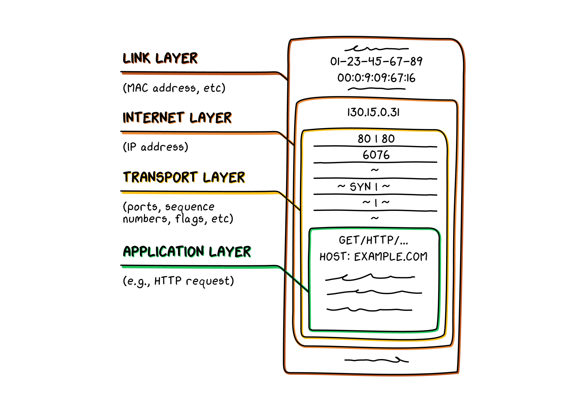

                                
The simpler, preemptive DNS and IP-blocking technologies <a href="/research&writing/Locknet_How_China_Disrupts_the_Network/#preemptive-censorship-preventing-users-from-reaching-their-intended-destination">described above</a>, which only ever look at packet headers, prevent users from making connections with a banned resource and thereby prevent any information exchange with that resource.

                                
Filtering technologies that rely on deep packet inspectionThe process of unpacking an internet packet and reading the content contained at the deepest (application) layer., by contrast, only function <em>after</em> a connection has been established and some amount of substantive information has flowed between the user and the site they’re trying to visit—even if that information is just a URL or domain name.

                                
Specifically, the PRC’s deep packet inspectionThe process of unpacking an internet packet and reading the content contained at the deepest (application) layer. system looks for two different protocols that might be used at the application layerThe part of the network stack that conducts high-level data management and translation, such as character encoding, data compression, encryption/decryption, and remote file access. <b>HTTP</b> and <b>HTTPS protocols</b> function at this layer.: HTTP and HTTPS.

                                <h3 id=http-filtering>HTTP Filtering</h3>
                                
<strong>Hypertext Transfer Protocol</strong> (HTTP) is the foundation for internet communication. The <a href="https://www.w3.org/Protocols/HTTP/AsImplemented.html" target="_blank" rel="noopener">protocol</a>, which operates at the application layerThe part of the network stack that conducts high-level data management and translation, such as character encoding, data compression, encryption/decryption, and remote file access. <b>HTTP</b> and <b>HTTPS protocols</b> function at this layer., acts as a set of instructions for requesting information from a website (or other online resource), as well as sending and receiving that information. You probably recognize it as the first part of many web addresses: “**http://**<a href="https://www.example.com" target="_blank" rel="noopener">www.example.com</a>.”

                                
<strong>HTTP filtering</strong> refers to a censorship system that monitors the information sent back and forth as part of HTTPA set of instructions for requesting information from a website (or other online resource), as well as sending and receiving that information. As such, it serves as the foundation for internet communication. HTTP functions at the <b>application layer</b> of the network stack. protocols and resets the connection if it detects a blacklisted keyword. HTTP filtering occurs <em>after</em> a TCP three-way handshakeThe mechanism <b>TCP</b> uses to establish a connection between two endpoints. The handshake ensures that each side of the connection is available and ready to transmit and receive data. The handshake works by both sides exchanging three different types of packets: first, a synchronization, or SYN, packet; second, a synchronize-acknowledge, or SYN-ACK, packet; and third, an acknowledgement, or ACK, packet. has been successfully completed and when one end of the connection is trying to send some substantive content.

                                
There are two main points at which a censorship system can disrupt HTTPA set of instructions for requesting information from a website (or other online resource), as well as sending and receiving that information. As such, it serves as the foundation for internet communication. HTTP functions at the <b>application layer</b> of the network stack. communications: first during the HTTP request, and then during the HTTP response.

                                <h4 id=http-request-filtering>HTTP Request Filtering</h4>
                                
After the TCP three-way handshakeThe mechanism <b>TCP</b> uses to establish a connection between two endpoints. The handshake ensures that each side of the connection is available and ready to transmit and receive data. The handshake works by both sides exchanging three different types of packets: first, a synchronization, or SYN, packet; second, a synchronize-acknowledge, or SYN-ACK, packet; and third, an acknowledgement, or ACK, packet. has been completed, and a user and a serverA computer that “serves up” requested content. Most online information is stored (or hosted) on a server. When a user visits a website, it is a server that actually sends back the website content to the user. Servers exist for many different purposes. Major social media companies have many of them in order to provide content to users quickly. have established a connection, the user’s computer will transmit a packetWhat the transport layer creates when preparing data to be sent from one computer to another. When the transport layer receives data from the application layer, it divides that data into segments called packets, which can then be individually processed and routed throughout the internet. requesting information from the website.

                                
Let’s say a person in Guangdong is trying to visit the CNBC website, hosted in the United States. We’ll assume that “www.cnbc.com” appears on neither China’s DNS blocklist nor IP blocklists. So without any initial interference, the person in Guangdong is able to get the website’s IP addressA series of characters that identifies a computer or server using the IP system to communicate over the internet. Internet Protocol Version 4 (IPv4) addresses are composed of a set of four numbers, each with one to three digits, separated by periods (for example, <b>104.18.204.43</b>). Internet Protocol Version 6 (IPv6) addresses are longer and can also include letters (such as <b>1050:0:0:0:5:600:300c:326b</b>). and successfully complete a TCP three-way handshake. The next thing that happens is that the user’s computer issues an HTTP request.

                                
An HTTPA set of instructions for requesting information from a website (or other online resource), as well as sending and receiving that information. As such, it serves as the foundation for internet communication. HTTP functions at the <b>application layer</b> of the network stack. request is created at the application layerThe part of the network stack that conducts high-level data management and translation, such as character encoding, data compression, encryption/decryption, and remote file access. <b>HTTP</b> and <b>HTTPS protocols</b> function at this layer., then sent to the transport layerThe part of the network stack that segments data into packets. Depending on the protocol in use, the transport layer may also establish a connection with another machine prior to sending packets, or reassemble received packets into the correct order. for packaging as a TCPA standard for delivering data online, specifying how to break data up into packets in preparation to be transmitted over the internet. Because TCP ensures that each side of a connection is ready before transmitting data, and because it allows for data reassembly at the destination, TCP is most often used by applications prioritizing reliability and completeness, such as web browsing, email, and file transfers. packet (if there is enough information the request may be split over multiple packets, but the theory is the same). Just like all TCP packets, it then goes to the internet and link layers, where additional headers are added, before zooming off to the internet beyond their computer. The structure of an HTTP request, as it sits within a larger packet, looks like this:

                                
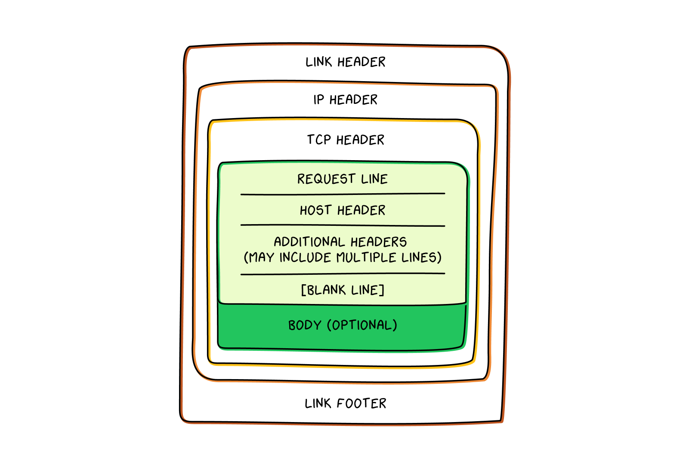

                                
Somewhat counterintuitively, since it is the second line in the packet, the <strong>host header</strong> line contains the website’s domain name (<a href="https://www.cnbc.com" target="_blank" rel="noopener">www.cnbc.com</a>). The <strong>request line</strong> (the first line in the packet) contains three other pieces of information:

                                <ol>
                                    <li><strong>HTTP method.</strong> This is essentially a command indicating what the user is hoping to do. If someone is trying to visit a webpage, the HTTP method is usually “GET,” which indicates that they would like the website server to send back what appears on that webpage.</li>
                                    <li><strong>Path.</strong> This refers to the URL of the webpage the user wants to visit. For example, the website “www.cnbc.com” may contain an article about Falun Gong, a spiritual practice banned in China, at “www.cnbc.com/falungong.html.” The path would therefore be “/falungong.html.” If the user is trying to access a web page that does not have a path beyond the domain name itself—that is, the name appears as “www.cnbc.com” rather than something like “www.cnbc.com/homepage.html”—the path simply appears as a slash (“/”).</li>
                                    <li><strong>HTTP version</strong>. As HTTP has evolved over time, new versions have come into use. This simply indicates which version of HTTP the computer is using (currently, this usually appears as “HTTP/1.1”).</li>
                                </ol>
                                
There are a number of additional headers that may appear in an HTTPA set of instructions for requesting information from a website (or other online resource), as well as sending and receiving that information. As such, it serves as the foundation for internet communication. HTTP functions at the <b>application layer</b> of the network stack. request packet and help facilitate the smooth transfer of information. Since they do not usually play a direct role in censorship, we will skip them here.

                                
In the case of our friend in Guangdong who wants to visit the CNBC article about Falun Gong, the HTTP request might look like this:

                                <figure>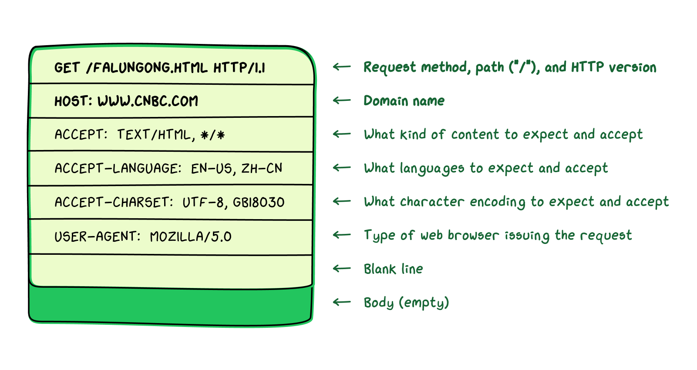
                                    <figcaption>
                                        
(The headers relevant to our discussion of HTTP requests are in bold.)

                                    </figcaption>
                                </figure>
                                
Once the user’s computer sends off the HTTPA set of instructions for requesting information from a website (or other online resource), as well as sending and receiving that information. As such, it serves as the foundation for internet communication. HTTP functions at the <b>application layer</b> of the network stack. request, the PRC censorship system’s reactive filtering kicks into gear. Remember that reactive middleboxesMachines that are positioned between two endpoints of online communications, often in order to read the contents of those communications as they pass back and forth. monitor any and all TCP three-way handshakes they see.

                                
As the HTTP request travels through the network, it is copied and sent to the middlebox. Using deep packet inspectionThe process of unpacking an internet packet and reading the content contained at the deepest (application) layer., the middlebox will <a href="https://dl.acm.org/doi/fullHtml/10.1145/3442381.3450076" target="_blank" rel="noopener">check the contents</a> of the host header and compare it to a list of banned domain names, which might include domains like cnn.com, washingtonpost.com, and wsj.com. In this case, cnbc.com does not appear on the banned domain list, so the HTTP request wouldn’t get blocked because of the domain name.

                                
However, HTTPA set of instructions for requesting information from a website (or other online resource), as well as sending and receiving that information. As such, it serves as the foundation for internet communication. HTTP functions at the <b>application layer</b> of the network stack. request filtering can be more powerful and precise than simply serving to block an entire domain. For a country hoping to curate its citizens’ information ecosystem, merely blocking websites already identified as “dangerous” isn’t adequate—new or unknown pages could spring up at any time, ready to disseminate undesirable information. HTTP request filtering therefore has two additional mechanisms that try to determine if a user is accessing banned content.

                                
For one, the middlebox looks at the content in the request line and compares it to a list of banned keywords. The banned keyword list might contain the terms “falun_gong,” “falungong,” or even just “falun.” (Most of the actual keywords, of course, are in Chinese.) In this case, the path “/<strong>falungong</strong>.html” would match with entries from the list. The path-adjacent middleboxA <b>middlebox</b> that monitors, but does not sit directly on, a cable transferring information between two endpoints. (More commonly referred to as an on-path middlebox by computer scientists.) It monitors internet traffic by reading copies of that traffic. A path-adjacent middlebox cannot directly block internet traffic; instead, it must issue orders to one or both endpoints of the connection in an attempt to have them break the connection. then issues one or more TCP resetA type of packet, and also the name of a mechanism frequently deployed by the Chinese censorship system to forcibly disrupt specific internet connections. After detecting undesirable content, a path-adjacent <b>middlebox</b> issues one or more TCP reset packets to each end of the connection. These packets instruct each endpoint of the connection to reset itself, effectively terminating the connection. This mechanism does not technically <em>block</em> content that has already been sent; instead, it tricks the endpoints into breaking the connection so no more content is sent or received. Also known as TCP RST.
                                    packets, telling each end of the connection to reset. It then enforces residual censorshiphe period during which, after censors have forcibly disrupted an internet connection between two endpoints, all further connections between those two endpoints are blocked. Chinese authorities enforce residual censorship to punish users who attempt to view banned content, or simply to make users think that the website in question is unstable and not worth visiting. Residual censorship can last anywhere from a few seconds to multiple hours., meaning that it prevents the user from accessing any part of the website for at least 90 seconds.

                                
The other mechanism also involves the request line. The middlebox looks at the request line and specifically checks if it contains the English word “search.” This usually happens when a user is actively searching for something—say, typing “Chinese Communist Party” into their Bing search bar. The resulting HTTPA set of instructions for requesting information from a website (or other online resource), as well as sending and receiving that information. As such, it serves as the foundation for internet communication. HTTP functions at the <b>application layer</b> of the network stack. request usually contains the term “search” in the URL, like “http://www.bing.com/<strong>search</strong>?q=chinese+communist+party.” The HTTP request line would therefore contain “/<strong>search</strong>?q=chinese+communist+party.” <a href="https://dl.acm.org/doi/fullHtml/10.1145/3442381.3450076" target="_blank" rel="noopener">A study done in 2021</a> showed that HTTP request lines containing the English word “search” triggered middleboxes to use a different, even longer keyword blacklist. This suggests that the Chinese government is not just trying to keep citizens away from previously-known and blacklisted sites. It also wants to discourage them from even bothering to seek out new sources of undesirable information.

                                
These two additional HTTPA set of instructions for requesting information from a website (or other online resource), as well as sending and receiving that information. As such, it serves as the foundation for internet communication. HTTP functions at the <b>application layer</b> of the network stack. request mechanisms mean Chinese authorities don’t have to preemptively discover and block every single international website that could pose a threat; they can instead block specific connections in real time if those connections reference banned keywords. In this way, reactive filtering technologies allow PRC authorities to disrupt <em>unexpected</em> unwanted connections.

                                
The <a href="https://dl.acm.org/doi/fullHtml/10.1145/3442381.3450076" target="_blank" rel="noopener">same 2021 study</a> suggests that middleboxes monitoring HTTPA set of instructions for requesting information from a website (or other online resource), as well as sending and receiving that information. As such, it serves as the foundation for internet communication. HTTP functions at the <b>application layer</b> of the network stack. requests, and issuing TCP resets if necessary, are probably not monitoring all the internet traffic within China—just the traffic that is headed abroad. Looking solely at network-level censorshipCensorship conducted by equipment placed within an internet network, aimed at all traffic that transits that network. This may include machines positioned throughout an ISP’s network, or machines positioned at international gateways that are designed to handle all internet traffic passing through those gateways. of HTTP requests, the researchers did not observe any censorship of traffic that stayed within mainland China. Whether this is still true, or was only true under the conditions of that study, we can’t know. But if it is the case, it suggests that China is satisfied with the effectiveness of service-level censorshipCensorship conducted by a company or entity monitoring the censorship on its own platform or service. This can be accomplished through both manual and automated means, but it only targets the content available on the platform or service in question. inside China and doesn’t see the need to deploy additional reactive resources to censor domestic internet traffic at the network level.

                                <h4 id=http-response-filtering>HTTP Response Filtering</h4>
                                
HTTPA set of instructions for requesting information from a website (or other online resource), as well as sending and receiving that information. As such, it serves as the foundation for internet communication. HTTP functions at the <b>application layer</b> of the network stack. response filtering happens after a user has successfully sent an HTTP request. An HTTP response is a website’s reply to that request and usually contains text from the website.

                                
HTTP response filtering is the most precision-targeted of the network-level censorshipCensorship conducted by equipment placed within an internet network, aimed at all traffic that transits that network. This may include machines positioned throughout an ISP’s network, or machines positioned at international gateways that are designed to handle all internet traffic passing through those gateways. mechanisms. (Remember, “network-level” censorship refers to the technologies embedded throughout China’s internet network, as opposed to the “service-level” censorship carried out by private companies monitoring their own platforms and services.) Rather than reading just the domain name in the request and assuming that a website contains “dangerous” content, HTTP response filtering reacts only when actual “dangerous” content appears in the body of the site. But that precision comes at a cost, especially at scale. HTTP response filtering is much more expensive than HTTP request filtering; the content that the HTTP response middleboxA machine that is positioned between two endpoints of online communications, often in order to read the contents of those communications as they pass back and forth.
                                    has to check for blacklisted keywords is longer and less consistently formatted. It is so much more costly, in fact, that PRC authorities may have abandoned it.

                                
Though HTTPA set of instructions for requesting information from a website (or other online resource), as well as sending and receiving that information. As such, it serves as the foundation for internet communication. HTTP functions at the <b>application layer</b> of the network stack. response filtering had been in use since at least <a href="https://web.archive.org/web/20250311233030/https://dash.harvard.edu/server/api/core/bitstreams/7312037c-a4c6-6bd4-e053-0100007fdf3b/content" target="_blank" rel="noopener">2002</a>, a later study <a href="https://jedcrandall.github.io/icdcs2010.pdf" target="_blank" rel="noopener">found</a> that it had largely been discontinued by early 2009, perhaps because it was simply too difficult for the censorship system to track so many HTTP response packets flowing through potentially different routes. (An HTTP request packet usually piggybacks on the end of a TCP three-way handshakeThe mechanism <b>TCP</b> uses to establish a connection between two endpoints. The handshake ensures that each side of the connection is available and ready to transmit and receive data. The handshake works by both sides exchanging three different types of packets: first, a synchronization, or SYN, packet; second, a synchronize-acknowledge, or SYN-ACK, packet; and third, an acknowledgement, or ACK, packet., making it easier to intercept, but HTTP response packets are both far more numerous and more likely to travel on different routes.) Yet, a <a href="https://drive.google.com/file/d/0B8ztBERe_FUwdF9pVEE1MWF2Y0E/edit?resourcekey=0-oWV-_Pdh6W0j6hWsUHVQIg" target="_blank" rel="noopener">2014 research project</a> found some evidence of HTTP response filtering and hypothesized it was happening only if the packet came from particular IP addressesCharacters identifying computers or servers using the IP system to communicate over the internet. Internet Protocol Version 4 (IPv4) addresses are composed of a set of four numbers, each with one to three digits, separated by periods (for example, <b>104.18.204.43</b>). Internet Protocol Version 6 (IPv6) addresses are longer and can also include letters (such as <b>1050:0:0:0:5:600:300c:326b</b>). (in this case, from Wikipedia’s IP address). A <a href="https://dl.acm.org/doi/fullHtml/10.1145/3442381.3450076" target="_blank" rel="noopener">2021 study</a> found no evidence of HTTP response filtering at all, but did not test whether this was true for packets from well-known, potentially “dangerous” websites like Wikipedia. Absent further information, it seems likely that the PRC’s censorship system is currently not using HTTP response filtering at scale.

                                
But, even if this censorship mechanism is not currently active, it is still an important capability that the PRC authorities could presumably turn back on, even in a limited manner, if they so choose. For that reason, it’s worth briefly describing how it works.

                                
Modifying our HTTPA set of instructions for requesting information from a website (or other online resource), as well as sending and receiving that information. As such, it serves as the foundation for internet communication. HTTP functions at the <b>application layer</b> of the network stack. request example a bit, let’s say our friend in Guangdong is trying to read an article on the CNBC website, at the URL <a href="https://www.cnbc.com/china-news.html" target="_blank" rel="noopener">www.cnbc.com/china-news.html</a>. As before, the CNBC domain name isn’t on any DNS, IP, or HTTP blocklist. Neither does the remainder of the URL (namely, /china-news.html) contain any keywords that might trigger the HTTP request filter. So the person in Guangdong should be able to complete a three-way handshake and send off an HTTP request in order to receive information from the website’s homepage. Once the website serverA computer that “serves up” requested content. Most online information is stored (or hosted) on a server. When a user visits a website, it is a server that actually sends back the website content to the user. Servers exist for many different purposes. Major social media companies have many of them in order to provide content to users quickly. receives the HTTP request, it sends out an HTTP response.

                                
Similar to an HTTPA set of instructions for requesting information from a website (or other online resource), as well as sending and receiving that information. As such, it serves as the foundation for internet communication. HTTP functions at the <b>application layer</b> of the network stack. request, an HTTP response is created at the application layerThe part of the network stack that conducts high-level data management and translation, such as character encoding, data compression, encryption/decryption, and remote file access. <b>HTTP</b> and <b>HTTPS protocols</b> function at this layer. and bundled into packets to be sent back to the user. The structure of an HTTP response, as it sits within a larger packet, looks like this:

                                
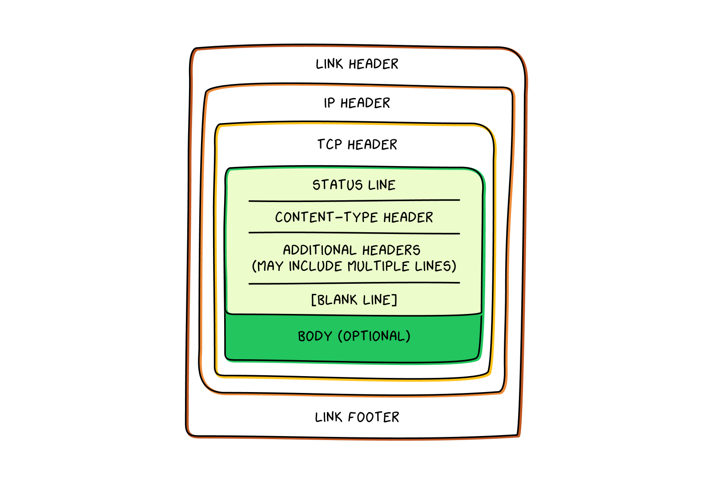

                                
Unlike an HTTPA set of instructions for requesting information from a website (or other online resource), as well as sending and receiving that information. As such, it serves as the foundation for internet communication. HTTP functions at the <b>application layer</b> of the network stack. request packet, the headers in an HTTP response packet don’t matter much in terms of censorship. The middleboxA machine that is positioned between two endpoints of online communications, often in order to read the contents of those communications as they pass back and forth. is instead focused on the body of the packet—that is, the part of the packet that actually contains website content.

                                
Our friend in Guangdong might expect to receive a packet that looks something like this:

                                <figure>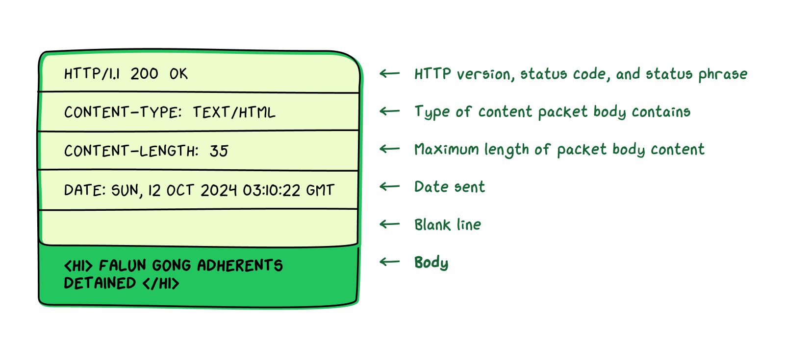
                                    <figcaption>
                                        
(The headers relevant to our discussion of HTTP responses are in bold.)

                                    </figcaption>
                                </figure>
                                
Just as with HTTPA set of instructions for requesting information from a website (or other online resource), as well as sending and receiving that information. As such, it serves as the foundation for internet communication. HTTP functions at the <b>application layer</b> of the network stack. requests, the reactive middleboxA machine that is positioned between two endpoints of online communications, often in order to read the contents of those communications as they pass back and forth. has already been alerted to this connection by the initial TCP three-way handshake and is watching to see what information gets transmitted. When the path-adjacent middleboxA <b>middlebox</b> that monitors, but does not sit directly on, a cable transferring information between two endpoints. (More commonly referred to as an on-path middlebox by computer scientists.) It monitors internet traffic by reading copies of that traffic. A path-adjacent middlebox cannot directly block internet traffic; instead, it must issue orders to one or both endpoints of the connection in an attempt to have them break the connection. receives the HTTP response, it uses deep packet inspectionThe process of unpacking an internet packet and reading the content contained at the deepest (application) layer. to read the body field and checks the contents against a keyword blacklist.

                                
This is where the trouble lies. Even though the CNBC domain isn’t on any blocklist, and the <a href="https://www.cnbc.com/china-news.html" target="_blank" rel="noopener">www.cnbc.com/china-news.html</a> URL easily passed through the HTTP request filter, the actual content of the website—describing the detention of Falun Gong practitioners—would trigger the HTTP response filter. The middlebox would issue TCP resetA type of packet, and also the name of a mechanism frequently deployed by the Chinese censorship system to forcibly disrupt specific internet connections. After detecting undesirable content, a path-adjacent <b>middlebox</b> issues one or more TCP reset packets to each end of the connection. These packets instruct each endpoint of the connection to reset itself, effectively terminating the connection. This mechanism does not technically <em>block</em> content that has already been sent; instead, it tricks the endpoints into breaking the connection so no more content is sent or received. Also known as TCP RST.
                                    packets, effectively ending the connection.

                                <h3 id=https-filtering>HTTPS Filtering</h3>
                                
HTTPS, like HTTPA set of instructions for requesting information from a website (or other online resource), as well as sending and receiving that information. As such, it serves as the foundation for internet communication. HTTP functions at the <b>application layer</b> of the network stack., is a <a href="https://www.w3.org/Protocols/HTTP/AsImplemented.html" target="_blank" rel="noopener">protocol</a> operating at the application layerThe part of the network stack that conducts high-level data management and translation, such as character encoding, data compression, encryption/decryption, and remote file access. <b>HTTP</b> and <b>HTTPS protocols</b> function at this layer. that sends data between a user and a website. You have probably seen it in many web addresses (like <strong>https</strong>://www.example.com), sometimes with a little lock icon next to it. This is because HTTPS is the secure version of HTTP, used by most websites in most countries these days. HTTPS encrypts its data payload, meaning that even the PRC’s deep packet inspectionThe process of unpacking an internet packet and reading the content contained at the deepest (application) layer. middleboxesMachines that are positioned between two endpoints of online communications, often in order to read the contents of those communications as they pass back and forth. cannot read what information a user or a website is sending. The information shared at the application layerThe part of the network stack that conducts high-level data management and translation, such as character encoding, data compression, encryption/decryption, and remote file access. <b>HTTP</b> and <b>HTTPS protocols</b> function at this layer. is still HTTP—it’s just wrapped in a layer of encryption before it gets sent out into the internet.

                                
Here’s how HTTPS works: after a TCP three-way handshakeThe mechanism <b>TCP</b> uses to establish a connection between two endpoints. The handshake ensures that each side of the connection is available and ready to transmit and receive data. The handshake works by both sides exchanging three different types of packets: first, a synchronization, or SYN, packet; second, a synchronize-acknowledge, or SYN-ACK, packet; and third, an acknowledgement, or ACK, packet. is completed, HTTPS initiates a <em>second</em> handshake between the user and the website, using a protocol known as <strong>Transport Layer Security</strong> (TLS). During this handshake, the two sides of the connection exchange cipher information with each other, allowing them to agree on an encryption key that they use to encrypt all subsequent traffic between them. (For more information about how two parties can create a secret, shared encryption key on the fly while communicating over an unencrypted channel, Wikipedia provides a <a href="https://en.wikipedia.org/wiki/Diffie%E2%80%93Hellman_key_exchange" target="_blank" rel="noopener">concise overview</a> with a helpful analogy to paint mixing. The main thing to know is that each party has a public key that they exchange with each other, and a private key that they keep hidden. The details of the TLS handshake are slightly different than this overview, but the main principle is the same.)

                                
Without getting too deep into the weeds, a TLS handshake includes:

                                <ol>
                                    <li>A Client Hello message from the user to the website serverA computer that “serves up” requested content. Most online information is stored (or hosted) on a server. When a user visits a website, it is a server that actually sends back the website content to the user. Servers exist for many different purposes. Major social media companies have many of them in order to provide content to users quickly., which initiates the handshake and includes some information to help generate a shared encryption key.</li>
                                    <li>A Server Hello message from the server to the user, which includes some additional encryption information, as well as information to help authenticate the website’s identity.</li>
                                    <li>A response from the user to the server, indicating that the user’s computer has validated the information sent by the server and is ready to proceed.</li>
                                </ol>
                                
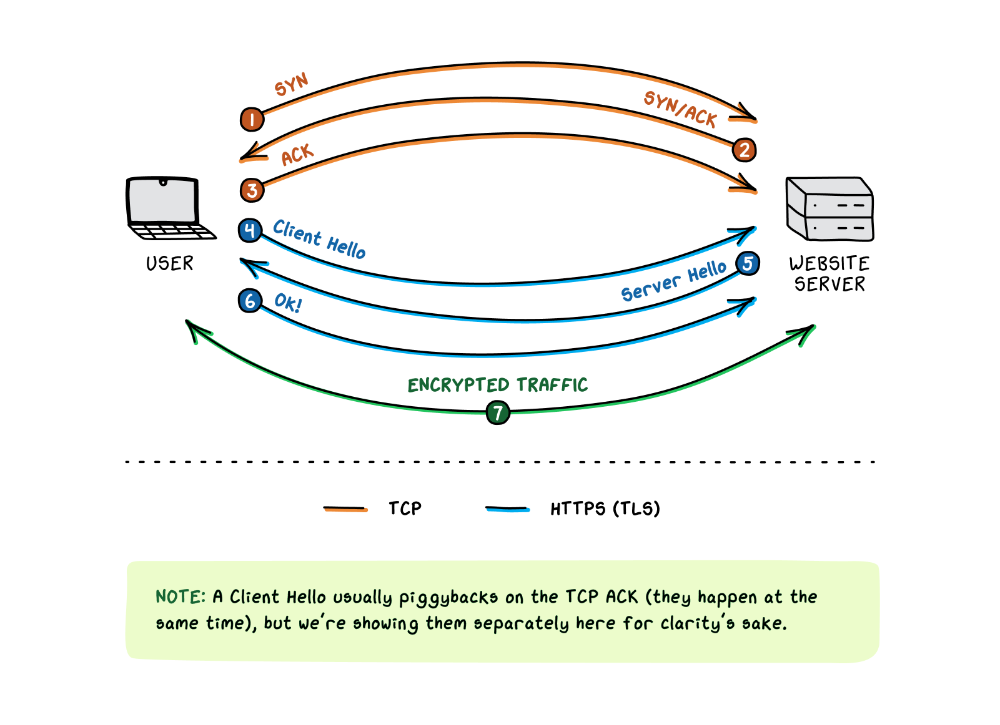

                                
Once the TLS handshake is successfully completed, all the data at the application layerThe part of the network stack that conducts high-level data management and translation, such as character encoding, data compression, encryption/decryption, and remote file access. <b>HTTP</b> and <b>HTTPS protocols</b> function at this layer. is encrypted and can flow between the two endpoints.

                                
That would seem to be the end of the censorship story. If middleboxesMachines that are positioned between two endpoints of online communications, often in order to read the contents of those communications as they pass back and forth. can’t see what HTTPSA secure version of HTTP, used by most modern websites in most countries, that determines how data is sent between a user and a website. At the application layer, the information is still formatted as HTTP. HTTPS simply wraps this HTTP data in a layer of encryption before sending it out over the internet. packets are requesting or sending, then the PRC should have no way to block packets based on their content. For a while, this was true. A <a href="https://drive.google.com/file/d/0B8ztBERe_FUwdF9pVEE1MWF2Y0E/edit?resourcekey=0-oWV-_Pdh6W0j6hWsUHVQIg" target="_blank" rel="noopener">2014 research project</a> looking at censorship of Wikipedia in China noted that the censorship system simply blocked all HTTPS traffic coming from Wikipedia, since it had no way to monitor the content of those specific pages. A <a href="https://www.cs.ucr.edu/~krish/imc17.pdf" target="_blank" rel="noopener">2017 study</a> found that the PRC did not appear to be inspecting or filtering HTTPS traffic at all. Technically, it would be possible for the censorship system to decrypt and re-encrypt HTTPS traffic, though it would come at a significant cost in both money and time. Though a few reports have suggested the system might do this under certain circumstances, <a href="https://dl.acm.org/doi/fullHtml/10.1145/3442381.3450076" target="_blank" rel="noopener">as of 2021 researchers found</a> no indication that the censorship system was decrypting HTTPS traffic at scale.

                                <h4 id=server-name-identification-sni-filtering>Server Name Identification (SNI) Filtering</h4>
                                
<a href="https://www.usenix.org/system/files/foci19-paper_chai_update.pdf" target="_blank" rel="noopener">By 2019</a>, however, China had deployed middleboxesMachines that are positioned between two endpoints of online communications, often in order to read the contents of those communications as they pass back and forth. to filter HTTPSA secure version of HTTP, used by most modern websites in most countries, that determines how data is sent between a user and a website. At the application layer, the information is still formatted as HTTP. HTTPS simply wraps this HTTP data in a layer of encryption before sending it out over the internet. traffic, utilizing part of the HTTPS protocol called the <strong>server name identification</strong>, or SNI. Though HTTPS traffic is mostly encrypted, there are still a few fields of information shared during the TLS handshakeA protocol used by HTTPS to conduct a second three-way handshake between two endpoints. During this handshake, the two sides of the connection exchange information that allows them to agree on an encryption key, which they then use to encrypt all subsequent traffic between them. that are <strong>cleartext</strong>, or unencrypted. One of these is the SNI field, which lists the domain the user would like to visit. Because so many modern websites do not have their own dedicated IP addressA series of characters that identifies a computer or server using the IP system to communicate over the internet. Internet Protocol Version 4 (IPv4) addresses are composed of a set of four numbers, each with one to three digits, separated by periods (for example, <b>104.18.204.43</b>). Internet Protocol Version 6 (IPv6) addresses are longer and can also include letters (such as <b>1050:0:0:0:5:600:300c:326b</b>). (again, think of making a personal website with a company like Squarespace—you’d almost certainly be sharing an IP address with many other Squarespace-run websites), the SNI field tells the serverA computer that “serves up” requested content. Most online information is stored (or hosted) on a server. When a user visits a website, it is a server that actually sends back the website content to the user. Servers exist for many different purposes. Major social media companies have many of them in order to provide content to users quickly. which domain name, out of all the domain names hosted at the relevant IP address, the user is interested in.

                                
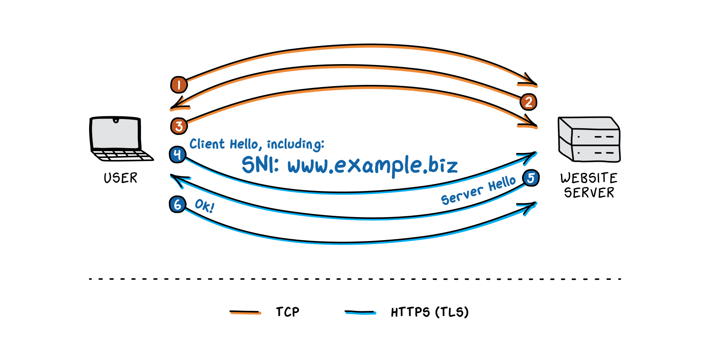

                                
Just like the middleboxesMachines that are positioned between two endpoints of online communications, often in order to read the contents of those communications as they pass back and forth. deployed against HTTPA set of instructions for requesting information from a website (or other online resource), as well as sending and receiving that information. As such, it serves as the foundation for internet communication. HTTP functions at the <b>application layer</b> of the network stack. traffic, <a href="https://www.usenix.org/system/files/foci19-paper_chai_update.pdf" target="_blank" rel="noopener">HTTPS middleboxes</a> have a list of banned keywords. Once the path-adjacent middleboxA <b>middlebox</b> that monitors, but does not sit directly on, a cable transferring information between two endpoints. (More commonly referred to as an on-path middlebox by computer scientists.) It monitors internet traffic by reading copies of that traffic. A path-adjacent middlebox cannot directly block internet traffic; instead, it must issue orders to one or both endpoints of the connection in an attempt to have them break the connection. reads the SNI field, it can compare the text to the entries on the blacklist and issue TCP resetsA type of packet, and also the name of a mechanism frequently deployed by the Chinese censorship system to forcibly disrupt specific internet connections. After detecting undesirable content, a path-adjacent <b>middlebox</b> issues one or more TCP reset packets to each end of the connection. These packets instruct each endpoint of the connection to reset itself, effectively terminating the connection. This mechanism does not technically <em>block</em> content that has already been sent; instead, it tricks the endpoints into breaking the connection so no more content is sent or received. Also known as TCP RST.
                                    to both ends of the connection. So, even though the HTTPSA secure version of HTTP, used by most modern websites in most countries, that determines how data is sent between a user and a website. At the application layer, the information is still formatted as HTTP. HTTPS simply wraps this HTTP data in a layer of encryption before sending it out over the internet. promises to encrypt the information shared between a user and a website, Chinese censors are able to disrupt the connection before the encryption begins. However, this means that websites with innocuous domain names but “dangerous” content can still get through this system—at least until the authorities discover the site and add it to their DNS or IP blocklists.

                                
One <a href="https://www3.cs.stonybrook.edu/~mikepo/papers/gfweb.sec24.pdf" target="_blank" rel="noopener">recent experiment</a> indicates that PRC authorities actually have two different HTTPS filtering systems: the path-adjacent one described above, and a separate in-pathA middlebox that sits directly on a cable transferring information between two endpoints. All internet traffic therefore also transits the middlebox before reaching its intended destination. An in-path middlebox can opt to block certain pieces of unwanted internet traffic so that they never reach their intended destination (also known as <b>dropping</b> traffic). system. The in-path system appears to only search for a smaller set of specific domains, most of which are websites for censorship circumvention providers. As an in-path system, it does not issue TCP resets, but rather drops packets when it sees an SNI field containing a blacklisted domain. It also enforces residual censorshiphe period during which, after censors have forcibly disrupted an internet connection between two endpoints, all further connections between those two endpoints are blocked. Chinese authorities enforce residual censorship to punish users who attempt to view banned content, or simply to make users think that the website in question is unstable and not worth visiting. Residual censorship can last anywhere from a few seconds to multiple hours. for a longer period (nearly six minutes) than seen with path-adjacent systems. The use of a separate, more expensive, in-path system to mainly target circumvention tools suggests how much the Party-state wants to keep its citizens from evading the censorship system.

                                <h4 id=encrypted-server-name-identification-esni-filtering>Encrypted Server Name Identification (ESNI) Filtering</h4>
                                
If the censors can read the SNI (server name identification) field because it’s cleartext, why not encrypt the SNI field too? The reason is that both sides of the connection need a way to negotiate an encryption key <em>before</em> sending the SNI. This presents a chicken-and-egg problem: an encryption key is needed in order to encrypt the SNI, but the SNI must be sent in order to obtain an encryption key.

                                
Encrypted server name identification (ESNI) attempted to solve this problem by having the encryption key exchange at a much earlier stage in the connection process—during the DNS lookupThe process by which a user’s computer converts human-friendly domain names into computer-friendly IP addresses. It consists of the computer sending the domain name to a DNS resolver, which searches for and returns the corresponding IP address to the user. phase. It <a href="https://blog.cloudflare.com/encrypted-sni/" target="_blank" rel="noopener">worked like this</a>: a domain (let’s say chinafile.com) adds its public encryption key to the DNSThe system that converts a human-friendly domain name (e.g., “catvideos.com”) into a computer-friendly IP address (e.g., “157.240.22.35”). By converting domain names into IP addresses, DNS allows routers throughout the internet to efficiently send information to the correct destination. DNS relies on <b>DNS resolvers</b> and <b>nameservers</b> to assist with this conversion. record system. Then, when a user wants to visit that domain and initiates a DNS lookupThe process by which a user’s computer converts human-friendly domain names into computer-friendly IP addresses. It consists of the computer sending the domain name to a DNS resolver, which searches for and returns the corresponding IP address to the user., their computer fetches not only ChinaFile’s IP addressA series of characters that identifies a computer or server using the IP system to communicate over the internet. Internet Protocol Version 4 (IPv4) addresses are composed of a set of four numbers, each with one to three digits, separated by periods (for example, <b>104.18.204.43</b>). Internet Protocol Version 6 (IPv6) addresses are longer and can also include letters (such as <b>1050:0:0:0:5:600:300c:326b</b>). but also its public encryption key. Next, the user’s computer completes a TCP three-way handshakeThe mechanism <b>TCP</b> uses to establish a connection between two endpoints. The handshake ensures that each side of the connection is available and ready to transmit and receive data. The handshake works by both sides exchanging three different types of packets: first, a synchronization, or SYN, packet; second, a synchronize-acknowledge, or SYN-ACK, packet; and third, an acknowledgement, or ACK, packet. (the initial connection between two endpoints) with the serverA computer that “serves up” requested content. Most online information is stored (or hosted) on a server. When a user visits a website, it is a server that actually sends back the website content to the user. Servers exist for many different purposes. Major social media companies have many of them in order to provide content to users quickly. that hosts ChinaFile’s website.

                                
Finally, the user’s computer initiates a TLS handshakeA protocol used by HTTPS to conduct a second three-way handshake between two endpoints. During this handshake, the two sides of the connection exchange information that allows them to agree on an encryption key, which they then use to encrypt all subsequent traffic between them. (the second handshake in an HTTPSA secure version of HTTP, used by most modern websites in most countries, that determines how data is sent between a user and a website. At the application layer, the information is still formatted as HTTP. HTTPS simply wraps this HTTP data in a layer of encryption before sending it out over the internet. connection that allows for encryption)—and here is where ChinaFile’s public encryption key comes into play. The user’s computer uses this public encryption key to encrypt the SNI field. When the user sends over a Client Hello, the message includes not only the ESNIAn encrypted version of the SNI field, allowing servers to return the proper website content to users while still keeping censors from knowing the website’s identity. As Chinese censors do not have an easy way to break the ESNI field’s encryption, they have instead blocked all ESNI traffic. but also some information that will allow the server to decrypt the ESNI. (Again, if you’re struggling to understand how it’s possible to publicly share encryption information and still somehow generate secure encryption, the <a href="https://en.wikipedia.org/wiki/Diffie%E2%80%93Hellman_key_exchange" target="_blank" rel="noopener">paint mixing analogy</a> can be very helpful.)

                                
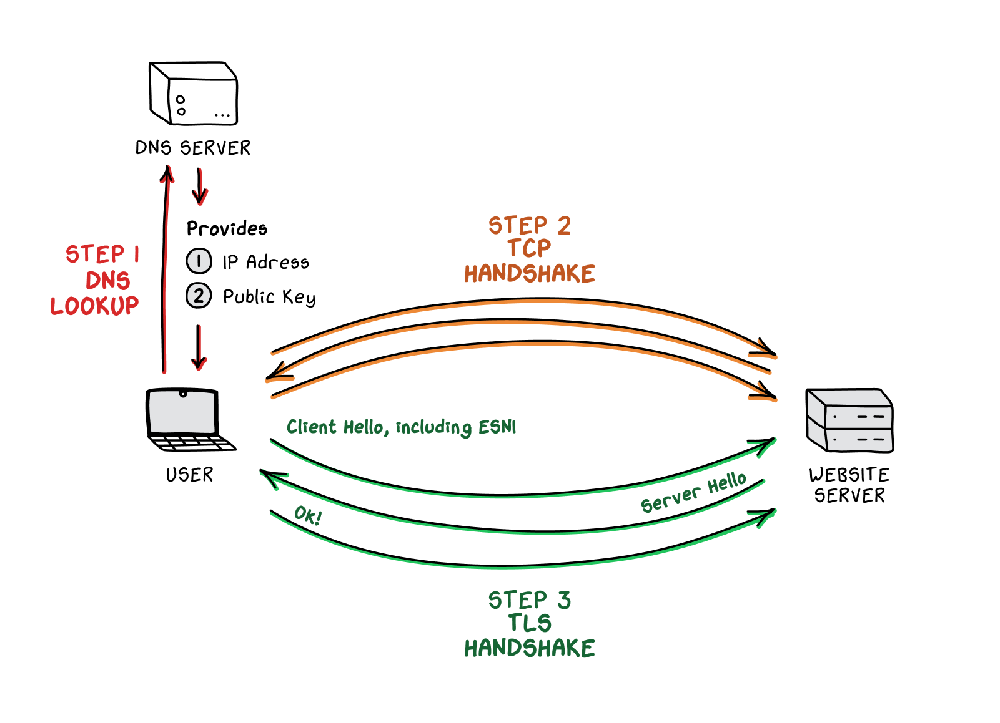

                                
This system, which was part of a newer version of TLS (Transport Layer Security, the mechanism that allows for encrypted connections), also relied on a more secure DNS lookupThe process by which a user’s computer converts human-friendly domain names into computer-friendly IP addresses. It consists of the computer sending the domain name to a DNS resolver, which searches for and returns the corresponding IP address to the user. process. DNSThe system that converts a human-friendly domain name (e.g., “catvideos.com”) into a computer-friendly IP address (e.g., “157.240.22.35”). By converting domain names into IP addresses, DNS allows routers throughout the internet to efficiently send information to the correct destination. DNS relies on <b>DNS resolvers</b> and <b>nameservers</b> to assist with this conversion. is unencrypted by default, which is why the PRC’s censorship system uses DNS filtering as one of its first lines of defense. The newer version of TLS also encrypts the DNS lookupThe process by which a user’s computer converts human-friendly domain names into computer-friendly IP addresses. It consists of the computer sending the domain name to a DNS resolver, which searches for and returns the corresponding IP address to the user.. This means that using ESNIAn encrypted version of the SNI field, allowing servers to return the proper website content to users while still keeping censors from knowing the website’s identity. As Chinese censors do not have an easy way to break the ESNI field’s encryption, they have instead blocked all ESNI traffic. helped bypass <em>both</em> DNS blocking as well as SNI blocking. With this system, Chinese authorities would have been completely unable to see the website a user was trying to visit, with no visibility into either the user’s DNS lookupThe process by which a user’s computer converts human-friendly domain names into computer-friendly IP addresses. It consists of the computer sending the domain name to a DNS resolver, which searches for and returns the corresponding IP address to the user. or into the user’s SNI field.

                                
At least, that was the state of play <a href="https://www.usenix.org/system/files/foci19-paper_chai_update.pdf" target="_blank" rel="noopener">as of 2019</a>. At that time, China had not yet begun blocking by ESNIAn encrypted version of the SNI field, allowing servers to return the proper website content to users while still keeping censors from knowing the website’s identity. As Chinese censors do not have an easy way to break the ESNI field’s encryption, they have instead blocked all ESNI traffic.. <a href="https://www.usenix.org/system/files/foci19-paper_chai_update.pdf" target="_blank" rel="noopener">Computer scientists</a> and the <a href="https://www.bamsoftware.com/sec/esni.html" target="_blank" rel="noopener">circumvention tool developers</a> noted that ESNI could be a game-changer for users looking to evade censorship and for online privacy generally. The one catch: widespread adoption of ESNI would have to take root relatively quickly, so that the sheer number of domains using it would keep the PRC from simply blocking it wholesale. Authorities would have to choose between “blocking all”—censoring any internet traffic with an encrypted SNI field, even if it caused some economic pain—or “blocking none”—letting through ESNI traffic even if they didn’t know where it was going. As one group of authors phrased it, “the fate of ESNI deeply depends on whether any censorship action is taken against it before it becomes an essential part of the internet.”

                                
But, by <a href="https://github.com/net4people/bbs/issues/43" target="_blank" rel="noopener">mid-2020</a>, China’s censorship system had made its move against ESNIAn encrypted version of the SNI field, allowing servers to return the proper website content to users while still keeping censors from knowing the website’s identity. As Chinese censors do not have an easy way to break the ESNI field’s encryption, they have instead blocked all ESNI traffic. and it did indeed just block all ESNI traffic. Once a user sends a Client Hello containing an ESNI field, the ESNI filtering system begins dropping packets sent from the user and enforces residual censorshiphe period during which, after censors have forcibly disrupted an internet connection between two endpoints, all further connections between those two endpoints are blocked. Chinese authorities enforce residual censorship to punish users who attempt to view banned content, or simply to make users think that the website in question is unstable and not worth visiting. Residual censorship can last anywhere from a few seconds to multiple hours. for two to three minutes. The ESNI filtering system appears to be a hybrid, containing both a path-adjacent component that monitors TCP three-way handshakes and an in-pathA middlebox that sits directly on a cable transferring information between two endpoints. All internet traffic therefore also transits the middlebox before reaching its intended destination. An in-path middlebox can opt to block certain pieces of unwanted internet traffic so that they never reach their intended destination (also known as <b>dropping</b> traffic). component that drops packets once an ESNI field is detected. The inclusion of a relatively more expensive in-path component hints at how authorities felt about this new threat to China’s censorship regime.

                                
Clearly, authorities had calculated that ESNI was not yet widely enough adopted to cause too much pain (and, in fact, it never got widely deployed due to other technical issues), so in this case they’d rather over-censor than under-censor.

                                <h4 id=ech-quic-and-the-future-of-https-filtering>ECH, QUIC, and the Future of HTTPS Filtering</h4>
                                
Though most global sites didn’t end up deploying ESNIAn encrypted version of the SNI field, allowing servers to return the proper website content to users while still keeping censors from knowing the website’s identity. As Chinese censors do not have an easy way to break the ESNI field’s encryption, they have instead blocked all ESNI traffic., China’s forceful, preemptive response to it offers clues as to how it might respond to future privacy-protecting technologies. In particular, a protocol known as Encrypted Client Hello (ECH) represents the <a href="https://blog.cloudflare.com/encrypted-client-hello/" target="_blank" rel="noopener">next iteration of TLS encryption technolog</a>y. Like ESNI, ECH also does not allow censors to see the ultimate destination of internet traffic. Beijing may react similarly to <a href="https://gfw.report/publications/usenixsecurity25/en/" target="_blank" rel="noopener">ECH</a> <a href="https://www.researchgate.net/publication/368628564_Measuring_the_Adoption_of_TLS_Encrypted_Client_Hello_Extension_and_Its_Forebear_in_the_Wild" target="_blank" rel="noopener">if and when it becomes widespread enough</a> to be perceived as a threat.

                                
Yet, China’s censors have taken a different tack with another new encryption technology known as <strong>QUIC</strong> (Quick UDPA standard for delivering data online, specifying how to break data up into packets in preparation to be transmitted over the internet. Because UDP does not establish a firm connection before sending data, and does not require reassembly of data once it reaches its destination, UDP is most often used by applications that prioritize speed, such as video streaming and <b>DNS lookups</b>. Internet Connections). The QUIC protocol aims to ensure speedy packetWhat the transport layer creates when preparing data to be sent from one computer to another. When the transport layer receives data from the application layer, it divides that data into segments called packets, which can then be individually processed and routed throughout the internet. delivery, making it particularly useful for real-time communications, like video chat, or real-time location updates.

                                
As its full name suggests, QUIC uses UDP rather than TCPA standard for delivering data online, specifying how to break data up into packets in preparation to be transmitted over the internet. Because TCP ensures that each side of a connection is ready before transmitting data, and because it allows for data reassembly at the destination, TCP is most often used by applications prioritizing reliability and completeness, such as web browsing, email, and file transfers. connections. Unlike TCP connections, UDP connections do not require any sort of handshake at the beginning to verify that both parties have agreed to the connection. Instead, the QUIC protocol first sends a QUIC Initial packet, which contains an SNI field indicating the ultimate destination of the packet. The QUIC Initial packet is encrypted, but in a way that allows for a third-party observer (like a middleboxA machine that is positioned between two endpoints of online communications, often in order to read the contents of those communications as they pass back and forth.) to decrypt it.

                                
Since <a href="https://gfw.report/publications/usenixsecurity25/en/" target="_blank" rel="noopener">April 2024</a>, the Party-state has deployed in-pathA middlebox that sits directly on a cable transferring information between two endpoints. All internet traffic therefore also transits the middlebox before reaching its intended destination. An in-path middlebox can opt to block certain pieces of unwanted internet traffic so that they never reach their intended destination (also known as <b>dropping</b> traffic). middleboxes to detect, decrypt, and read QUIC Initial packets, then drop any packets with banned keywords in the SNI field. These middleboxes must be relatively expensive to maintain, given that they are both in-path and must decrypt traffic. At the same time, the QUIC middleboxes use a blocklist much larger than strictly necessary; of the more than 58,000 domains these middleboxes blocked, only about 2,300 actually supported the QUIC protocol. This suggests authorities may be trying to get ahead of QUIC’s rollout as a widespread encryption technology, anticipating additional websites that might seek to add it at a later date.

                                
However, the QUIC middleboxes are relatively vulnerable to being overrun with too much traffic, as <a href="https://gfw.report/publications/usenixsecurity25/en/" target="_blank" rel="noopener">recent computer science research shows</a>. The percentage of banned QUIC connections successfully blocked by the middleboxes hovers near 50 percent or more in the middle of the night, when internet traffic is light. But during the day, when internet usage is much higher, the vast majority of banned QUIC packets are able to pass unimpeded. In addition to this limited processing capacity, research has revealed additional flaws in the QUIC middleboxes that make them relatively easy to bypass for the time being. Given past precedent, some of these flaws may remain in place for years, depending on the effort required to fix them and the urgency Beijing accords them.

                                
ESNIAn encrypted version of the SNI field, allowing servers to return the proper website content to users while still keeping censors from knowing the website’s identity. As Chinese censors do not have an easy way to break the ESNI field’s encryption, they have instead blocked all ESNI traffic. and QUIC represent the two main paths the Party-state can take to handle a new encryption technology: block it wholesale, or attempt to block only specific packets and risk missing some of them. The former is cheaper in the short term—and may be Beijing’s only real option if it can’t defeat the encryption—but it comes with potentially large costs in terms of global interconnectedness should the technology become widely used. The latter is much more expensive in the short term, but if it can be tweaked to successfully block enough traffic, it doesn’t cause the same sort of collateral damage.

