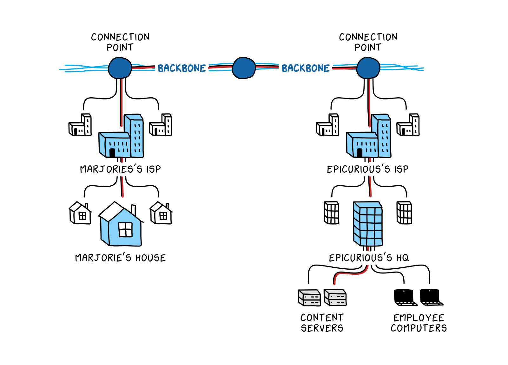
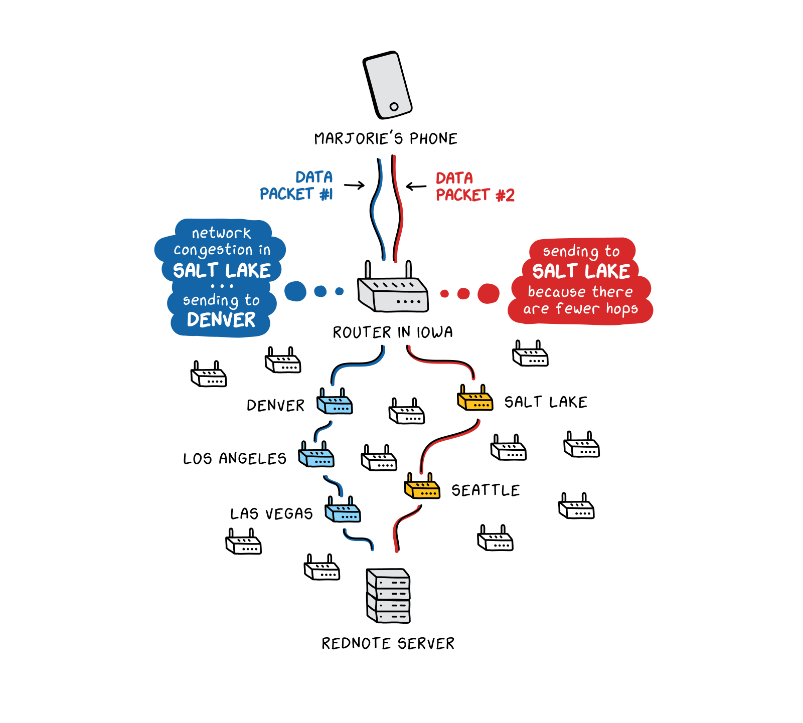
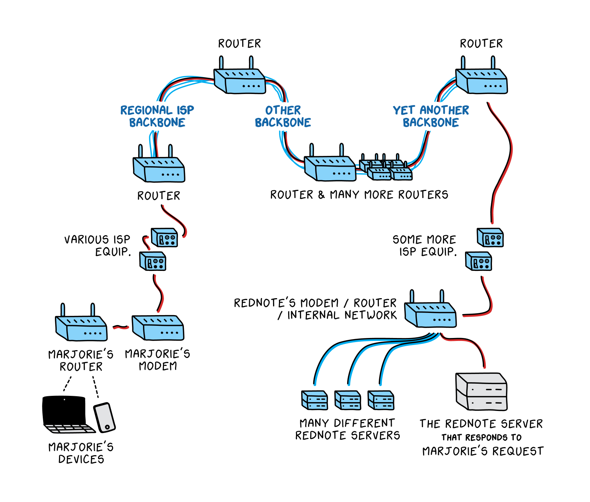
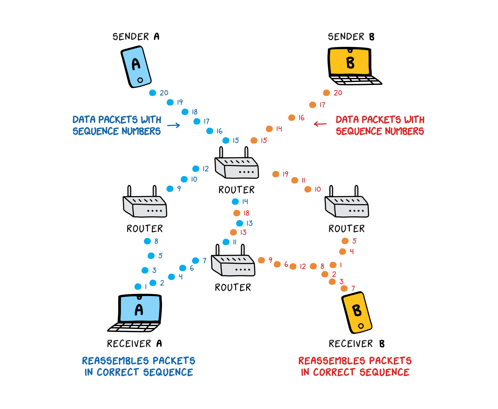
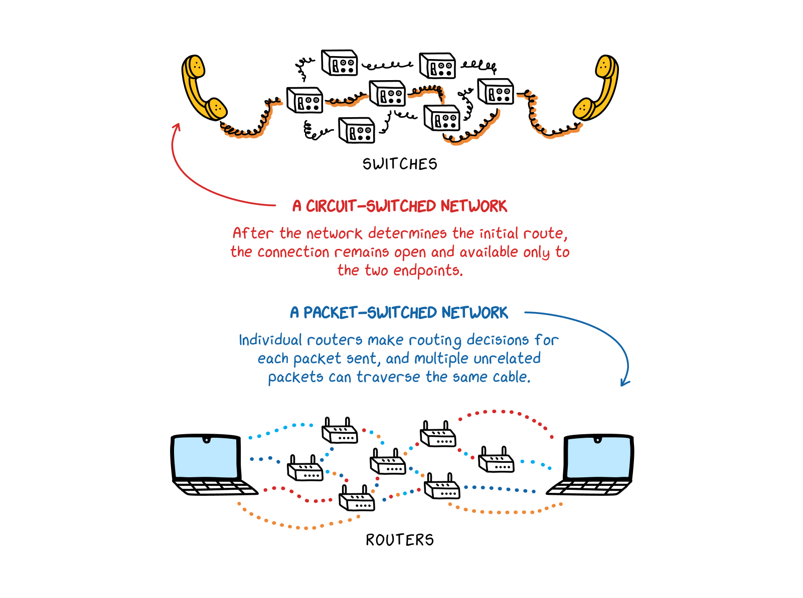
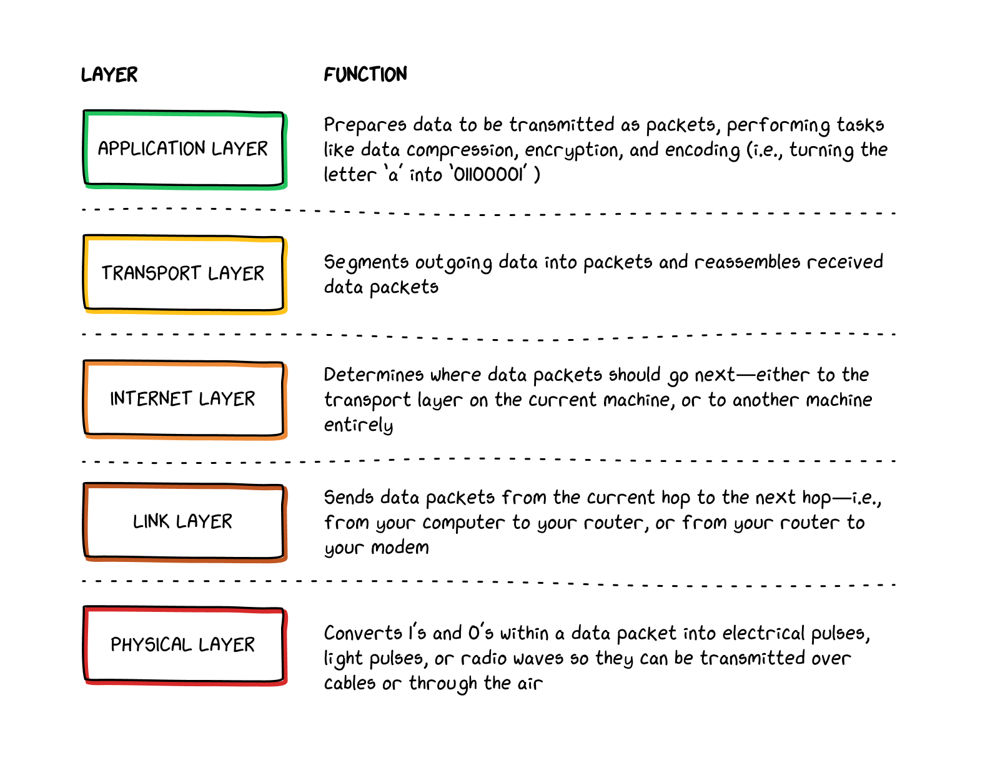
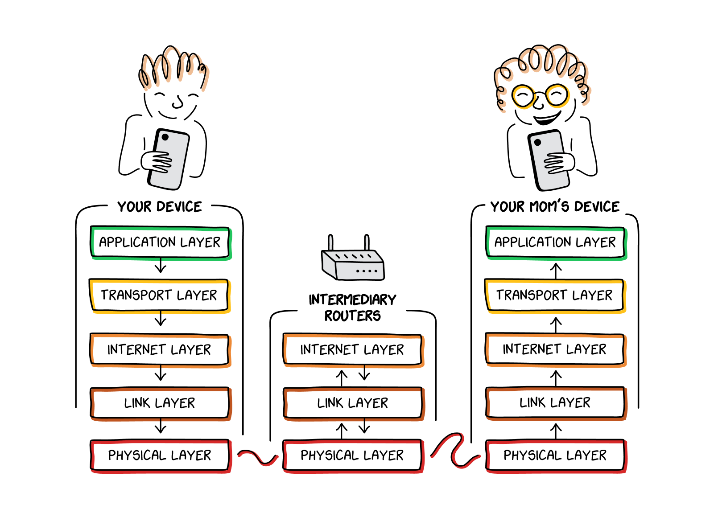
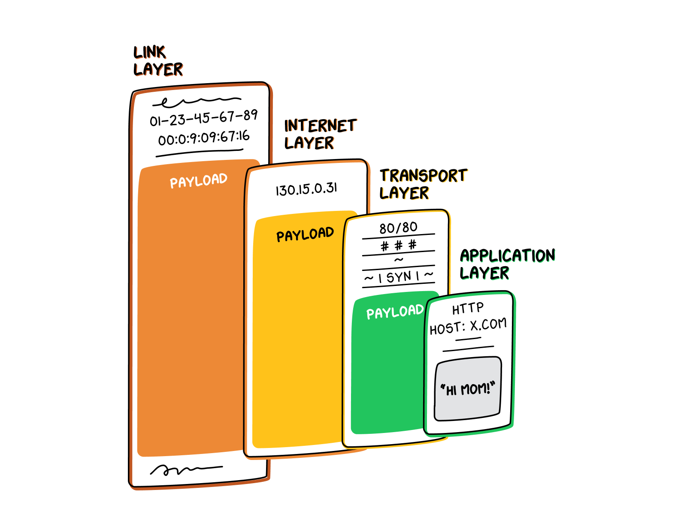

**By Jessica Batke and Laura Edelson**

**This is part of “The Locknet,” originally published on [ChinaFile](https://locknet.chinafile.com/additional-materials/the-mechanics-of-online-censorship/internet-101/).**

<h2 id=what-even-is-the-internet>What Even Is the Internet?</h2>
                                
The internet is not one thing, but rather a “network of networks.” A personal computer in Iowa, for example, does not have a single, dedicated wire physically connecting it to the recipe website Epicurious. Nevertheless, an Iowan (let’s call her Marjorie) can get all the recipes she wants simply by pointing her web browser to epicurious.com.

                                
A <strong>network</strong> is <a href="https://www.cloudflare.com/learning/network-layer/how-does-the-internet-work/" target="_blank" rel="noopener">a group of connected computers that are able to send data to one another</a>. Marjorie’s request to fetch data from epicurious.com first travels through her immediate network. In Marjorie’s case, this means it goes from her computer to the modem in her home, which then <a href="https://web.stanford.edu/class/msande91si/www-spr04/readings/week1/InternetWhitepaper.htm#:~:text=After%20your%20packets%20traverse%20the,the%20ISP%20buys%20bandwidth%20from." target="_blank" rel="noopener">relays</a> the request to equipment run by her <strong>Internet Service Provider</strong>, or ISP. (An ISP is an organization that connects users’ home devices to the rest of the internet. Most home users pay a monthly bill to their ISP for internet service. An ISP is often a company, but can sometimes be another type of organization, like a university.)

                                
Of course, Marjorie’s small, local ISP in Iowa doesn’t maintain a wire that directly connects to Epicurious’s servers, either. (A <strong>server</strong> is simply a computer that “serves up” requested content. All the online news articles you read and cat videos you watch come to you from a server that <strong>hosts</strong> that content.) Therefore, Marjorie’s request gets passed along to an <a href="https://www.pcmag.com/encyclopedia/term/internet-backbone" target="_blank" rel="noopener">internet backbone</a>—one of the high-speed links designed to carry what is commonly referred to as <strong>internet traffic</strong> across longer distances. A large ISP like Verizon might manage its own backbone, while a smaller ISP like Marjorie’s in Iowa may pay for the right to use Verizon’s backbone.

                                
From there, the request will continue to jump from backbone to backbone (as Verizon <em>also</em> does not have a dedicated line that goes to Epicurious’s servers) until it reaches the network that Epicurious is on. The request will then make its way through that network until it reaches the server (or one of the many servers) that hosts epicurious.com. Then, the process happens in reverse: Data from the epicurious.com homepage gets sent back to Iowa, making its way across networks, and backbones, and more networks, until Marjorie can read the banana bread recipe she was looking for. Even though this process requires traversing several different networks and hundreds of miles—perhaps from a data center in New Jersey to Marjorie’s home in Dubuque, Iowa—the data packetsWhat the transport layer creates when preparing data to be sent from one computer to another. When the transport layer receives data from the application layer, it divides that data into segments called packets, which can then be individually processed and routed throughout the internet. generally make the round trip in less than a second. (Just think about how long it usually takes you to load a recipe when you visit a cooking site.)

                                

                                
In the era of the smartphone, WiFi, bluetooth, and “the cloud,” it can be easy to forget that all data doesn’t just magically transmit itself through the air from one device to another. In fact, the “network of networks” requires a very tangible physical infrastructure. For our recipe fanatic Marjorie, this includes the integrated circuits in her personal computer, as well as the cables that connect her home to her ISPAn organization that provides users access to the internet, in addition to other related services, such as maintaining <b>DNS resolvers</b>. An ISP may be privately or publicly owned. In many countries, including China and the U.S., ISPs are required to share certain information with law enforcement agencies. and to the backboneA high-speed cable, or set of cables, designed to carry internet traffic across longer distances. A home internet user does not connect directly into an internet backbone; rather, backbones generally run between large hubs of internet traffic, such as between two major ISPs’ networks.. If she wants to watch a cooking tutorial on RedNote, a video-sharing site hosted in China, it also includes the hefty undersea communications cables running along the ocean floor that have to withstand <a href="https://www.csis.org/analysis/red-sea-cable-damage-reveals-soft-underbelly-global-economy" target="_blank" rel="noopener">sinking ships</a>, <a href="https://archive.ph/gLodT" target="_blank" rel="noopener">shark bites</a>, and, sometimes, good old-fashioned <a href="https://carnegieendowment.org/emissary/2024/12/baltic-sea-internet-cable-cut-europe-nato-security?lang=en" target="_blank" rel="noopener">sabotage</a>. If Marjorie is reading recipes on her phone while she’s out and about, the tiny radio in her device sends and receives data as an electromagnetic radio wave to a nearby cell tower. At that point the process is the same—the cell tower passes on the data via the same networks and cables her computer would use.

                                
But the internet is not just a series of cables. At every connection point within and between networks, additional equipment helps direct data to its proper destination. Routers—essentially just a bigger version of the internet router you have in your home—do exactly this: They forward data packetsWhat the transport layer creates when preparing data to be sent from one computer to another. When the transport layer receives data from the application layer, it divides that data into segments called packets, which can then be individually processed and routed throughout the internet. <a href="https://www.ciscopress.com/articles/article.asp?p=2180208&seqNum=9" target="_blank" rel="noopener">along the best route</a> to the intended destination. This could mean that the router selects the path requiring the fewest <strong>hops</strong> (instances the data has to go through additional routers), or the path that appears the fastest and most reliable at that moment. Data sent from a serverA computer that “serves up” requested content. Most online information is stored (or hosted) on a server. When a user visits a website, it is a server that actually sends back the website content to the user. Servers exist for many different purposes. Major social media companies have many of them in order to provide content to users quickly. in Beijing to a computer in Iowa might go through dozens of routers, with each one making its own determination on how best to forward the data. Routers at the edge of a network—say, where Comcast’s network touches Verizon’s, where they must communicate to pass information to each other—use a specific mechanism, the <strong>Border Gateway Protocol</strong> (BGPThe set of rules governing how one router at the edge of a network communicates with a router in a neighboring network. This allows the routers to provide and receive information about the status of each others’ networks, such as what paths are available in the neighboring network. This helps them decide what paths they might use to transmit packets.), to provide and receive information about each others’ networks. Information shared via the BGPThe set of rules governing how one router at the edge of a network communicates with a router in a neighboring network. This allows the routers to provide and receive information about the status of each others’ networks, such as what paths are available in the neighboring network. This helps them decide what paths they might use to transmit packets. allows routers to know what paths are available in the neighboring network and helps them decide which paths are most efficient for transmitting packets.

                                
These decisions can result in data taking very different paths to reach the same destination in different instances. If Marjorie visits the RedNote website, her initial request for the RedNote homepage might traverse routers in Las Vegas and Los Angeles. But if there is network congestion or other disruptions on that route, her next request might travel through Salt Lake City and Seattle.

                                

                                
The nature of this system—diffuse, with many points of connection between many different networks, and with the ability to quickly divert traffic through different paths—explains why the internet is so resilient. A power outage in one geographic area does not have to disrupt the internet in another, because routers direct internet traffic around the affected area. It also means that, in many countries, no one government or company controls all the physical infrastructure carrying data from one computer to another. Data gets routed along the best available path at any given time, which can entail passing through equipment belonging to many different companies, universities, governments, or other entities.

                                

                                
Of course, in certain places, direct or indirect government control over the physical infrastructure can drastically alter this picture.

                                
There are <a href="https://archive.ph/k5pT7" target="_blank" rel="noopener">nearly 3,000</a> ISPsOrganizations that provide users access to the internet, in addition to other related services, such as maintaining <b>DNS resolvers</b>. An ISP may be privately or publicly owned. In many countries, including China and the U.S., ISPs are required to share certain information with law enforcement agencies. in the United States, the largest 200 of which serve a million or more people. In China, by contrast, the <a href="https://archive.ph/eWZuF" target="_blank" rel="noopener">vast majority</a> of domestic internet traffic flows through infrastructure owned by only <a href="https://archive.ph/NdvJK" target="_blank" rel="noopener">three major companies</a>, all of which are <a href="https://archive.ph/JK2ad" target="_blank" rel="noopener">state-owned</a>. This has implications not only for resiliency, since fewer networks means that there are fewer options for re-routing if something goes wrong, but also for ease of censorship. If there are only a few entities that manage domestic internet infrastructure, and the government has direct or indirect control over all of them, it can efficiently install (or force the installation of) monitoring equipment on those networks.

                                
The same handful of companies control China’s international gateways, or points at which data enters or leaves the country. Especially considering the size of its population, China has <a href="https://web.archive.org/web/20190719053729/http://www.caict.ac.cn/english/yjcg/bps/201808/P020180829385778461678.pdf" target="_blank" rel="noopener">relatively few</a> such gateways—10 submarine cables, as of 2018, compared with Japan’s 23, Singapore’s 24, or the United States’ 80. For the few state-owned enterprises controlling these international gateways, it is reasonably easy, without fear of market competition, to slow, or <strong>throttle</strong>, international internet traffic at the gateways. Indeed, it appears that international traffic <a href="https://jhalderm.com/pub/papers/slowdown-sigmetrics20.pdf" target="_blank" rel="noopener">regularly</a> gets throttled at the gateways, for a host of potential reasons: for censorship purposes (to allow more time for censorship equipment to inspect incoming traffic); to pressure international businesses to pay more for faster loading times; to encourage those international businesses to move their serversComputers that “serve up” requested content. Most online information is stored (or hosted) on a server. When a user visits a website, it is a server that actually sends back the website content to the user. Servers exist for many different purposes. Major social media companies have many of them in order to provide content to users quickly. inside China; or simply to assist the growth of domestic businesses at the expense of foreign ones.

                                
Because there are a limited number of international gateways and entities controlling them, Chinese authorities would have a straightforward way to stop data flowing across their national borders, should they so choose: they would simply order the companies managing the international gateways to shut them down. This would mean that no traffic could flow across the national border, limiting citizens to just sites and services hosted within the mainland.

                                <h2 id=how-do-you-send-data-across-the-internet>How Do You Send Data Across the Internet?</h2>
                                
But what does it mean to send data through this system? How does typing a website address into a browser window create data, and how does that data actually flow through cables and routersA router is a computer and networking device that guides and directs data, in small chunks called <b>data packets</b>, between computer networks. In addition to other functions, routers ensure packets are sent to their correct destination, or IP address, via the best available route. to its destination? The answer lies in the notion of <strong>packet switching</strong>.

                                
The internet is a <a href="https://www.britannica.com/technology/packet-switched-network" target="_blank" rel="noopener"><strong>packet-switched network</strong></a>. In this type of network, data can be broken up into tiny pieces, or <strong>packets</strong>, that can be sent across different routes to their final destination, where, if needed, the recipient machine can reassemble them in the correct order. This means that packets from multiple senders, going to multiple destinations, can travel along the same physical infrastructure together, as they will eventually be separated back out by routers and sent to their intended addresses.

                                

                                
This process contrasts with traditional wired telephone networks, which were <a href="https://www.britannica.com/technology/packet-switched-network" target="_blank" rel="noopener"><strong>circuit-switched networks</strong></a>. In a circuit-switched network, information—like the sound of someone’s voice, transferred as electrical impulses down a conductive cable—is sent in order, and on just one route. The circuit must be kept open and dedicated to just that one stream of data. Though data is less likely to go missing on a circuit-switched network (because data travels down just one temporarily-dedicated line), and doesn’t require much processing power (as no data has to be reassembled once it reaches its destination), these networks aren’t quick, flexible, or efficient enough to support the wide range of data and applications that we think of as the modern internet.

                                

                                
Let’s say you want to read an article on <em>The Sydney Morning Herald</em> website. When you click on a link to go to the <em>Herald</em>’s homepage, the information on that homepage does not get transmitted to your device all at once. Instead, the information, including the text of the article and the website banner at the top of the page, along with any ads, get divided up into little chunks—the packetsWhat the transport layer creates when preparing data to be sent from one computer to another. When the transport layer receives data from the application layer, it divides that data into segments called packets, which can then be individually processed and routed throughout the internet.. One packet might contain a few sentences of the article. Another might contain information about the color scheme and overall styling of the page.

                                
Each of these packets also has a <strong>header</strong>, which contains information such as the source of the packet and its destination. You can think of packets as letters or parcels sent in the mail—the header functions as the address written on the front of the envelope, while the <strong>data payload</strong> is what’s inside. Once multiple packets reach their destination—that is, <em>The Sydney Morning Herald</em> article packets arrive at your computer—the receiving machine reassembles them in the correct order according to their sequence numbers, which are contained in the packet headers.

                                

                                <h2 id=ip-addresses-and-the-domain-name-system-how-do-routers-know-where-to-send-data>IP Addresses and the Domain Name System: How Do Routers Know Where to Send Data?</h2>
                                
RoutersA router is a computer and networking device that guides and directs data, in small chunks called <b>data packets</b>, between computer networks. In addition to other functions, routers ensure packets are sent to their correct destination, or IP address, via the best available route. use the packet headers to determine where to send the packetWhat the transport layer creates when preparing data to be sent from one computer to another. When the transport layer receives data from the application layer, it divides that data into segments called packets, which can then be individually processed and routed throughout the internet. next. The destination address in the header comes in the form of an IP address. For much of the internet’s history, IP addresses have looked something like <em>104.18.204.43</em>: a set of four numbers, each with one to three digits, separated by periods. This format is mandated by Internet Protocol Version 4 (IPv4), which is essentially the set of rules, or protocols, that guides how routers and other equipment manage packet-switchingThe process whereby data is broken down into small chunks called <b>data packets,</b> which are then independently routed via the most efficient pathway to their destination, where the packets are then reassembled.. Like many other aspects of the internet’s functioning, IPThe set of rules, developed over time and with the input of many different international organizations and individuals, that guides how packets of data travel across networks and that allows the many different networks that make up the internet to be interoperable. Internet Protocol Version 4 (IPv4) and Internet Protocol Version 6 (IPv6) are both currently in use on the internet. protocols and addresses are broadly overseen by an <a href="https://archive.ph/jAxSj" target="_blank" rel="noopener">international organization</a> with a mandate to ensure global coordination. Crucially, this coordination allows the many different networks that make up the internet to talk to each other.

                                
You can think of an IP address as the inverse of an address written on a piece of American mail. On a U.S. envelope, an address starts out very specific and gets more general (the addressee’s name comes first, then their street address, then their city, state, and country, as in: “Marjorie Smith, 123 Main Street, Dubuque, Iowa, USA”). IP addresses, like addresses written on envelopes in China, start from the general and move to the specific. The first two numbers in an IP address indicate what network you are on, the third indicates what <em>part</em> of that network you are on, and the fourth identifies the device you’re using—often not your computer itself, but rather the modem in your home or school or office. Your ISPAn organization that provides users access to the internet, in addition to other related services, such as maintaining <b>DNS resolvers</b>. An ISP may be privately or publicly owned. In many countries, including China and the U.S., ISPs are required to share certain information with law enforcement agencies. assigns the specific IP address for your modem. (Though the IPv4 address format allows for about 4 billion unique IP addresses, this isn’t enough to keep up with the current pace of growth. Therefore, as part of a transition from IPv4 to an updated IPv6, IP addresses are becoming longer and more complex, represented by both numbers and letters.)

                                
But how does the data packet header come up with an IP address in the first place? If you want to read an article on <em>The Sydney Morning Herald</em>, you do not type “151.101.2.133” (one of *The Sydney Morning Herald’*s actual IP addresses) into your browser’s address bar. Instead, you type “smh.com.au.” How does “smh.com.au” become “151.101.2.133”?

                                
The <a href="https://www.cloudflare.com/learning/dns/what-is-a-dns-server/" target="_blank" rel="noopener">Domain Name System</a> (DNS) translates “smh.com.au” (a domain name) into “151.101.2.133” (an IP address). When you type “smh.com.au,” that request gets sent off to a DNS resolver, which is simply a machine that looks up the correct IP address for you. Anyone can operate a DNS resolverA server that is the first stop in the DNS lookup process. It receives a domain name from a user and then queries a nameserver to find the corresponding IP address, which it then sends back to the user. DNS resolvers are often run by <b>internet service providers (ISPs)</b>., but usually you’re connecting to a DNS resolver run by your ISPAn organization that provides users access to the internet, in addition to other related services, such as maintaining <b>DNS resolvers</b>. An ISP may be privately or publicly owned. In many countries, including China and the U.S., ISPs are required to share certain information with law enforcement agencies.. There are also hundreds of <strong>nameservers</strong> scattered around the world, holding information linking domain names with IP addresses. The DNS resolverA server that is the first stop in the DNS lookup process. It receives a domain name from a user and then queries a nameserver to find the corresponding IP address, which it then sends back to the user. DNS resolvers are often run by <b>internet service providers (ISPs)</b>. checks the information on these nameservers and returns to your machine the correct IP address for the website you want to visit. That IP address then gets written onto the data packet headers as the destination address.

                                
(If you’re now asking yourself, “But how does my computer know the IP address for the <em>DNS resolver</em>? If the DNS resolverA server that is the first stop in the DNS lookup process. It receives a domain name from a user and then queries a nameserver to find the corresponding IP address, which it then sends back to the user. DNS resolvers are often run by <b>internet service providers (ISPs)</b>. is where I look up IP addresses, but I need an IP address to reach the DNS resolver…” This is the right question to be asking. Your computer has already saved the IP address for a nearby DNS resolver—this is part of the behind-the-scenes process when your ISPAn organization that provides users access to the internet, in addition to other related services, such as maintaining <b>DNS resolvers</b>. An ISP may be privately or publicly owned. In many countries, including China and the U.S., ISPs are required to share certain information with law enforcement agencies. assigns you an IP address. Like so much else, your internet provider takes care of this for you without you even knowing it happened.)

                                
Essentially, DNSThe system that converts a human-friendly domain name (e.g., “catvideos.com”) into a computer-friendly IP address (e.g., “157.240.22.35”). By converting domain names into IP addresses, DNS allows routers throughout the internet to efficiently send information to the correct destination. DNS relies on <b>DNS resolvers</b> and <b>nameservers</b> to assist with this conversion. functions like the contact list in your smartphone. Rarely do you punch in someone’s phone number directly when making a call. Instead, you look up the person’s name in your contact list. Your phone then associates that person’s name with the proper phone number, and calls that number for you—without you having to see or remember the person’s phone number at all.

                                <h2 id=intro-to-the-stack-how-does-all-of-this-come-together>Intro to the Stack: How Does All of This Come Together?</h2>
                                
How do these disparate systems and protocols—the physical infrastructure, the IP addressA series of characters that identifies a computer or server using the IP system to communicate over the internet. Internet Protocol Version 4 (IPv4) addresses are composed of a set of four numbers, each with one to three digits, separated by periods (for example, <b>104.18.204.43</b>). Internet Protocol Version 6 (IPv6) addresses are longer and can also include letters (such as <b>1050:0:0:0:5:600:300c:326b</b>). system, data packetsWhat the transport layer creates when preparing data to be sent from one computer to another. When the transport layer receives data from the application layer, it divides that data into segments called packets, which can then be individually processed and routed throughout the internet., and DNSThe system that converts a human-friendly domain name (e.g., “catvideos.com”) into a computer-friendly IP address (e.g., “157.240.22.35”). By converting domain names into IP addresses, DNS allows routers throughout the internet to efficiently send information to the correct destination. DNS relies on <b>DNS resolvers</b> and <b>nameservers</b> to assist with this conversion.—all work together? How do these different pieces know what to do and when to do it?

                                
Computer scientists refer to the relationship among these elements as a <strong>network stack</strong>. The network stack is an abstraction, a way to visualize how different parts of the online communication process interact. As such, it can be represented in several different ways. The table below contains elements from both of the <a href="https://en.wikipedia.org/wiki/Internet_protocol_suite#" target="_blank" rel="noopener">two</a> <a href="https://en.wikipedia.org/wiki/OSI_model" target="_blank" rel="noopener">main</a> models computer scientists often use to describe the stack.

                                

                                
Within each layer, there are a number of different protocols, or standardized procedures, that can be used to accomplish the task at hand. For instance, at the internet layerThe part of the network stack that manages flows of information across the internet. The internet layer organizes traffic and routing among multiple different nodes within and between networks, ensuring that packets reach the correct destination., IP addressesCharacters identifying computers or servers using the IP system to communicate over the internet. Internet Protocol Version 4 (IPv4) addresses are composed of a set of four numbers, each with one to three digits, separated by periods (for example, <b>104.18.204.43</b>). Internet Protocol Version 6 (IPv6) addresses are longer and can also include letters (such as <b>1050:0:0:0:5:600:300c:326b</b>). can be formatted in the IPv4 format (like 104.18.204.43) or the IPv6 format (like 2606:4700::6812:cc2b). Similarly, the transport layerThe part of the network stack that segments data into packets. Depending on the protocol in use, the transport layer may also establish a connection with another machine prior to sending packets, or reassemble received packets into the correct order. can break up packets via either TCP (Transmission Control Protocol) or UDP (User Datagram Protocol)—the two main protocols used for packet segmentation. Which of these protocols end up being used in any given situation depends on what you, the user, are trying to accomplish, as well as the nature of the resources to which you’re trying to connect. For example, does the website you’re trying to visit even have an IPv6 address (not all websites yet do)? If not, you’ll be using IPv4 to connect to the site. Are you trying to prioritize speed in your connection (as you might for a video call)? Then you’ll probably be using UDP on the transport layer. If instead you want to optimize for reliability and completeness (as you might when reading a news article), then TCP will likely be breaking up your data into packets for you. Thankfully, all of these decisions happen without your direct intervention, through your device’s operating system or the specific app you’re using.

                                
How does this work in practice? Let’s say you want to send a text to your mom using the popular messaging app WeChat. (Actual old-school SMS messages that one would send on a “dumb” phone work slightly differently, but we won’t get into that here.) WeChat (functioning at the application layerThe part of the network stack that conducts high-level data management and translation, such as character encoding, data compression, encryption/decryption, and remote file access. <b>HTTP</b> and <b>HTTPS protocols</b> function at this layer.) will take the content of your text and send it down to the transport layer. The transport layer will break your text up into packets, appending a header to each packet. These packets then go to the internet layerThe part of the network stack that manages flows of information across the internet. The internet layer organizes traffic and routing among multiple different nodes within and between networks, ensuring that packets reach the correct destination., which adds on its own headers, including the destination IP addressA series of characters that identifies a computer or server using the IP system to communicate over the internet. Internet Protocol Version 4 (IPv4) addresses are composed of a set of four numbers, each with one to three digits, separated by periods (for example, <b>104.18.204.43</b>). Internet Protocol Version 6 (IPv6) addresses are longer and can also include letters (such as <b>1050:0:0:0:5:600:300c:326b</b>).. Next, the packets move to the link layer, which transmits them to your home router or modem. Then, the packets enter the physical layerThe part of the network stack that converts digital data into electrical, radio, or optical signals, which it then transmits and receives over a physical medium such as a cable., where they become electrical or optical signals traveling over cables out into the wider world. Every time these packets reach a routerA router is a computer and networking device that guides and directs data, in small chunks called <b>data packets</b>, between computer networks. In addition to other functions, routers ensure packets are sent to their correct destination, or IP address, via the best available route., they must go back up through the link layer to the internet layer. There, the router reads their destination IP address and sends them back down through the link and physical layers and on to the next appropriate router. Finally, the text reaches your mom’s home router—or the nearest cell tower—which sends it to her phone. There, the data goes back up through all the layers of the stack, until it reaches the application layerThe part of the network stack that conducts high-level data management and translation, such as character encoding, data compression, encryption/decryption, and remote file access. <b>HTTP</b> and <b>HTTPS protocols</b> function at this layer. and your mom’s phone notifies her that she has a text (“Hi, Mom!”).

                                

                                
Each layer of the stack is only responsible for a few defined tasks and pushes any other non-relevant information up to the layer above or down to the layer below (it does not communicate directly with more distant layers). Any given layer of the stack does not need to know what the other layers are doing with the information they get. It simply receives information that allows it to play its role and passes on everything else.

                                
Every time a packetWhat the transport layer creates when preparing data to be sent from one computer to another. When the transport layer receives data from the application layer, it divides that data into segments called packets, which can then be individually processed and routed throughout the internet. moves through the stack, one of two things can happen, depending on which direction the packet is moving in. If the packet is being <em>sent away</em> to another destination, each layer adds its own information to the packet and sends the newly-enlarged packet down to the next layer of the stack. If the packet is <em>coming in</em> from somewhere else and needs to be read, each layer reads the appropriate information and passes the remaining information along to the layer above.

                                
You can also think of a packet as a Russian nesting doll. Any packet that is being sent out to the internet starts as a kernel of information created at the application layerThe part of the network stack that conducts high-level data management and translation, such as character encoding, data compression, encryption/decryption, and remote file access. <b>HTTP</b> and <b>HTTPS protocols</b> function at this layer.. This kernel—the innermost Russian doll—usually contains some headers as well as the actual content being sent.

                                
This doll then makes its way to the transport layerThe part of the network stack that segments data into packets. Depending on the protocol in use, the transport layer may also establish a connection with another machine prior to sending packets, or reassemble received packets into the correct order.. The transport layer adds information, wrapping the doll in a shell of transport layer headers (which provide information about how to reassemble the packets, among other things.) At this point, if you were to look at the packet, all you would see is the shell created by the transport layer. The inner doll, provided by the application layerThe part of the network stack that conducts high-level data management and translation, such as character encoding, data compression, encryption/decryption, and remote file access. <b>HTTP</b> and <b>HTTPS protocols</b> function at this layer., remains hidden and only exists as an inscrutable payload that the transport layer is carrying inside itself. The packet appears to just consist of one bigger doll, created by the transport layer.

                                
Next, the doll heads to the internet layerThe part of the network stack that manages flows of information across the internet. The internet layer organizes traffic and routing among multiple different nodes within and between networks, ensuring that packets reach the correct destination.. Again, the internet layer adds its own shell of information, obscuring the transport layerThe part of the network stack that segments data into packets. Depending on the protocol in use, the transport layer may also establish a connection with another machine prior to sending packets, or reassemble received packets into the correct order. doll, which simply becomes an undefined payload. A similar process happens again at the link layer, after which the whole Russian nesting doll gets shipped off to the physical layerThe part of the network stack that converts digital data into electrical, radio, or optical signals, which it then transmits and receives over a physical medium such as a cable..

                                
Once the nesting dolls reach their destination, the receiving computer reverses this process, starting at the link layer. The link layer opens just the doll created by the sender’s link layer. The dolls nested inside are simply payload—meaningless to the link layer, which simply passes them on up to the internet layerThe part of the network stack that manages flows of information across the internet. The internet layer organizes traffic and routing among multiple different nodes within and between networks, ensuring that packets reach the correct destination.. Again, the internet layer opens the outermost doll and passes the inner dolls upwards. This happens again at the transport layerThe part of the network stack that segments data into packets. Depending on the protocol in use, the transport layer may also establish a connection with another machine prior to sending packets, or reassemble received packets into the correct order., which reads the transport layer headers, including packet sequence numbers (which allow for the packets to be read in the correct order). It then passes the final, innermost doll to the application layerThe part of the network stack that conducts high-level data management and translation, such as character encoding, data compression, encryption/decryption, and remote file access. <b>HTTP</b> and <b>HTTPS protocols</b> function at this layer., which reads the content. At this point, the content stops being an undifferentiated payload and becomes meaningful information for whatever program is using it.

                                

                                <h2 id=how-do-basic-design-principles-of-the-internet-function-in-china>How Do Basic Design Principles of the Internet Function in China?</h2>
                                
A number of basic network design principles underpin the structure of the modern internet. Some of these principles flow directly from the ideas and individual preferences of the individuals who first built out interconnected networks. Since then, a range of standards bodies have created and maintained the protocols that enact these principles online. These principles work together to fulfill our collective requirements for the internet—that it be robust enough to manage small errors gracefully, that it transmit information efficiently (and therefore cost-effectively), and that it be redundant enough to retain overall function even if portions of it are damaged or offline.

                                
The Chinese Party-state, however, has an additional requirement for the internet: that a censor be able to monitor and disrupt “dangerous” communication at will. This “control” requirement interacts in interesting ways with the other underlying principles of the internet. Some underlying principles incidentally support the Party-state’s information control aims, while others directly contravene them.

                                <h2 id=robustness-principle>Robustness Principle</h2>
                                
Often phrased as, “be conservative in what you send, be liberal in what you accept,” the <a href="https://queue.acm.org/detail.cfm?id=1999945" target="_blank" rel="noopener">robustness principle</a> aims to maximize interoperability between different machines and networks. It proposes that computers and services connected to the internet do their best to send out properly formatted information, while simultaneously being willing to accept less-than-perfect information from others.

                                
This principle underpins much of China’s technical censorship capacity. Many of its censorship tools rely on injecting false, or “forged,” information into a connection—and because of the robustness principle, the computers on either end of that connection will likely accept the forged information, even if it is slightly malformed or otherwise nonsensical.

                                <h2 id=end-to-end-principle>End-to-End Principle</h2>
                                
The end-to-end principle asserts data should only be <em>transmitted</em> from one endpoint to another—like from a serverA computer that “serves up” requested content. Most online information is stored (or hosted) on a server. When a user visits a website, it is a server that actually sends back the website content to the user. Servers exist for many different purposes. Major social media companies have many of them in order to provide content to users quickly. to your computer—without modifying that data at all. In other words, the network “<a href="https://archive.ph/4cxAW" target="_blank" rel="noopener">should act like a big, fat, dumb, digital pipe</a>.” This means that any more complex functions, such as encryption or error-checking, must be done at the endpoints (by the server or by your computer).

                                
The widespread adoption of this principle has shaped the development not only of the internet as a whole, but also of China’s censorship mechanisms. At the ends that the Chinese government can control, such as domestic Chinese tech companies and telecommunications infrastructure, censorship is relatively straightforward: surveillance and censorship functions get built directly into the companies’ products and services. When such control over an end is not possible—the Chinese government has no control over foreign websites, for example—China’s censors must rely on alternative methods to ensure “safe” content, often violating the end-to-end principle to do so. Rather than act as “big, fat, dumb, digital pipes,” internet networks within China are studded with machines that exist only to inspect, record, and disrupt the traffic flowing through them.

                                
The end-to-end principle thus serves as a direct threat to China’s censorship aims. In Beijing’s ideal world, the end-to-end principle wouldn’t exist. In the actual world, Beijing makes do by violating the end-to-end principle throughout the network.

