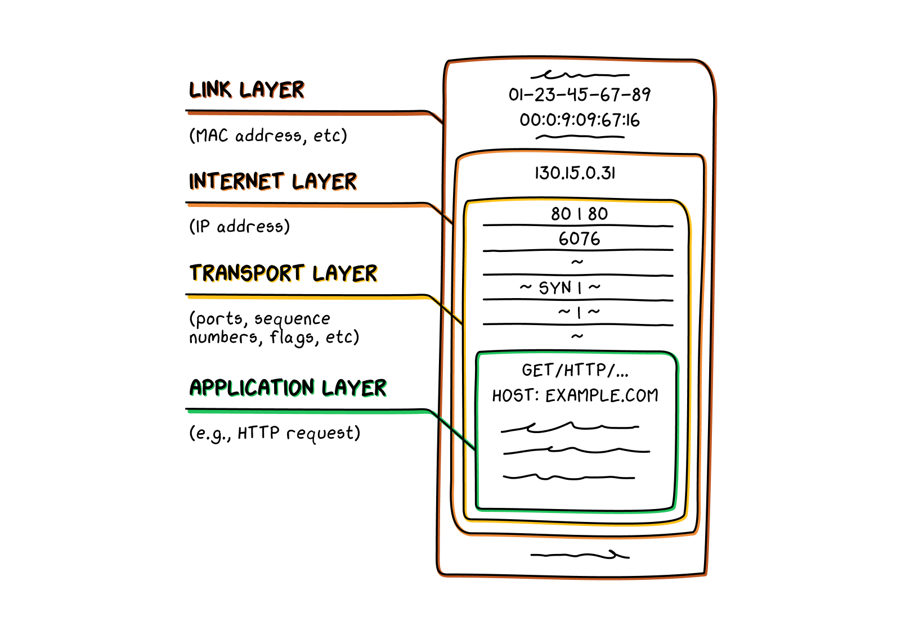
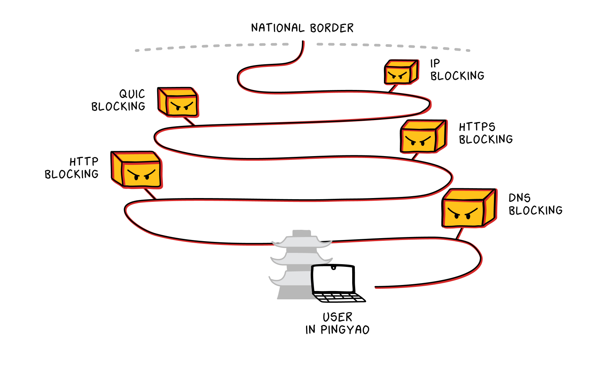

**By Jessica Batke and Laura Edelson**

**This is part of “The Locknet,” originally published on [ChinaFile](https://locknet.chinafile.com/the-locknet/part-3/).**

Beijing does not need to censor content posted online by its citizens first-hand; it has a retinue of corporate employees and <a href="https://web.archive.org/web/20150620032219/https://chinadigitaltimes.net/space/Volunteer_fifty_center" target="_blank" rel="noopener">individual nationalists</a> to police domestically-generated internet content. Thus, the censorship technology authorities control more directly targets information seeping in from outside China. These tools perform “<a href="/research&writing/Locknet_How_China_Disrupts_the_Network/#network-level-censorship">network-level censorship</a>,” inspecting data headed across the border, regardless of which app or service generated it.

                                
It’s easy to think of Beijing’s simply toggling a switch: internet on, internet off. Or, more specifically, <em>this</em> website on, <em>that</em> website off. In fact, the internet itself comprises <a href="/research&writing/Locknet_Internet_101/#what-even-is-the-internet">many different components</a>, each offering censors opportunities to disrupt or co-opt the information exchanged within that component. China’s day-to-day control mechanisms, therefore, function as more than simple on-off switches. Instead, they often hijack the internet’s normal functions and turn them against themselves.

                                
We know about many of China’s network-level censorship tools thanks to experiments conducted by researchers located outside of the mainland. (Beijing, unsurprisingly, does not openly discuss the technical means it uses to disrupt internet traffic.) But how can someone <em>outside</em> China see how the government censors traffic <em>inside</em> China? Network-level experiments work, even from abroad, because the censorship system is mostly <em>bidirectional</em>. This means that the system largely doesn’t bother to check whether internet traffic is coming from inside or outside of China—if that traffic contains banned content, the system will censor it, no matter what direction it’s headed. Researchers have taken advantage of the system’s bidirectionality to test what content is actually banned.

                                <h2 id=data-packets-the-basis-of-internet-information-exchange>Data Packets: The Basis of Internet Information Exchange</h2>
                                
The internet’s basic functions depend on packets: small chunks of information, sent one by one across the network. The conceptual basis for the entire internet depends on packets. Breaking down information—such as an email or a text message—into pieces allows the network to send those pieces individually, along whichever of the many routes makes the most sense at the moment. Is there too much internet traffic between Beijing and Shanghai? No problem, just send a packet or two along a route that avoids those places.

                                
Receiving a message over the internet is a little like getting a shipment from IKEA. But rather than sending you one parcel containing all the constituent parts for, say, a table, imagine IKEA instead sends you several separate parcels—one containing the table legs, one containing the table top, and one containing the screws needed to put them together. Each parcel looks identical on the outside, in the same size box, so no one shipping them from one place to another knows what’s inside them. The parcels arrive on different delivery trucks, with each driver getting different directions from her GPS about which route is the fastest to your home. The delivery trucks share the road with hundreds of other vehicles carrying their own parcels to different destinations. Your parcels might arrive at your home around the same time, or depending on the routes the delivery trucks took, could arrive over the course of the day. If one of the parcels goes missing, IKEA will send you a replacement. Once you receive all the parcels, you assemble them correctly to produce a table.

                                
Information transmitted over the internet <a href="/research&writing/Locknet_Internet_101/#how-do-you-send-data-across-the-internet">travels</a> essentially the same way: whenever you send information, such as an email, your computer breaks the email down into packets. The packets contain fragments of the email—a sentence or two here, part of an image there—however much will fit inside the packet. Unlike in the IKEA example, in which you’d hope your table top arrives in one piece, your computer can easily break apart sentences, images, or anything else into small parts to fit into packets. The packets also contain some additional addressing information that helps guide them through the network to their intended destination. After your computer sends out these packets, the network will respond to real-time conditions and route them individually along whichever path seems most efficient at the time. Your packets are traversing the network along with packets from many other users—just like delivery trucks on a road, many different packets can share part of the same path even if their final destinations are different. Once the receiving computer gets the packets, it can determine whether any packets are missing and, if needed, your computer can resend them. The receiving computer then reassembles them in the proper order, and the recipient can read your email.

                                
The internet, as a “packet-switched” network, represents a massive innovation over “circuit-switched” networks, like landline telephone networks. On landlines, at least historically, a dedicated circuit is established between a caller and a receiver. That circuit remains the same for the duration of the phone call, and no other callers can use it (otherwise you’d hear their voices on the line as well). This setup severely limits how much information can traverse a circuit-switched network; the number of possible circuits determines the maximum number of phone calls that can happen at any one time. In the IKEA analogy, this would be tantamount to shutting down roads to all but one delivery vehicle at a time.

                                
On the internet, by contrast, because packets can mingle along the same route, the limiting factor is the number of <em>packets</em> a cable can carry, not the number of <em>person-to-person connections</em>. Thus a packet-switched network can handle much more information much more quickly than a circuit-switched network can, allowing for all of the wonderful, terrible, and downright frivolous real-time applications humans have developed for the internet.

                                <h2 id=censorship-built-into-the-infrastructure>Censorship Built into the Infrastructure</h2>
                                
China’s control over this process begins before any packetsWhat the transport layer creates when preparing data to be sent from one computer to another. When the transport layer receives data from the application layer, it divides that data into segments called packets, which can then be individually processed and routed throughout the internet. are even sent. Someone must first lay and maintain the myriad cables and wires that carry such packets—including, crucially, the cables and equipment that straddle national borders, known as “international gateways.” In China, the handful of companies that manage these cables are themselves managed by the government. Five Internet Service Providers (ISPs), all of which are state-owned, handle China’s domestic internet traffic and administer China’s international gateways. This means that the Chinese government has indirect but very real control over the most basic physical infrastructure of the internet, allowing it to install, or mandate the installation of, monitoring equipment along those cables.

                                
The physical infrastructure also includes built-in chokepoints for international internet traffic. The People’s Republic of China (PRC) has <a href="http://www.caict.ac.cn/english/yjcg/bps/201808/P020180829385778461678.pdf" target="_blank" rel="noopener">relatively few</a> international gateways—especially as compared to other technologically developed states such as Singapore, the United States, or Japan—with just a few companies running them. One <a href="https://dl.acm.org/doi/10.1145/3314344.3332502" target="_blank" rel="noopener">study</a>, estimating the “national chokepoint potential” of various countries in 2018, found that China sat at one extreme of the spectrum: only two ISPsOrganizations that provide users access to the internet, in addition to other related services, such as maintaining <b>DNS resolvers</b>. An ISP may be privately or publicly owned. In many countries, including China and the U.S., ISPs are required to share certain information with law enforcement agencies. controlled more than 90 percent of the paths internet traffic could use to enter or exit the country.

                                <figure>
                                    

                                    <figcaption>Data courtesy of Kirtus G. Leyba, Benjamin Edwards, Cynthia Freeman, Jedidiah R. Crandall, and Stephanie Forrest, drawn from their article “<a href="https://dl.acm.org/doi/10.1145/3314344.3332502" target="_blank" rel="noopener">Borders and Gateways: Measuring and Analyzing National AS Chokepoints</a>.”</figcaption>
                                </figure>
                                
                                

                                
The “chokepoint potential” of this system offers both the government and the state-owned ISPsOrganizations that provide users access to the internet, in addition to other related services, such as maintaining <b>DNS resolvers</b>. An ISP may be privately or publicly owned. In many countries, including China and the U.S., ISPs are required to share certain information with law enforcement agencies. plenty of opportunities to slow or even stop the flow of internet traffic passing through the international gatewaysThe physical points at which data enters or leaves a country. Depending on the volume of a country’s internet traffic and the number of international gateways it has, such gateways can be bottlenecks or chokepoints, since all cross-border data must flow through them.. In 2020, several researchers showed that packets flowing into China do indeed get <a href="https://jhalderm.com/pub/papers/slowdown-sigmetrics20.pdf" target="_blank" rel="noopener">throttled</a> or even dropped at these gateways, though traffic exiting China remains unaffected. Based on their observations, the researchers argued that this slowdown was not likely the result of China’s censorship equipment (the equipment inspecting packets for banned keywords didn’t seem to be making things sluggish). Instead, the researchers posited several other potential explanations: the Chinese government might have made a policy decision to throttle incoming traffic, in order to discourage Chinese users from accessing foreign services or to make it harder for foreign companies to reach Chinese users; or the ISPsOrganizations that provide users access to the internet, in addition to other related services, such as maintaining <b>DNS resolvers</b>. An ISP may be privately or publicly owned. In many countries, including China and the U.S., ISPs are required to share certain information with law enforcement agencies. themselves may have opted to stunt international internet speeds so that foreign companies would have to pay more for a “higher tier” of service. These explanations, of course, are not mutually exclusive. Nor is the lack of outward-facing infrastructure likely an accident. Observers have long <a href="https://archive.is/A1ybU" target="_blank" rel="noopener">noted</a> that the government has “failed to build infrastructure that would allow for quicker connections overseas.” If you have ever cooled your heels while trying to access a foreign website from China, it was almost certainly the poor international infrastructure that slowed down your browsing, not censorship per se.

                                <h2 id=ip-blocking>IP Blocking</h2>
                                
The internet depends on IP (Internet ProtocolThe set of rules, developed over time and with the input of many different international organizations and individuals, that guides how packets of data travel across networks and that allows the many different networks that make up the internet to be interoperable. Internet Protocol Version 4 (IPv4) and Internet Protocol Version 6 (IPv6) are both currently in use on the internet.) addresses to know where to send information. Humans using the internet rarely see or interact with IP addresses—our machines mostly manage them behind the scenes. This is fortunate because IP addresses are not designed to be easily read or memorized by humans, consisting of strings of numbers (or both numbers and letters). Internet routing equipment, however, uses these strings of numbers to <a href="/research&writing/Locknet_Internet_101/#ip-addresses-and-the-domain-name-system-how-do-routers-know-where-to-send-data">pass along</a> information from one machine to another until it reaches the correct destination.

                                
All websites have an IP addressA series of characters that identifies a computer or server using the IP system to communicate over the internet. Internet Protocol Version 4 (IPv4) addresses are composed of a set of four numbers, each with one to three digits, separated by periods (for example, <b>104.18.204.43</b>). Internet Protocol Version 6 (IPv6) addresses are longer and can also include letters (such as <b>1050:0:0:0:5:600:300c:326b</b>)., as do devices connected to the internet. Often, one household has only one IP address—it’s the router in your home that probably has an IP address assigned to it, which all the computers and phones connected to it share. Once you move to another location, like your office, your device will be accessing the internet from a different IP address. (The highly mobile nature of our online lives—responding to emails from the airport, sending emojis while in line at the grocery store, all from different IP addresses—necessitates the use of intermediary services, like Gmail and Outlook. These services send and receive messages from a consistent online “location,” allowing the actual humans to access them no matter what their IP address happens to be at that moment.)

                                
When a computer divides information into packetsWhat the transport layer creates when preparing data to be sent from one computer to another. When the transport layer receives data from the application layer, it divides that data into segments called packets, which can then be individually processed and routed throughout the internet., it writes the IP address of the intended destination on each packet, much as one would write a street address on the outside of a parcel. As the packets flow throughout the network, machines called routers—essentially just a bigger version of the internet router you have in your home—then read the IP addresses of each packet. The millions or billions of routers deployed throughout the global internet all have one main task: to <a href="https://ipcisco.com/lesson/routing-path-determination/" target="_blank" rel="noopener">forward</a> packets along the best available path, based on the information they have about the state of the network around them.

                                
Routers are akin to post offices or carrier facilities that receive parcels in transit and forward them on to another facility closer to their destination. Each post office along the way might ship the parcel in the exact direction of the destination, if there is a post office there to receive it. Or, it might decide to ship the parcel slightly out of the way—if, say, a road had been washed out or was gridlocked during rush hour. Routers have similar information about the networks around them and dispatch packets along the best possible path at the time, avoiding any damaged or congested paths. This means that the packets from one email or text might take different paths, maybe transiting dozens of routers, before arriving at the recipient’s device.

                                
If someone in China is trying to visit a blocklisted website hosted in the United States, his computer attempts to send a packet to the website, containing something akin to “Hello! I&rsquo;d like to connect!” The packet travels from the computer, through a series of routers, each of which reads the IP addressA series of characters that identifies a computer or server using the IP system to communicate over the internet. Internet Protocol Version 4 (IPv4) addresses are composed of a set of four numbers, each with one to three digits, separated by periods (for example, <b>104.18.204.43</b>). Internet Protocol Version 6 (IPv6) addresses are longer and can also include letters (such as <b>1050:0:0:0:5:600:300c:326b</b>). on the packet and forwards it along. Because the packet is destined for the United States, it must at some point traverse an international gatewayThe physical point at which data enters or leaves a country. Depending on the volume of a country’s internet traffic and the number of international gateways it has, such gateways can be bottlenecks or chokepoints, since all cross-border data must flow through them.—a machine that provides routers information about the status of international networks—in order to leave China. And here is where the Chinese government takes an opportunity to interfere.

                                
It does this essentially by <a href="/research&writing/Locknet_How_China_Disrupts_the_Network/#ip-blocking">claiming</a> the U.S. website is inaccessible, even though that’s not actually true. The Chinese government (or a company working at its behest) has loaded <a href="https://queue.acm.org/detail.cfm?id=2405036" target="_blank" rel="noopener">false information</a> onto these international gateways, alleging IP addresses associated with “dangerous” websites or services are unreachable. When a router near the border, trying to figure out how best to route a packet to the U.S. website, asks the international gateway for information, the international gateway will tell the router that the website in question can’t be accessed. The router will then simply <a href="https://www.cloudflare.com/learning/ddos/glossary/ddos-blackhole-routing/" target="_blank" rel="noopener">give up</a>, not bothering to forward on the packet. The user in China might get an error message like “Network unreachable” or “Connection refused.” To return to the post office example, this would be like a postal worker calling the next county over to figure out the best route for a particular parcel, only for the person on the other end to inaccurately tell them the destination address no longer exists. Rather than sending the parcel back to its point of origin, the postal worker just dumps the parcel into a garbage bin.

                                
This means of online censorship is known as “IP blocking,” and China has <a href="https://ora.ox.ac.uk/objects/uuid:084840ac-b192-407b-ab6c-f8f810310369/files/m288240d9de06449ce5eb98e7ad3d0edc" target="_blank" rel="noopener">employed</a> it for nearly as long as the country has been <a href="https://library.fes.de/libalt/journals/swetsfulltext/14218789.PDF" target="_blank" rel="noopener">connected</a> to the internet. As a censorship technology, it is cheap and easy: it requires no special hardware, as authorities can simply alter the information stored on existing routers and international gatewaysThe physical points at which data enters or leaves a country. Depending on the volume of a country’s internet traffic and the number of international gateways it has, such gateways can be bottlenecks or chokepoints, since all cross-border data must flow through them..

                                
Back in the late 1990s, when there were dozens of independent ISPs <a href="https://web.archive.org/web/20160201194316/https://www.wired.com/1997/06/china-3/" target="_blank" rel="noopener">providing</a> internet access throughout China, ISPsOrganizations that provide users access to the internet, in addition to other related services, such as maintaining <b>DNS resolvers</b>. An ISP may be privately or publicly owned. In many countries, including China and the U.S., ISPs are required to share certain information with law enforcement agencies. <a href="https://www.jstor.org/stable/10.7249/mr1543.9?seq=1" target="_blank" rel="noopener">conducted</a> IP blocking throughout their own networks using their own lists of blocklisted websites, which complemented “national-level blocks” put in place by government agencies. Nowadays, the enhanced “chokepoint potential” of China’s physical internet infrastructure means that China only needs to carry out IP blocking near its <a href="https://queue.acm.org/detail.cfm?id=2405036" target="_blank" rel="noopener">national borders</a>, using one <a href="https://ensa.fi/papers/Ensafi2015a.pdf" target="_blank" rel="noopener">centralized list</a> of blocklisted sites. (The centralization of network-level censorshipCensorship conducted by equipment placed within an internet network, aimed at all traffic that transits that network. This may include machines positioned throughout an ISP’s network, or machines positioned at international gateways that are designed to handle all internet traffic passing through those gateways. contrasts with the way service-level censorshipCensorship conducted by a company or entity monitoring the censorship on its own platform or service. This can be accomplished through both manual and automated means, but it only targets the content available on the platform or service in question. is still carried out, with each company creating its own list of banned terms.)

                                
In 2019, one study determined that Chinese authorities were using IP blocking against <a href="https://www.usenix.org/system/files/foci19-paper_chai_update.pdf" target="_blank" rel="noopener">nearly 40,000</a> of the one million most popular global websites. They likely block far more than just these 40,000; many of the websites China’s Party-state wishes to <a href="https://www3.cs.stonybrook.edu/~mikepo/papers/gfweb.sec24.pdf" target="_blank" rel="noopener">block</a> are far more niche and likely <a href="https://www.usenix.org/system/files/sec21-hoang.pdf" target="_blank" rel="noopener">wouldn’t appear</a> among the web’s most visited sites. Notably, however, authorities do not block all websites this way; they have a number of additional technologies they use to block other sites—and sometimes one site can be blocked by multiple different technologies. Authorities likely use IP blocking against sites and services with relatively static IP addresses.

                                
Even though IP blocking represents an older generation of censorship technology, it’s still very much a <a href="https://www.usenix.org/system/files/foci19-paper_chai_update.pdf" target="_blank" rel="noopener">key weapon</a> in China’s online censorship arsenal. It works in tandem with an expanding set of additional blocking technologies, most of which require supplemental, specialized hardware, known as “<a href="/research&writing/Locknet_How_China_Disrupts_the_Network/">middleboxes</a>,” to identify and block internet traffic the CCP deems threatening. Like IP blocking, these technologies depend on computers throughout the network to behave according to commonly-accepted practices, which the technologies then subvert to their own ends. And, like IP blocking technologies, these middleboxes are physically located near China’s national borders, to better patrol the internet traffic entering and leaving the country.

                                <h2 id=blocking-via-middlebox>Blocking via Middlebox</h2>
                                
In the China context, middleboxes serve as little digital spies embedded in the online network. They are actual, physical pieces of hardware that inspect packetswhat the transport layer creates when preparing data to be sent from one computer to another. When the transport layer receives data from the application layer, it divides that data into segments called packets, which can then be individually processed and routed throughout the internet. and determine whether or not those packets are destined for blocklisted locations, or, sometimes, if they contain banned keywords. Middlebox technologies target websites or services that may not get caught up in the IP blockingWhen a network-level censorship system disrupts a connection based on either the destination or origin IP address written to data packet headers. dragnet—like a service that uses a wide range of frequently-changing IP addresses.

                                <blockquote class="pullquote"><b>“Packets travel so quickly, at near the speed of light, that these exchanges take seconds or even milliseconds, barely perceptible to a human user. But for computers, these milliseconds matter a great deal. Something thousands of miles away will take longer to send back a response than something just up the block. Though the internet often feels intangible and instantaneous, it runs on very real physical infrastructure, which affects how it functions—and how China is able to disrupt it.”</b></blockquote>
                                
In most cases, the government’s middleboxes don’t bother to stop an initial packet or two from flowing across the border. Instead, equipment near the border <a href="/research&writing/Locknet_How_China_Disrupts_the_Network/#in-path-vs-path-adjacent-technologies">makes copies</a> of those packets, allowing the original packets to continue on to their intended destination, and sending the copies to a middlebox. The middlebox then inspects the copies, and if it finds objectionable content, takes steps to temporarily stymie any further communication between the sender and the destination.

                                
This method may seem unnecessarily circuitous. Why shouldn’t the Chinese government simply stop the original packets from ever crossing the border and just end the whole business right there? Though there are a few cases when middleboxes <em>do</em> stop the original packets, the copy method remains much more widely used because it saves resources and money. A middlebox that has to read packets and make decisions about them in real time requires a fair amount of computing power if it wants to keep internet traffic running smoothly and quickly.

                                
Imagine a cash-strapped secret police station that wants to prevent citizens from sending letters and parcels back and forth to certain foreign “enemies.” In particular, they’re very concerned with keeping citizens from getting politically inconvenient information from the outside world. At the same time, however, the country depends on international commerce, so the secret police do not want to stop or even significantly slow down innocuous mail from flowing through the system. If the secret police hoped to review all the mail headed across the border in real time, they would need to hire many additional officers, particularly during busy hours of the day, when the volume of mail could easily overwhelm a small workforce. This would allow them to immediately throw out any parcels they found concerning, but it would cost much more in salaries and office space.

                                
The analogy breaks down a bit here, but if we can permit the use of a little magic, it can still help explain how the copying mechanism works. Let’s assume the secret police have a cheap, fast way to copy all of the mail flowing through the system, and one that doesn’t require hiring a bunch of additional officers. (Perhaps they have a <a href="https://en.wikipedia.org/wiki/The_Sorcerer%27s_Apprentice" target="_blank" rel="noopener">sorcerer’s apprentice</a> on staff, who, upon enchanting individual parcels, can then split them in half and thereby create a second version of each parcel.) The secret police could then allow the original mail to continue unimpeded across the border, while sending all the copies for inspection and review. The mail reviewers would still work quickly, but they would have the benefit of a little extra time—they would know the original parcel still has to travel all the way to its foreign destination, whereby the recipient would have to compose and send a reply, which would then have to make its way back across the border, all before any citizen could conceivably get their hands on it. This gives the secret police enough time to spring into action and take whatever steps they so choose to prevent further communications between these two individuals.

                                
The effectiveness of this method lies in the physical location of the middleboxesMachines that are positioned between two endpoints of online communications, often in order to read the contents of those communications as they pass back and forth.. Positioned near, but inside, China’s national borders, they are physically closer to any given user in China than a machine situated on foreign soil. Thus, these middleboxes don’t need to stop the initial packetsWhat the transport layer creates when preparing data to be sent from one computer to another. When the transport layer receives data from the application layer, it divides that data into segments called packets, which can then be individually processed and routed throughout the internet. from leaving the country; they will have the advantage of proximity when they do decide to take action, allowing them to win the race against any real response that might come from abroad. Packets travel so quickly, at near the speed of light, that these exchanges take seconds or even milliseconds, barely perceptible to a human user. But for computers, these milliseconds matter a great deal. Something thousands of miles away will take longer to send back a response than something just up the block. Though the internet often feels intangible and instantaneous, it runs on very real physical infrastructure, which affects how it functions—and how China is able to disrupt it.

                                <h3 id=dns-blocking>DNS Blocking</h3>
                                
MiddleboxesMachines that are positioned between two endpoints of online communications, often in order to read the contents of those communications as they pass back and forth. can interrupt Chinese citizens’ internet communications in a number of different ways. One of the simplest involves tampering with the Domain Name System (DNS). <a href="/research&writing/Locknet_How_China_Disrupts_the_Network/#dns-based-censorship">DNS</a> is essentially a translation service: when you type a human-friendly domain name (such as “nytimes.com”) into your browser, DNS converts it into a computer-friendly IP addressA series of characters that identifies a computer or server using the IP system to communicate over the internet. Internet Protocol Version 4 (IPv4) addresses are composed of a set of four numbers, each with one to three digits, separated by periods (for example, <b>104.18.204.43</b>). Internet Protocol Version 6 (IPv6) addresses are longer and can also include letters (such as <b>1050:0:0:0:5:600:300c:326b</b>). (like “151.101.65.164”), which, as we’ve seen, the network then uses to route information to the correct destination. DNS works a lot like the contact list in your smartphone. Rarely do you punch in someone’s phone number directly in order to make a call. Instead, you look up the person’s name in your contact list. Your phone then associates that person’s name with the proper phone number, and calls that number for you—without your having to see or remember the person’s phone number at all.

                                
Let’s say that Xiaofang in Shanghai wants to visit a blocklisted website in the United States. When she types the domain name into her browser (“nytimes.com”), her computer sends out a packetWhat the transport layer creates when preparing data to be sent from one computer to another. When the transport layer receives data from the application layer, it divides that data into segments called packets, which can then be individually processed and routed throughout the internet. to a nearby DNS resolver—a machine whose job is to look up and temporarily store IP addresses—also located in Shanghai. The packet tells the DNS resolverA server that is the first stop in the DNS lookup process. It receives a domain name from a user and then queries a nameserver to find the corresponding IP address, which it then sends back to the user. DNS resolvers are often run by <b>internet service providers (ISPs)</b>. which website Xiaofang is trying to visit, requesting that the resolver send back the matching IP address to Xiaofang. The resolver then queries other machines throughout the DNSThe system that converts a human-friendly domain name (e.g., “catvideos.com”) into a computer-friendly IP address (e.g., “157.240.22.35”). By converting domain names into IP addresses, DNS allows routers throughout the internet to efficiently send information to the correct destination. DNS relies on <b>DNS resolvers</b> and <b>nameservers</b> to assist with this conversion. system (sending out packets like Xiaofang’s, seeking a matching IP address) until it finds one that has the relevant information. Because <em>The New York Times</em> is based in the United States, the machine with this information will likely be located outside of China—meaning that, at some point, the DNS resolverA server that is the first stop in the DNS lookup process. It receives a domain name from a user and then queries a nameserver to find the corresponding IP address, which it then sends back to the user. DNS resolvers are often run by <b>internet service providers (ISPs)</b>. will have to send packets over the national border, where they will be copied and inspected by a middleboxA machine that is positioned between two endpoints of online communications, often in order to read the contents of those communications as they pass back and forth..

                                
The middlebox will see the requested domain name and compare it to a blocklist of banned domain names. Finding “nytimes.com” is on the blocklist (we’re assuming for the sake of this example that <em>The New York Times</em> is blocked by DNSThe system that converts a human-friendly domain name (e.g., “catvideos.com”) into a computer-friendly IP address (e.g., “157.240.22.35”). By converting domain names into IP addresses, DNS allows routers throughout the internet to efficiently send information to the correct destination. DNS relies on <b>DNS resolvers</b> and <b>nameservers</b> to assist with this conversion. rather than by some other method), the middlebox will send its own packet back to the DNS resolverA server that is the first stop in the DNS lookup process. It receives a domain name from a user and then queries a nameserver to find the corresponding IP address, which it then sends back to the user. DNS resolvers are often run by <b>internet service providers (ISPs)</b>.. That packet will contain a spurious IP addressA series of characters that identifies a computer or server using the IP system to communicate over the internet. Internet Protocol Version 4 (IPv4) addresses are composed of a set of four numbers, each with one to three digits, separated by periods (for example, <b>104.18.204.43</b>). Internet Protocol Version 6 (IPv6) addresses are longer and can also include letters (such as <b>1050:0:0:0:5:600:300c:326b</b>).—that is, an IP address that points somewhere other than “nytimes.com.” The DNS resolverA server that is the first stop in the DNS lookup process. It receives a domain name from a user and then queries a nameserver to find the corresponding IP address, which it then sends back to the user. DNS resolvers are often run by <b>internet service providers (ISPs)</b>. in turn passes this spurious IP address to Xiaofang, who ultimately gets <a href="/research&writing/Locknet_How_China_Disrupts_the_Network/#dns-injection">sent to</a> a defunct website or receives an error message.

                                
This method works, even though Xiaofang’s DNS request likely did generate a real answer from <em>The New York Times</em>’ serverA computer that “serves up” requested content. Most online information is stored (or hosted) on a server. When a user visits a website, it is a server that actually sends back the website content to the user. Servers exist for many different purposes. Major social media companies have many of them in order to provide content to users quickly., because the middlebox is closer to the DNS resolverA server that is the first stop in the DNS lookup process. It receives a domain name from a user and then queries a nameserver to find the corresponding IP address, which it then sends back to the user. DNS resolvers are often run by <b>internet service providers (ISPs)</b>. in Shanghai and won the race against the real answer from abroad. Once the real answer reached the DNS resolverA server that is the first stop in the DNS lookup process. It receives a domain name from a user and then queries a nameserver to find the corresponding IP address, which it then sends back to the user. DNS resolvers are often run by <b>internet service providers (ISPs)</b>., the resolver had already logged the fake IP address and did not accept any further (from its perspective) unsolicited information. Like IP blockingWhen a network-level censorship system disrupts a connection based on either the destination or origin IP address written to data packet headers., this method also benefits from the physical chokepoints <a href="https://www.usenix.org/system/files/conference/foci14/foci14-anonymous.pdf" target="_blank" rel="noopener">built into</a> China’s internet infrastructure.

                                
China <a href="https://www.researchgate.net/publication/3419563_Internet_filtering_in_China" target="_blank" rel="noopener">probably</a> started using DNS blocking in <a href="https://web.archive.org/web/20021015121616/http://www.dit-inc.us/hj-09-02.html" target="_blank" rel="noopener">late 2002</a>. Two decades later, according to tests conducted by researchers on 600 million domain names, Chinese authorities were blocking about <a href="https://www3.cs.stonybrook.edu/~mikepo/papers/gfweb.sec24.pdf" target="_blank" rel="noopener">one million websites</a> via DNSThe system that converts a human-friendly domain name (e.g., “catvideos.com”) into a computer-friendly IP address (e.g., “157.240.22.35”). By converting domain names into IP addresses, DNS allows routers throughout the internet to efficiently send information to the correct destination. DNS relies on <b>DNS resolvers</b> and <b>nameservers</b> to assist with this conversion.. Authorities almost certainly use just one <a href="https://ensa.fi/papers/Ensafi2015a.pdf" target="_blank" rel="noopener">centralized list</a> of banned websites that they deploy to all DNS middleboxes throughout the country. Notably, the centralized DNS-blocking list differs from the centralized IP-blocking list; they do have some overlap, but they also each censor their own set of websites.

                                <h3 id=deep-packet-inspection>Deep Packet Inspection</h3>
                                
But middleboxesMachines that are positioned between two endpoints of online communications, often in order to read the contents of those communications as they pass back and forth. can do more than disrupt the DNSThe system that converts a human-friendly domain name (e.g., “catvideos.com”) into a computer-friendly IP address (e.g., “157.240.22.35”). By converting domain names into IP addresses, DNS allows routers throughout the internet to efficiently send information to the correct destination. DNS relies on <b>DNS resolvers</b> and <b>nameservers</b> to assist with this conversion. process. For packetsWhat the transport layer creates when preparing data to be sent from one computer to another. When the transport layer receives data from the application layer, it divides that data into segments called packets, which can then be individually processed and routed throughout the internet. that survive the gauntlet of DNS and IP blockingWhen a network-level censorship system disrupts a connection based on either the destination or origin IP address written to data packet headers.—that is, packets whose destinations don’t appear on either the DNS or IP blocklists—additional sets of middleboxes await. These middleboxes also try to determine where packets are headed, but they employ a slightly different method to do so: “<a href="/research&writing/Locknet_How_China_Disrupts_the_Network/#deep-packet-inspection">deep packet inspection</a>.”

                                
In the IKEA analogy, a computer creating packets is like IKEA shipping a table by breaking it up into constituent parts (legs, tabletop, screws), packaging each part separately, and sending them individually to the receiver. This is correct as far as it goes, but it leaves out a crucial part of packet creation: encapsulation. Imagine that instead of one box, each table part is put into a series of four nested boxes, with the innermost box showing the recipient’s name and containing one of the table parts. The outer boxes all have their own information written on them (one might have the zip code, for example), but none gives any indication of what might be inside. While this parcel is in transit, whoever handles it may see only the outermost box, or they may open it to view what’s written on the second- or third-largest box to help decide where to send the box next. But only the final recipient is supposed to get all the way to the inner box, seeing their own name on the outside and opening it to find what it contains.

                                
This is also how packets work over the internet, with the actual substantive content (say, a few lines of an email) <a href="/research&writing/Locknet_How_China_Disrupts_the_Network/#deep-packet-inspection">nested in</a> the innermost part of a packet, invisible to the network until it reaches the intended recipient. The outer layers of a packet contain information to aid in routing and other tasks, but generally give no clue as to the actual content of the packet. A middleboxA machine that is positioned between two endpoints of online communications, often in order to read the contents of those communications as they pass back and forth. conducting deep packet inspectionThe process of unpacking an internet packet and reading the content contained at the deepest (application) layer. violates the norms of the internet by opening up those three outer boxes to see what’s written on the innermost box: usually, the domain name of a website someone is trying to connect to. In the graphic below, the innermost box appears as the green “application layer” portion of the packet, surrounded by other layers serving as the outer boxes China’s censors have to unwrap in order to see the destination (in this case, “example.com”):

                                <figure>
                                </figure>
                                
Neither IP nor DNS blocking require deep packet inspectionThe process of unpacking an internet packet and reading the content contained at the deepest (application) layer.; both of these mechanisms rely on the normal functioning of the internet to intercept easily readable information. This makes IP and DNS blocking relatively cheap and simple, especially as compared to deep packet inspectionThe process of unpacking an internet packet and reading the content contained at the deepest (application) layer., which requires additional computing power to carry out. (Imagine a secret police officer having to open up three boxes just to find out the name of a parcel’s recipient.)

                                <h4 id=http-blocking>HTTP Blocking</h4>
                                
HTTP blocking targets the Hypertext Transfer Protocol (HTTP), the foundation for internet communication. The protocol acts as a set of instructions for requesting information from a website (or other online resource), as well as sending and receiving that information. You probably recognize it as the first part of many web addresses: “<strong>http</strong>://www.example.com.”

                                
Let’s say Tianyu in Guangdong wants to visit a webpage hosted in the United States. This (fictional) webpage, “www.cnbc.com/falungong.html,” hosts a CNBC article about the banned spiritual group <a href="/research&writing/Locknet_Notes_on_China/#why-are-chinas-leaders-afraid-of-large-public-gatherings">Falun Gong</a>. The CNBC domain (“cnbc.com”) appears on neither China’s DNS blocklist nor IP blocklists, but the full URL does contain a phrase that the Party-state generally wishes to censor: “Falun Gong.”

                                
After Tianyu types “cnbc.com/falungong.html” into his browser, his computer sends out packetsWhat the transport layer creates when preparing data to be sent from one computer to another. When the transport layer receives data from the application layer, it divides that data into segments called packets, which can then be individually processed and routed throughout the internet. with the aim of connecting to that website. The packets (or copies of these packets) sail through the DNS and IP blockingWhen a network-level censorship system disrupts a connection based on either the destination or origin IP address written to data packet headers. mechanisms without any issues. However, (copies of) these packets then reach a keyword-filtering middleboxA machine that is positioned between two endpoints of online communications, often in order to read the contents of those communications as they pass back and forth., and this is where Tianyu runs into trouble. The middleboxes use deep packet inspectionThe process of unpacking an internet packet and reading the content contained at the deepest (application) layer. to read both the domain Tianyu wants to visit (“cnbc.com”) and the specific webpage within that domain (“/falungong.html”). HTTP middleboxes check both of these against their own lists of banned keywords (which include terms like “falun gong,” “fa lun,” “flg,” among many others). In this case, the middlebox identifies the string “falungong” as verboten.

                                
This is when the <a href="/research&writing/Locknet_How_China_Disrupts_the_Network/#http-request-filtering">middlebox</a> springs into disruptive action. The middlebox must terminate further communication between Tianyu and “www.cnbc.com/falungong.html,” even as Tianyu’s original packets are still en route to the website. The middlebox does so by issuing its own “reset” packets to both Tianyu and “www.cnbc.com/falungong.html.” Reset packets do exactly what they say: they tell the recipient to disconnect (reset) the connection. Upon getting these reset packets, both Tianyu’s computer and the machine hosting “www.cnbc.com/falungong.html” will adhere to internet norms and break off their connection.

                                
Again, the physical location of the middleboxes inside China makes this method possible. Even if “www.cnbc.com/falungong.html” manages to issue a response to Tianyu, the middlebox’s reset packets will almost certainly reach Tianyu’s computer first. Tianyu’s computer will faithfully reset the connection, and when the “www.cnbc.com/falungong.html” packets arrive, his computer will simply refuse to take them.

                                
Worse yet, if Tianyu tries to reconnect to “www.cnbc.com/falungong.html” the middlebox will enforce what is called “residual censorship.” For a minute or two after resetting a connection, a middlebox monitors the network for any additional connection attempts between the same two endpoints (that is, between Tianyu’s computer and cnbc.com), and will issue additional reset packets if it detects such an attempt. Residual censorship likely aims to tacitly <a href="https://www.researchgate.net/publication/3419563_Internet_filtering_in_China" target="_blank" rel="noopener">train</a> internet users in China not to even bother trying to <a href="https://archive.org/details/GFW_Wikipedia_V3.0" target="_blank" rel="noopener">access</a> certain websites or information about certain topics.

                                
These three intertwined technologies—conducting <a href="https://web.archive.org/web/20190305010303/https://opennet.net/sites/opennet.net/files/ONI_China_Country_Study.pdf" target="_blank" rel="noopener">keyword</a> <a href="https://web.eecs.umich.edu/~zmao/Papers/china-censorship-pam11.pdf" target="_blank" rel="noopener">filtering</a> of <a href="https://www3.cs.stonybrook.edu/~mikepo/papers/gfweb.sec24.pdf" target="_blank" rel="noopener">domain names</a> via deep packet inspectionThe process of unpacking an internet packet and reading the content contained at the deepest (application) layer., <a href="https://www.freehaven.net/anonbib/cache/clayton:pet2006.pdf" target="_blank" rel="noopener">issuing</a> <a href="https://jedcrandall.github.io/icdcs2010.pdf" target="_blank" rel="noopener">reset packets</a> upon finding a banned keyword, and <a href="https://www.researchgate.net/publication/3419563_Internet_filtering_in_China" target="_blank" rel="noopener">employing</a> <a href="https://web.archive.org/web/20200318020744/https://www.cs.unm.edu/~crandall/concept_doppler_ccs07.pdf" target="_blank" rel="noopener">residual</a> <a href="https://www.usenix.org/system/files/foci19-paper_chai_update.pdf" target="_blank" rel="noopener">censorship</a>—have been in consistent use since the early 2000s. Out of 600 million domain names tested by researchers in 2022 and 2023, China’s keyword-filtering middleboxes <a href="https://www3.cs.stonybrook.edu/~mikepo/papers/gfweb.sec24.pdf" target="_blank" rel="noopener">blocked</a> about 2.4 million of them every month. The keyword-filtering blocklist <a href="https://dl.acm.org/doi/fullHtml/10.1145/3442381.3450076" target="_blank" rel="noopener">changes over time</a>, too, to keep pace with real-world events and the vagaries of online popularity (though some keywords remain perennially forbidden, like those referring to the Tiananmen massacre in 1989.) China’s keyword-filtering mechanism appears to use just <a href="https://www3.cs.stonybrook.edu/~mikepo/papers/gfweb.sec24.pdf" target="_blank" rel="noopener">one centralized list</a> of banned terms, deployed to all related middleboxes throughout the country. Again, this list is different from the IP-blocking list or the DNS-blocking list, though there is some overlap between them.

                                <blockquote class="pullquote"><b>“If the system used to primarily keep ‘out’ things ‘out,’ it may now also be tasked with keeping ‘in’ things ‘in.’”</b></blockquote>
                                
Though keyword filtering has been in use in China for over two decades, the Party-state continues to invest in its improvement. For example, in the first few years of their deployment, the keyword-filtering middleboxes couldn’t <a href="https://www.freehaven.net/anonbib/cache/clayton:pet2006.pdf" target="_blank" rel="noopener">keep track</a> of the back-and-forth exchange of packets within any given connection, and their reset packets contained a number of tells indicating that they had been forged by middleboxes. This meant that tech-savvy users could potentially evade the system by simply ignoring reset packets that had obviously been generated by a middlebox. But by 2009, authorities had begun to <a href="https://censorbib.nymity.ch/pdf/Park2010a.pdf" target="_blank" rel="noopener">deploy</a> equipment that could conduct connection tracking—even though such tracking entails more computing resources and therefore money—and by 2011 the entire system had been <a href="https://web.eecs.umich.edu/~zmao/Papers/china-censorship-pam11.pdf" target="_blank" rel="noopener">upgraded</a> to more closely monitor each individual cross-border connection. By then the middleboxes had also already begun to <a href="https://jedcrandall.github.io/icdcs2010.pdf" target="_blank" rel="noopener">send</a> more convincing reset forgeries. These developments both helped make the system harder to sidestep. Even so, deep packet inspectionThe process of unpacking an internet packet and reading the content contained at the deepest (application) layer. still requires a lot of resources, relatively speaking, so it’s not practical for Beijing to use it on everything. Mainland researchers continue to work to find <a href="https://kd.nsfc.cn/finalDetails?id=5829e51a93a2e4d9cc6785c97be33d7c" target="_blank" rel="noopener">more efficient</a> means to conduct deep packet inspectionThe process of unpacking an internet packet and reading the content contained at the deepest (application) layer..

                                
In addition to operational enhancements, authorities have also (apparently) <a href="https://jedcrandall.github.io/icdcs2010.pdf" target="_blank" rel="noopener">discontinued</a> at least one <a href="https://dl.acm.org/doi/fullHtml/10.1145/3442381.3450076" target="_blank" rel="noopener">major function</a> of the keyword-filtering system. The system used to inspect not only the domain names written to packets but also the <a href="https://www.researchgate.net/publication/3419563_Internet_filtering_in_China" target="_blank" rel="noopener">contents of the packets themselves</a>, such as the text of a website or email. (In the four-nested-IKEA-boxes analogy, this is equivalent to opening the innermost box and looking at what’s inside.) As one might imagine, this is a <a href="/research&writing/Locknet_How_China_Disrupts_the_Network/#http-response-filtering">relatively slow, resource-intensive process</a>—and one that, in practice, had a high failure rate—perhaps leading the Party-state to abandon it.

                                
But one of the most important, if still narrowly implemented, conceptual changes to network-level censorshipCensorship conducted by equipment placed within an internet network, aimed at all traffic that transits that network. This may include machines positioned throughout an ISP’s network, or machines positioned at international gateways that are designed to handle all internet traffic passing through those gateways. in recent years involves an expansion of its remit. For most of its history, the Chinese government’s network-level censorship system was primarily concerned with preventing unwanted foreign information from reaching Chinese internet users. Efforts to surveil or stymie communication in the other direction—for example, efforts to prevent people in Tibet and Xinjiang from contacting the outside world—can easily be accomplished by surveillance at the service level, with companies or even officials directly <a href="https://theintercept.com/2021/01/29/china-uyghur-muslim-surveillance-police/" target="_blank" rel="noopener">monitoring</a> individual accounts; authorities could also monitor an individual’s devices by manually <a href="https://www.hrw.org/report/2021/07/06/prosecute-them-awesome-power/chinas-crackdown-tengdro-monastery-and-restrictions" target="_blank" rel="noopener">examining</a> them. Such efforts were generally directed at specific groups of people or specific geographic areas.

                                
In recent years, however, the Chinese government has made use of its network-level censorship system to keep international internet users from <a href="/research&writing/Locknet_How_China_Disrupts_the_Network/#dns-based-geoblocking">accessing information inside China</a>. Its tweaks to the DNSThe system that converts a human-friendly domain name (e.g., “catvideos.com”) into a computer-friendly IP address (e.g., “157.240.22.35”). By converting domain names into IP addresses, DNS allows routers throughout the internet to efficiently send information to the correct destination. DNS relies on <b>DNS resolvers</b> and <b>nameservers</b> to assist with this conversion. system, for example, now prevent anyone outside China from <a href="https://www.usenix.org/system/files/sec21-hoang.pdf" target="_blank" rel="noopener">reaching</a> at least one Chinese government website. Separately, in 2021, researchers discovered that, for specific keywords, middleboxes only reset connections if the keyword was in a packet <a href="https://dl.acm.org/doi/fullHtml/10.1145/3442381.3450076" target="_blank" rel="noopener">sent</a> from outside China to inside China. This may seem like a small change, and if its use doesn’t expand any further, it may well be only that. But its advent corresponds with larger shifts in the political winds and speaks to the current administration’s increasing discomfort with unregulated, unmonitored international exchange. If the system used to primarily keep “out” things “out,” it may now also be tasked with keeping “in” things “in.”

                                <h4 id=https-blocking>HTTPS Blocking</h4>
                                
Of course, internet technologies, particularly privacy- and security-related technologies, haven’t been standing still either. Over the last 20 years, developers have worked to integrate encryption into the world’s everyday internet browsing. This started with the introduction of HTTPS (a more secure version of the protocol your computer uses to connect to a website, and what you&rsquo;ll see at the left of your browser’s address bar as you’re reading this article). HTTPS <a href="/research&writing/Locknet_How_China_Disrupts_the_Network/#https-filtering">encrypts</a> the innermost layer of each packetWhat the transport layer creates when preparing data to be sent from one computer to another. When the transport layer receives data from the application layer, it divides that data into segments called packets, which can then be individually processed and routed throughout the internet., obscuring both the packet’s substantive contents as well as the domain name that the keyword-filtering middleboxesMachines that are positioned between two endpoints of online communications, often in order to read the contents of those communications as they pass back and forth. use to conduct censorship. (In the IKEA nested box analogy, this is akin to wrapping the innermost box with wrapping paper and aggressively covering the whole thing with packing tape, concealing both the writing on the exterior of the box and making the whole thing much more difficult to open.) Though HTTPS was <a href="https://www.britannica.com/technology/HTTP" target="_blank" rel="noopener">developed</a> in 1994, websites didn’t begin using it en masse until the 2010s.

                                
The uptake of HTTPS did briefly hinder China’s network-level censorshipCensorship conducted by equipment placed within an internet network, aimed at all traffic that transits that network. This may include machines positioned throughout an ISP’s network, or machines positioned at international gateways that are designed to handle all internet traffic passing through those gateways.. A <a href="https://www.cs.ucr.edu/~krish/imc17.pdf" target="_blank" rel="noopener">2017 study</a> found that the PRC did not appear to be inspecting or filtering HTTPS traffic at all. But the HTTPS protocol still had to communicate the domain name of the intended destination somehow. It did so by sending the domain name at a new stage in the connection process—but did not encrypt it. So by 2019, China had <a href="https://www.usenix.org/system/files/foci19-paper_chai_update.pdf" target="_blank" rel="noopener">rolled out</a> additional keyword-filtering middleboxes that simply targeted this unencrypted element, the “<a href="/research&writing/Locknet_How_China_Disrupts_the_Network/#server-name-identification-sni-filtering">server name identification</a>” field. This meant that authorities were again able to block HTTPS traffic by looking for banned keywords in the server name identification field, which contained the destination domain name.

                                
Internet engineers then upped the ante by encrypting this field, creating “<a href="/research&writing/Locknet_How_China_Disrupts_the_Network/#encrypted-server-name-identification-esni-filtering">encrypted server name identification</a>.” This innovation <a href="https://www.bamsoftware.com/sec/esni.html" target="_blank" rel="noopener">threatened</a> to negate the bulk of China’s network-level censorship—there was just no easy way to read an encrypted server name identification field. It alarmed Beijing enough that, since mid-2020, authorities have simply <a href="https://github.com/net4people/bbs/issues/43" target="_blank" rel="noopener">blocked</a> any packet (and therefore any connection) that makes use of encrypted server name identification, even though ESNI never ended up being widely deployed globally.

                                
Blocking an entire technology wholesale represents a significant shift in censorship tactics. Previously, China’s censors had resigned themselves to disregarding internet traffic they didn’t have the ability to censor, judging that the downsides of “blocking all” outweighed the risks of “blocking none.” But because encrypted server name identification had not yet been widely <a href="https://www.usenix.org/system/files/foci19-paper_chai_update.pdf" target="_blank" rel="noopener">adopted</a>, officials clearly felt they could take this step without causing too much economic pain.

                                
Network-level censorship can therefore block both specific websites and specific technologies, helping the Party-state keep out “dangerous” information they already know about as well as potentially “dangerous” information they can’t read. In this way, it also assists with the larger project of meta-censorship. The Google Play Store, for example, is <a href="https://archive.ph/5Xo6R" target="_blank" rel="noopener">unavailable</a> in China due to both DNS blocking and keyword filtering; anything a Chinese user might download from the Play Store is also unavailable. This saves Beijing from having to individually evaluate all the apps posted to Google Play (which doesn’t have the same sort of top-down approval process that Apple’s App Store does). Instead, simply blocking “google.com” ensures that the <a href="/research&writing/Locknet_Notes_on_China/#chaos">chaotic</a>, unvetted mass of conceivably subversive software stays safely out of China’s cyberspace.

                                <figure>
                                    <figcaption>
                                        
Data packets leaving China must run a gauntlet of middleboxes (including middleboxes targeting the <a href="/research&writing/Locknet_How_China_Disrupts_the_Network/#ech-quic-and-the-future-of-https-filtering">QUIC protocol</a>).

                                    </figcaption>
                                </figure>
