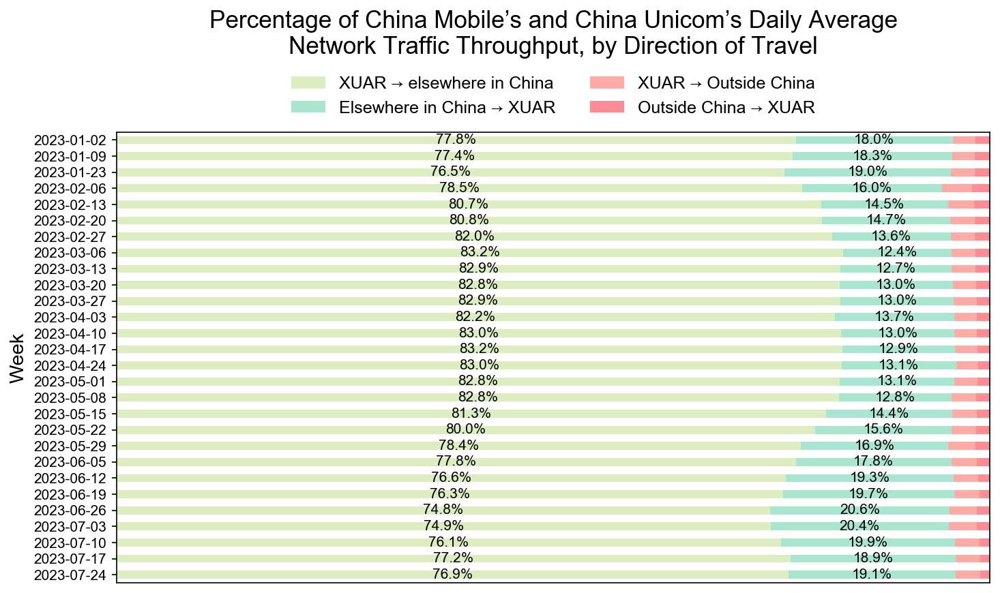
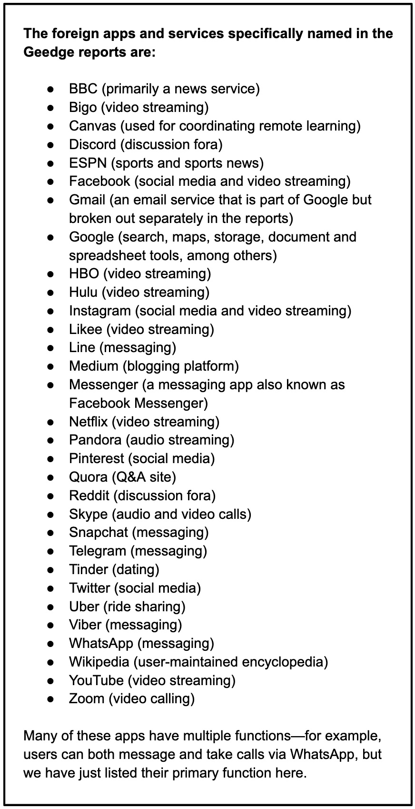
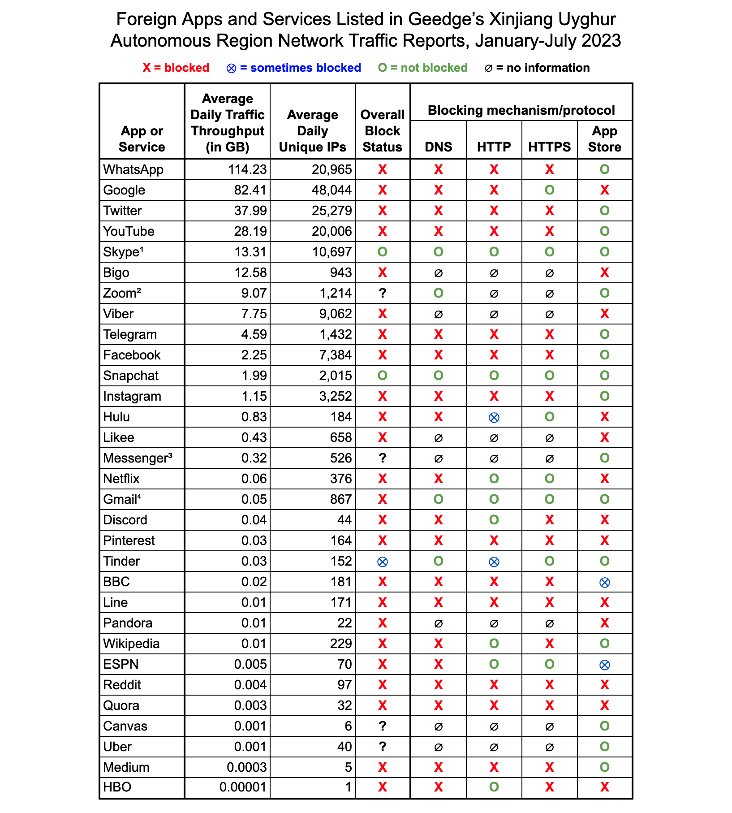
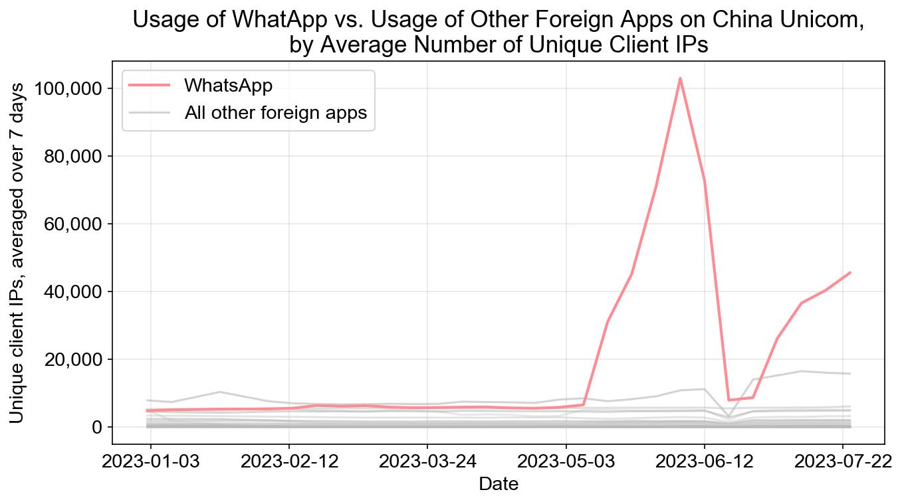
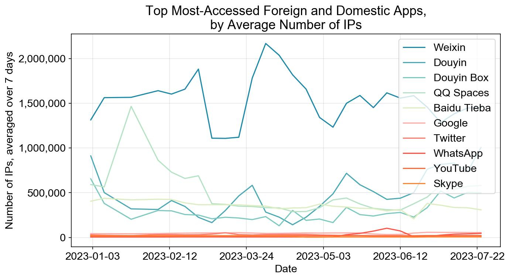
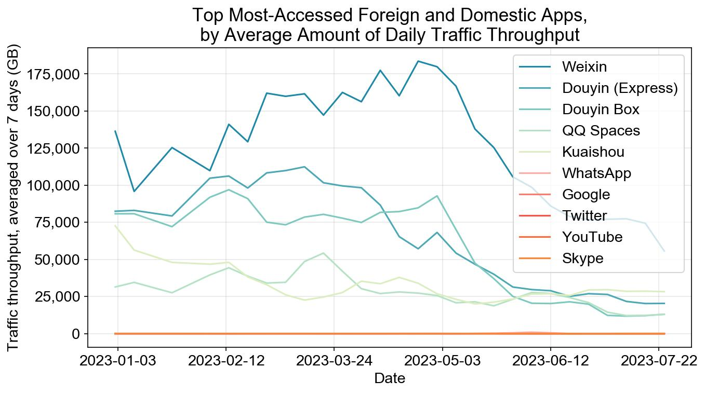

**By Jessica Batke and Laura Edelson**

**This article originally appeared on [ChinaFile](https://www.chinafile.com/reporting-opinion/features/leaked-documents-show-success-of-chinas-vpn-crackdown) and [GPPi](https://gppi.net/2026/05/27/chinas-vpn-crackdown).**

As long as Beijing has been censoring content online, people in China have been finding ways around that censorship. Such “<a href="https://chinadigitaltimes.net/space/Scale_the_wall" target="_blank" rel="nofollow">wall-jumpers</a>” used to have a relatively easy time getting their hands on the necessary digital tools. Often, this was in the form of a VPN, or virtual private network, which disguises a user’s ultimate online destination to any censor who might be snooping in. In recent years, however, Beijing has <a href="/research&writing/Locknet_Part_4/" target="_blank" rel="nofollow">cracked down</a> on VPNs, making them less readily accessible to average internet users. State-approved VPNs, which are relatively easy for authorities to <a href="https://archive.is/vsOXD" target="_blank" rel="nofollow">surveil</a>, are still permitted. At the same time, it’s become harder for outside observers to estimate the number of wall-jumpers in the country. Given how much effort Beijing expends on <a href="/research&writing/Locknet_Blocking_Circumvention/" target="_blank" rel="nofollow">identifying and blocking</a> unsanctioned VPN traffic, we suspect that China’s internet bureaucracy has a reasonable estimate but it does not share this information with the public.

This leaves us largely in the dark if we want to understand how many people in China are accessing information outside of Beijing’s censorship bubble. Should we assume that half the country is getting contraband content, or that almost no one is? Understanding VPN usage in China can tell us a lot about the efficacy of the online censorship system, a system we have dubbed the “<a href="/research&writing/Locknet/" target="_blank" rel="nofollow">Locknet</a>” for its similarity to a water lock system that can dynamically adjust to shifting tides.

<a href="/research&writing/Locknet_Part_4/" target="_blank" rel="nofollow">Previous estimates</a> of <a href="https://cybernews.com/best-vpn/vpn-usage-by-country/" target="_blank" rel="nofollow">VPN use</a> differ dramatically, ranging from 3 to 30 percent of internet users—a range so wide as to be almost useless in understanding the actual scale of the practice. A leak of documents last summer, however, now offers us an opportunity to better gauge this behavior. The leaked documents provide information about in-country internet traffic, including use of foreign (and banned) apps. Even with a number of caveats, not least of which is that the data come from the <a href="https://www.nytimes.com/2019/05/22/world/asia/china-surveillance-xinjiang.html" target="_blank" rel="nofollow">most surveilled</a> region in the country, we assess that VPN usage in China is probably closer to a few percentage points rather than a third of the population. This contradicts what many casual observers of China <a href="https://archive.is/OmSOD" target="_blank" rel="nofollow">might assume</a>—that VPNs are both widely available and widely used.

Even so, the data also offer glimpses of people’s persistent longing for foreign content. The government may constrain citizens’ behavior, but it can’t constrain their desires.

* * *

For months, <a href="https://interseclab.org/research/the-internet-coup/" target="_blank" rel="nofollow">researchers</a> have been <a href="https://www.wired.com/story/geedge-networks-mass-censorship-leak/" target="_blank" rel="nofollow">poring</a> over the more than 100,000 documents produced by a Chinese company called Geedge Networks, which were provided anonymously to a consortium of global media and research outlets that collaborated to verify and report on the leak. Many of the resulting articles focus on Geedge’s export of internet surveillance and censorship technologies worldwide. But, as we reviewed some of the leaked documents ourselves, we found that some also contain information about internet traffic coming in and out of the Xinjiang Uyghur Autonomous Region in northwest China.

In 2022 and 2023, Geedge conducted a <a href="https://interseclab.org/wp-content/uploads/2025/09/The-Internet-Coup_September2025.pdf" target="_blank" rel="nofollow">field test</a> in the region, surveilling the internet traffic flowing through the networks of the country’s three biggest internet service providers (ISPs): China Unicom, China Mobile, and China Telecom. In a series of weekly reports, Geedge’s Network Operator Front-End Analytics Team summarized internet traffic data for these ISPs, including information about the domestic and foreign apps their users were visiting. (After Geedge <a href="https://interseclab.org/wp-content/uploads/2025/09/The-Internet-Coup_September2025.pdf" target="_blank" rel="nofollow">concluded the field test</a> in 2023, it began operating a more centralized surveillance infrastructure that made use of the major carriers’ data facilities.) The fact that the private company Geedge carried out this effort, rather than the state-affiliated ISPs themselves, underscores the continued commercialization and outsourcing of government <a href="https://www.chinafile.com/state-surveillance-china" target="_blank" rel="nofollow">surveillance</a> and <a href="https://www.chinafile.com/reporting-opinion/features/message-control-china" target="_blank" rel="nofollow">censorship</a> within China.

In order to analyze this internet traffic and app usage data, we reviewed Geedge’s January to July 2023 reports about China Unicom and China Mobile. (Missing from the leak were reports from one week in January, as well as all the reports that Geedge apparently produced for China Telecom.) These weekly write-ups provide somewhat detailed accounts of the internet traffic headed from the Uyghur region to blocked foreign websites or apps. How were users accessing such sites, if China blocks them? As we will show below, many of these connections were probably not functional in any real sense, sending back so little data that users wouldn’t have been able to load a webpage. This means users may have briefly slipped through a crack in China’s online censorship system—which is powerful, but not impermeable—and quickly ended up with a dead connection. For functional connections, in which users were able to do things like WhatsApp with their friends, or edit a Google Doc, or send out a Tweet, such users were likely employing state-approved VPNs. Businesses, for example, often use such VPNs to reliably connect with needed foreign services, knowing that the VPNs offer <a href="https://archive.is/vsOXD" target="_blank" rel="nofollow">only access, not privacy</a>. Beijing allows for these VPNs so as not to completely hobble the economy, but retains the ability to peer into users’ data and observe what sites they’re visiting. A true black-market VPN, by contrast, would have prevented Geedge from seeing exactly where internet traffic was headed (though it still would appear as traffic going to a foreign destination). When we estimate VPN usage below, we are including <em>all</em> VPN traffic, approved and unapproved, and to do so we’re threading the needle between this lower bound of highly-visible, state-approved VPN users, and the upper bound of all foreign traffic sent overseas.

Geedge’s data comes with a few caveats: First, the Uyghur region is not exactly an ideal representative sample for all of China. The extreme <a href="https://www.bbc.com/news/world-asia-china-22278037" target="_blank" rel="nofollow">government repression</a> visited on Uyghur and other non-Han ethnic groups there means that many people might not dare connect to a foreign site or app; the government has meted out draconian punishments in recent years to those who merely have <a href="https://www.newyorker.com/news/a-reporter-at-large/china-xinjiang-prison-state-uighur-detention-camps-prisoner-testimony" target="_blank" rel="nofollow">WhatsApp downloaded</a> on their phones. This means the international traffic figures we see in the Geedge reports may be lower than they might be in other provinces.

Second, we can’t see network traffic that traveled solely within the Uyghur region—the Geedge reports provide only traffic that crossed a provincial border, either to another location in China or to another country. It is hard to know how large this missing chunk of local-only data is. Many of the most-used apps and sites are hosted elsewhere in China, which means that much of people’s day-to-day internet traffic likely heads in that direction. However, it’s also possible that some of these apps and services host data within the Uyghur region and deliver it locally. From the data we have, we don’t have a way to know which sites do which. In any case, were local-only traffic included in our data, it would further diminish the percentage of traffic headed abroad. (The reports are frustratingly vague on exactly what they term “traffic from Xinjiang to China” and “from China to Xinjiang” mean. Based on the data, we suspect these labels indicate where the initial data request originated—as in, if someone from the Uyghur region initiated a connection with a site elsewhere in China, all traffic back and forth for that one connection would have counted as traffic “from Xinjiang to China.”)

Finally, though the Geedge report data can tell us about actual internet usage, it can’t tell us about latent demand. Are there lots of people who want to use foreign apps but are too scared? Who don’t know how? Who can’t be bothered? Or, is most everyone more or less content with the range of apps readily available to them? We don’t have any way of gauging this from the Geedge data. All we can estimate is how many people are <em>actually</em> using VPNs, not just dreaming about it.

That said, the Geedge reports represent some of the most detailed network traffic data available for China and offer the best, most recent information we have about real-world online behavior there. Even if VPN usage might be lower in the Uyghur region than elsewhere, it is likely a difference of degree rather than kind. At the time the Geedge reports were written, there did not appear to be a separate censorship system in place just for the Uyghur region; China’s online censorship functioned in largely the same way throughout the country, making VPNs hard to access everywhere. This means that any disparity in VPN usage between the Uyghur region and the rest of China probably was not the result of harsher automated online anti-VPN measures, but rather the result of depressed demand due to fear. So, even if the percentage of VPN usage elsewhere in China is double or triple that in the Uyghur region, it is still likely in the single digits. Therefore, we think even this heavily-caveated data has something to tell us about the online lives of Chinese citizens.

<h2>Domestic Traffic Dwarfs Overseas Traffic</h2>

It won’t come as much of a surprise that the majority of traffic in and out of the Xinjiang Uyghur Autonomous Region (XUAR) was headed to or from the rest of China. Most people going online just want to see content relevant to them, in their own languages (or, for some, in the “national” language). But the actual numbers here underscore just how little of the region’s internet traffic is either headed to or coming from another country.

                                        

In all the reports we found in the Geedge leak, traffic headed out to or in from a foreign country never reached 6 percent of the total. Over the seven months covered in these reports, it averaged just over 4 percent.

How unusual is this kind of traffic pattern, in which the overwhelming majority of traffic stays within national borders? Unfortunately, it’s hard to know. Even if we had comparable data from other countries (we don’t), the nature of the modern internet muddies the distinction between “international” and “domestic” internet traffic. In most of the rest of the world, online services don’t host content only in their country of origin. A major service like WhatsApp may set up its own content servers in many locations globally, in order to quickly and efficiently interact with nearby users. A smaller service, like the UK-based news platform the BBC, may not maintain its own foreign servers, but it almost certainly uses a content delivery network (CDN) like Cloudflare, which lets individual websites and services use <em>its</em> servers to store and deliver data to end users around the world. So in Poland, for example, let’s say someone tries to load an article from the BBC website. If the BBC’s content delivery network has servers hosting BBC content in Poland, the resulting internet traffic will likely stay within the country, and would look like domestic-only traffic. If the CDN is hosting BBC content in Germany, or all the way back in the UK, the traffic would appear “foreign.” This makes labeling “international” internet traffic somewhat tricky. Is it “international” traffic if it comes from a service whose corporate headquarters is located abroad? Or only if the data sent actually crossed a national border?

Ultimately, this chart is a marker of Beijing’s success: the combination of measures levied by the Chinese government, combined with a human inclination to use familiar, local apps, has kept cross-border internet traffic to a minimum.  

China’s internet setup, by contrast, means these questions rarely have to be asked. Beijing has banned many foreign sites and services, including WhatsApp and the BBC, meaning they have no content servers in the mainland. Other international platforms, even if they aren’t formally banned, don’t maintain China-based servers, as that would entail abiding by China’s data storage and censorship regulations. (There are, of course, some international companies that have deliberately <a href="https://archive.ph/Mdzer" target="_blank" rel="nofollow">chosen</a> to <a href="https://archive.ph/kYOVG" target="_blank" rel="nofollow">maintain</a> servers within China.) In general, China’s internet ecosystem functions in a fundamentally different manner from online spaces elsewhere in the world.

So the above chart also reflects Beijing’s internet policies and regulations, and not simply the local residents’ innate preference for domestic internet services. Beyond simply banning specific apps, Beijing has taken a number of steps to encourage or ensure that internet traffic stays within China. Platform substitution, whereby a domestic alternative to a foreign app takes over the local market, has reduced the utility or appeal of foreign apps. A crackdown on censorship circumvention tools in recent years means that some people who might otherwise seek out blocked foreign websites no longer have the means to do so. All of these factors have depressed the active pursuit of foreign content, in ways that are impossible to untangle. And of course, in the Uyghur region, a constant sense of surveillance undoubtedly leads locals to engage in more self-censorship than people elsewhere in China.

Ultimately, this chart is a marker of Beijing’s success: the combination of measures levied by the Chinese government, combined with a human inclination to use familiar, local apps, has kept cross-border internet traffic to a minimum.

<h2>Blocked Foreign Apps Have Low Traffic</h2>

The foreign apps tracked in the reports—most of them blocked by the Locknet—generally make up less than one percent of total foreign traffic.

The Geedge reports delve deeper into their analysis by listing a number of “commonly-used” foreign apps and services, tracking both the volume of traffic and the number of connections to them. (Specifically, the reports track the number of Internet Protocol (IP) addresses that connect to the foreign apps. Unique IP addresses don’t perfectly map onto individual users; one user might connect to the same app from their home and later from their office, each of which would have a different IP address. However, tracking IP addresses can offer a ballpark estimate of individual users.)

The “commonly-used” apps included news, video streaming, social media, messaging, blogging, and video-calling platforms.

                                        

We suspect that Geedge tracked these “commonly-used” foreign services not because they were actually commonly used at the time, but because they are the types of apps likely to most worry the Chinese Communist Party (CCP). Uncensored platforms could relay information the CCP would rather China’s citizens not know. (If ESPN’s inclusion on the list seems puzzling, remember that it has a robust fantasy sports and betting vertical, and that in China gambling is illegal.)

Our suspicion is bolstered by the report data. A few of the enumerated apps show barely any traffic at all, sometimes not even enough to fully load a webpage once over the course of an entire week. Moreover, China was censoring most of the listed apps at the time, making it difficult for users to access them without a VPN and thereby limiting their popularity. Elsewhere in the reports, discussions of other types of network traffic betray a concern with blocking and censoring traffic—all of which leads us to believe that the reports’ inclusion of these particular foreign apps is based on their political sensitivity, not on their widespread usage within the Uyghur region.

The table below includes all the foreign apps Geedge names in its reports (though not every app appears in every report). It also shows which of these services China was blocking at the time, based on data from <a href="https://censoredplanet.org/" target="_blank" rel="nofollow">Censored Planet</a> and <a href="https://applecensorship.com/" target="_blank" rel="nofollow">Apple Censorship</a> (both organizations that track online censorship). Because Beijing can use multiple different mechanisms (protocols) to block a service, we have included blocking information for several protocols. If you’re not familiar with the technical details of these various protocols, don’t worry—you only need to know that the Chinese government has several means by which it can block a site, and as long as it has implemented one of these means, the website is more or less blocked for an average user. In addition to blocking by protocol, Beijing can also mandate that local app stores not carry particular apps; again, this is usually enough to keep average users from downloading and using them, meaning that they are effectively blocked.

                                        
Each listing includes: information from Geedge about daily traffic and unique IP connections; information from Censored Planet about contemporaneous protocol blocking; and information from Apple Censorship about contemporaneous app store availability.

¹ Skype for Business is the only Skype service for which Apple Censorship provided relevant App Store data, but contemporaneous media reporting suggests that Skype was indeed generally available in China at the time.

² Zoom for Workplace and Zoom Rooms are the only Zoom services for which Apple Censorship provided relevant App Store data.

³ “Messenger” refers to Facebook Messenger.

⁴ The domain gmail.com itself does not appear to be blocked under any of these mechanisms; however, when you type “gmail.com” into your browser, you are redirected to mail.google.com, which is blocked under the google.com domain name.
              

This chart illustrates just how few users were accessing these foreign services, and how little traffic was flowing for even the most popular apps. In an average day, just under 320 Gigabytes (GB) of information moved between these services and users in the Uyghur region. About <a href="https://archive.ph/VVy03" target="_blank" rel="nofollow">26 million people</a> used mobile internet services in the Uyghur region in 2023; if we assume that half of them use either China Mobile or China Unicom, then it means just 0.0000256 GB of traffic per person, or 0.0256 Megabytes (MB) a person. (For reference, it takes <a href="https://archive.ph/lVgQM" target="_blank" rel="nofollow">about</a> 3.5 MB to stream a 15-second TikTok video.)

Of course, only a small subset of the population is using these foreign apps, making the traffic per person much more substantial. But even so, it is not a lot. For example, Google saw about 48,000 users from the Uyghur region in an average day, for a total of about 82 GB of traffic. That divides out into a bit over 1.7 MB of traffic per user—less than it takes to run a Google search, or load a webpage with even a moderate number of graphics. Like much of online app usage, traffic for Google skews towards a few heavier users (one particular IP address on China Mobile accounted for 1.3 GB of traffic the week of April 17, 2023), meaning that most users are probably not even reaching that 1.7 MB average. Because of this, we strongly suspect that most attempted connections with Google simply are not successful, leading to a little bit of data transmission but no substantive content exchanged. We don’t have a way of guessing how many of the 48,000 daily Google users were actually able to do a Google search, or open a Google Doc, but it was certainly far fewer than the raw number suggests.

All of this boils down to: Relative to the total regional population, only a small percentage of people attempt to use the foreign apps on this list, and for many users, the attempts are not even successful.

The chart also suggests that there is no clear relationship between which apps are censored and which are most popular. Of the two unambiguously unblocked apps on this list, Skype and Snapchat, only Skype cracks the top five in terms of traffic. The most-used apps from this list (WhatsApp, Google, and Twitter) are blocked in China, suggesting users are availing themselves of (state-approved) VPNs in order to access them. Of course, this tells us very little about foreign app demand as a whole—we do not know what apps and services Geedge omitted from these reports, and we do not know how many more users would be trying to access these sites if they were not banned.

We assume that users’ successful interactions with these foreign apps occurred over state-sanctioned VPNs. Without a VPN of some kind, China’s online censorship system would have blocked most traffic to these sites. And with a black-market VPN, Geedge would not have been able to see what sites users were visiting.

All of Geedge’s listed foreign services combined generally make up less than one percent of all foreign traffic. Given that foreign traffic only composes about 4 percent of total traffic, the share of total traffic these particular foreign services represent is miniscule (0.004 percent).

The only time we see a bump in traffic from the listed foreign apps occurred in late May and early June 2023—the time of year authorities are on high alert for any mention of the June 4, 1989 Tiananmen Massacre. During those three weeks, the listed foreign apps accounted for between one and two percent of all foreign traffic, driven primarily by a large spike in WhatsApp usage on China Unicom:

                                        

We can not say for certain why such a drastic spike occurred, though we speculate that either a new and briefly successful circumvention tool came online at that time, or that a technical tweak to either China Unicom or the country’s larger censorship system temporarily allowed more WhatsApp traffic through.

Even so, this spike hardly represents a widespread social phenomenon—WhatsApp traffic peaked at just above two percent of all foreign traffic, or 0.1 percent of total traffic the week of June 5, 2023. However, it does hint at how popular WhatsApp might become if given the chance: Over the course of just a few weeks, its user base increased by several orders of magnitude.

But we should also consider which foreign apps are absent from the reports. TikTok, the international version of the China-developed video-sharing site Douyin, is not represented, even though the company <a href="https://newsroom.tiktok.com/year-on-tiktok-2023-uk?lang=en-GB" target="_blank" rel="nofollow">claimed</a> more than one billion users globally by the end of 2023 and <a href="https://www.visualcapitalist.com/the-worlds-most-used-apps-by-downstream-traffic/" target="_blank" rel="nofollow">likely</a> comprised a significant chunk of worldwide mobile internet usage. TikTok is blocked in China, but so are Google and Wikipedia, so that’s clearly not the only reason it doesn’t appear in the report. Did the report authors assume that anyone wanting to use TikTok would instead happily use its local counterpart, Douyin? Or did they assume authorities were less concerned about the content appearing on TikTok than on other video-streaming sites?

Similarly, foreign gaming apps also do not appear in the reports—a surprising omission <a href="https://www.reuters.com/world/china/china-rolls-out-new-rules-minors-online-gaming-xinhua-2021-08-30/" target="_blank" rel="nofollow">given</a> how much <a href="https://www.bbc.com/news/technology-67801091" target="_blank" rel="nofollow">hand-wringing</a> the Chinese government has done over online gaming in recent years. We are left wondering why gaming services did not merit tracking in these reports; the reports themselves do not say.

<h2>Usage of Foreign Apps Does Not Compare with Most-Used Domestic Apps</h2>

Across all the reports, the most popular domestic apps and services draw far more users than any foreign app. Whether one looks at the number of people accessing a service (estimated by tallying the number of unique IP addresses connecting to it), or at the volume of data exchanged between the user and the service, the top five domestic services handily beat out the top five foreign ones. In terms of unique IPs, the top five domestic apps saw 25 times more users than the top five foreign apps; in terms of total traffic throughput, the top five domestic apps ferried 1,000 times as much data back and forth to users.

In both charts below, you can see that the spike in WhatsApp usage appears much smaller when compared to data from domestic apps. (Note that among the domestic apps, Douyin has several services listed: Douyin Express, a version of the app that requires <a href="https://archive.ph/s3tug" target="_blank" rel="nofollow">less space</a> on a users’ smartphone, and Douyin Box, a now-defunct e-commerce Douyin <a href="https://archive.ph/XVSqb" target="_blank" rel="nofollow">spinoff</a>.)

                                        
                                        

We considered both the number of users and traffic volume because traffic volume can vary widely based on the service in question. A video-streaming app, for example, may show fewer users but more traffic volume than an email app because, in general, streaming a few videos requires more data than sending several text-only emails. Or, a few power users might account for a large amount of traffic volume (think of one person binge-watching several seasons of their favorite show in one sitting) versus many users only accounting for a bit of traffic each (think of a large apartment complex in which everyone only watches one half-hour episode per night). Disaggregating the number of users from the traffic volume allows us to see if, for example, any foreign apps have a large number of individual users, or if a small set of users are managing to exchange large quantities of data with a foreign app. Yet, other than the WhatsApp spike, both IP addresses and traffic volume for foreign services remained almost imperceptible compared to popular domestic alternatives.

<h2>What Can All of This Tell Us about VPN Usage?</h2>

Nowhere in the reports does Geedge specify how much VPN usage it was seeing. And the traffic data the reports provide does not allow us to make very precise estimates. But we can still use the data to sketch the upper and lower bounds of VPN usage in the Uyghur region.

Again, we must stress that locals’ use of VPNs may not be strictly representative of all of China. Having seen one’s friends and family taken to extra-legal detention camps—or having spent time in one of the camps oneself—likely makes one very wary of casually visiting forbidden foreign websites. The trauma and fear non-Han residents have experienced in recent years has undoubtedly changed how locals use the internet, and not just in ways that we have brought up in this article. We have to assume that VPN usage is higher in places like Zhejiang or Guangdong, where software engineers use them to <a href="https://jeffgortmaker.com/files/Open_Source_Software_Policy_in_Industry_Equilibrium.pdf" target="_blank" rel="nofollow">create and share code</a> with a reasonable expectation of safety.

If we take the most expansive view, we could count all foreign-bound traffic as VPN traffic—meaning we assume all foreign traffic is headed to banned websites, and thereby requires people in the Uyghur region to use a VPN to access them. We know this is not actually possible, because at least a few of the foreign apps listed in the Geedge reports were <em>not</em> banned at the time. But, as an extremely conservative estimate, we can say that an absolute maximum of 4 percent of internet traffic from the Uyghur region could have traveled via VPN to a banned foreign site each week. Though we only have information for two of the region’s three major carriers, we suspect this number wouldn’t change dramatically even with complete data: the two sets of data we have look extremely similar in terms of foreign traffic volume.

In terms of the number of <em>people</em> using VPNs to access banned foreign sites, we can look at the number of unique IPs Geedge listed in its reports. Geedge’s reports show that in an average day, about 154,000 unique IPs accessed the enumerated foreign apps. However, we know that some of those IPs visited more than one foreign app. If someone goes to the trouble of getting a VPN up and running, they are probably not going to visit just one foreign site and call it a day. Therefore, we have to assume that any unique IP is only unique for a given app—meaning that the single app with the most unique IP addresses serves as our minimum estimate of VPN users. On average, Google saw approximately 48,000 unique IPs, so we take 48,000 as our baseline. Because we only have data for two of three major carriers, we need to increase this figure to account for the missing third carrier’s data. If we assume we’re only seeing about half of the region’s internet traffic, we can double (and round up) our baseline figure to 100,000. That is, a minimum of 100,000 people likely use VPNs to access banned foreign sites and services every day. This represents about 0.4 percent of the regional population of 25 million. Given that an absolute maximum of 4 percent of internet traffic could possibly be headed to banned foreign sites, we suspect that the actual percentage of VPN users, while undoubtedly more than 0.4 percent, remains in the low single digits.

All of this puts our VPN usage estimate in the same neighborhood as one 2022 <a href="https://archive.ph/pmDBg" target="_blank" rel="nofollow">estimate</a> of 3 percent, if not lower. Though at first blush this figure might suggest Chinese citizens’ appetite for foreign content is minimal, we believe it represents just the tip of the iceberg. We can see from the Geedge data that, in the few weeks that WhatsApp somehow managed to give the censors the slip, locals’ usage skyrocketed. We know that many people, even if freed from the constraints of censorship, would still opt for China-made apps—but we have no idea how many people would venture onto foreign platforms if given the chance.

This also suggests that, for many people in China, it’s not just <a href="/research&writing/Locknet_Part_4/" target="_blank" rel="nofollow">as easy</a> as firing up their phone and downloading a VPN. If it were, we would see more than a sliver of the population doing so. Whether through technical means or through intimidation, Beijing has successfully dampened citizens’ ability to access a lot of the foreign platforms many people outside China use without a second thought. But a latent demand clearly exists, ready to blossom the moment the opportunity presents itself.

